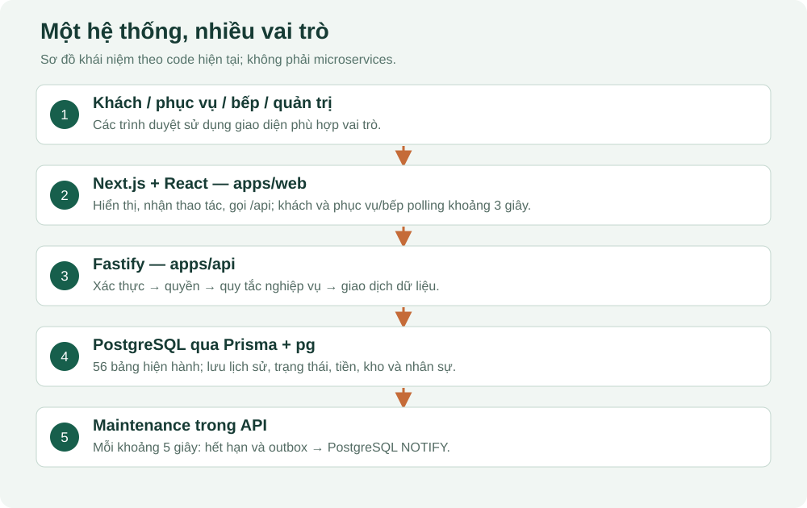

# 01. Bức tranh toàn hệ thống

## Nhà hàng cần hệ thống này để làm gì?

Một bàn có nhiều khách. Mỗi người có thể tự quét QR, chọn món và gửi phần của mình. Nhân viên kiểm tra các lượt gọi cần duyệt. Bếp nhận từng món, chế biến và báo sẵn sàng. Phục vụ mang món ra. Thu ngân ghi nhận tiền, xử lý hoàn/thiếu tiền và kết thúc phiên bàn. Quản trị quản lý danh mục, nhân viên, kho, lương và báo cáo.

Trong dự án này, “thu ngân” là công việc nằm trong quyền **STAFF**, chưa có vai trò CASHIER riêng. Khách không cần tài khoản nhân viên; khách có định danh tham gia phiên bàn riêng.

## Những bộ phận đang có

| Bộ phận | Trách nhiệm | Nguồn để lần theo |
|---|---|---|
| Web Next.js / React | Vẽ màn hình, nhận thao tác, gọi API | `apps/web/app`, `apps/web/features` |
| API Fastify | Xác thực, kiểm tra nghiệp vụ, ghi và đọc dữ liệu | `apps/api/src/modules` |
| PostgreSQL | Lưu bền vững dữ liệu và chặn các trạng thái sai bằng ràng buộc | migration SQL, schema Prisma |
| Prisma + thư viện pg | Hai cách code truy cập cùng PostgreSQL | `packages/database/src/index.ts` |
| Tác vụ bảo trì | Hết hạn lượt duyệt/thanh toán, dọn phiên rỗng, phát outbox | `notifications/maintenance.ts` |
| Kiểm thử | Kiểm tra logic, API/database và trình duyệt | `tests`, các tệp `*.test.ts` |

Đây là một monorepo: nhiều ứng dụng và gói dùng chung nằm trong cùng repository. Backend là một ứng dụng chia module, không phải mỗi module là một máy chủ độc lập. Database có `restaurant_id` và các kiểm tra cùng nhà hàng, nhưng một tiến trình API hiện được cấu hình cho một `RESTAURANT_ID`; không vì có cột này mà kết luận đã có sản phẩm SaaS nhiều nhà hàng hoàn chỉnh.

## Ví dụ xuyên suốt: hai người tại bàn A01

Các số tiền dưới đây chỉ là ví dụ học, không phải dữ liệu thật lấy từ nhà hàng. An gọi hai phần cơm giá 60.000đ/phần; Bình gọi một nước giá 20.000đ. Tổng phải thu sau khi các lượt được chấp nhận là 140.000đ.

1. QR xác định **bàn A01**. Lượt ngồi ăn hiện tại tạo một **phiên bàn S**.
2. An và Bình là hai **người tham gia** cùng phiên S.
3. Cùng một giỏ của phiên, nhưng mỗi dòng có người sở hữu.
4. Gửi món tạo **lượt gọi** và các **dòng món**. Một phiên có thể gọi nhiều lượt.
5. Khi món được nhận hợp lệ để phục vụ, hệ thống có **khoản phải thu**. Tiền chưa tự xuất hiện chỉ vì bấm gửi món.
6. Khi nhân viên xác nhận đã nhận tiền, hệ thống có **giao dịch thanh toán**.
7. Đủ tiền và hoàn tất các việc còn lại mới đóng phiên. Bàn chuyển sang chờ dọn, rồi mới sẵn sàng cho lượt khách sau.

## Hiện tại bạn có thể làm gì trên website?

Hãy nhìn theo công việc của một nhà hàng: khách chọn món, bếp làm món, nhân viên phục vụ và nhận tiền, quản trị theo dõi hoạt động.

| Công việc | Ví dụ dễ hình dung |
|---|---|
| Đăng nhập và phân quyền | Quản trị, phục vụ và bếp dùng tài khoản riêng; mỗi vai trò có màn hình và quyền thao tác phù hợp. |
| Khách gọi món bằng QR | Khách quét QR của bàn, nhập tên, chọn món và gửi món. Hệ thống biết dòng món nào do ai chọn để người khác không sửa phần của họ. |
| Kiểm tra lượt gọi cần xác nhận | Nếu lượt gọi vượt ngưỡng quy định, chẳng hạn số lượng lớn, nhân viên cần kiểm tra và duyệt trước khi chuyển cho bếp. |
| Bếp và phục vụ theo dõi món | Bếp nhận món → bắt đầu chế biến → báo sẵn sàng; phục vụ xác nhận đã mang món ra bàn. |
| Thu tiền và hoàn tiền | Nhân viên ghi nhận tiền mặt hoặc chuyển khoản sau khi kiểm tra đã nhận tiền; khi cần hoàn, nhân viên ghi nhận khoản đã hoàn cho khách. |
| Chuyển bàn và hỗ trợ khách | Nhân viên chuyển bữa ăn đang diễn ra sang bàn khác; khách có thể yêu cầu nước, dụng cụ hoặc tính tiền. |
| Quản lý nhà hàng | Quản trị quản lý món, bàn, nhân viên, nguyên liệu, nhập kho, công thức, ca làm, công/lương và báo cáo. |

Đây là các chức năng đang có trong dự án. Khi muốn xem những tình huống nào đã được chạy thử thành công, bạn tra [15 — Hồ sơ đối chiếu](15-doi-chieu.md).

## Vì sao bếp thấy món mới sau vài giây?

Ví dụ: khách ở bàn A01 vừa bấm “Gửi món”. Hệ thống lưu lượt gọi đó vào database. Khi màn hình bếp lấy dữ liệu mới, lượt gọi xuất hiện để bếp tiếp nhận; lượt cần duyệt phải được nhân viên duyệt trước.

Màn hình khách, phục vụ và bếp đang mở sẽ **tự lấy dữ liệu mới khoảng mỗi 3 giây**. Bạn không cần bấm tải lại trang liên tục. Cách làm này gọi là **polling**: màn hình hỏi hệ thống theo chu kỳ xem có gì thay đổi.

Khi bếp đổi món sang “Đang chế biến”, màn hình khách cũng thấy trạng thái mới sau lần lấy dữ liệu tiếp theo. Thời gian hiển thị còn phụ thuộc mạng và tốc độ xử lý; 3 giây là chu kỳ lấy dữ liệu, không phải cam kết mọi thay đổi luôn hiện trong đúng 3 giây.

## Những chức năng sẽ làm ở giai đoạn sau

| Chức năng dự kiến | Hiện tại đang thế nào? |
|---|---|
| Thanh toán online qua VNPay/MoMo | Chưa có quy trình hoàn chỉnh để khách bấm thanh toán qua cổng rồi website tự nhận xác nhận từ cổng. Hiện nhân viên vẫn kiểm tra và xác nhận tiền mặt/chuyển khoản. |
| AI chatbot | Chưa có khung chat để khách hỏi AI về món hoặc nhờ AI hỗ trợ chọn món. |
| Đẩy thay đổi trực tiếp tới màn hình | Hiện màn hình tự hỏi lại mỗi 3 giây. Cách để máy chủ chủ động gửi thay đổi qua WebSocket/SSE chưa được triển khai cho trình duyệt. |

## Các phần kỹ thuật hỗ trợ bên trong

Bạn có thể quay lại phần này sau khi đã hiểu luồng gọi món. “Phần nền” trong bản mô tả trước nghĩa là **code hỗ trợ chạy bên trong hệ thống**, người dùng thường không thấy một nút riêng trên màn hình cho nó.

| Tên gặp trong tài liệu/code | Hiểu đơn giản |
|---|---|
| Connector thanh toán và HMAC | Có một đường nhận thông báo thanh toán được bảo vệ bằng chữ ký kiểm tra. Đây là phần chuẩn bị cho kết nối thanh toán; muốn sử dụng VNPay/MoMo còn phải làm phần kết nối đúng với từng nhà cung cấp. |
| Outbox và PostgreSQL NOTIFY | Hệ thống lưu các sự kiện cần thông báo vào bảng outbox_event. Một tác vụ khoảng mỗi 5 giây xử lý các sự kiện đó và phát tín hiệu nội bộ qua database. Màn hình bếp/khách hiện lấy thay đổi bằng polling đã giải thích ở trên. |
| Lịch sử để truy vết | Hệ thống lưu các bước xử lý và người thao tác để có thể kiểm tra lại: món được nhận lúc nào, ai miễn tiền, khoản nào đã thu hoặc hoàn. |

Bạn hãy nhớ hai việc khác nhau: **màn hình lấy dữ liệu khoảng mỗi 3 giây**; **tác vụ nội bộ xử lý outbox khoảng mỗi 5 giây**. Hai tác vụ này chạy theo nhịp riêng, không cộng thành “phải chờ 8 giây mới thấy món”. Phần thanh toán online và chatbot được giải thích thêm ở [bài 14](14-mo-rong.md).

## Tự kiểm tra

Vì sao một bàn không chỉ có một đơn duy nhất? Vì bàn được dùng nhiều lần; mỗi lần là phiên riêng, mỗi phiên có nhiều lượt gọi. Nếu gộp mọi thứ theo mã bàn, hóa đơn của khách trước và khách sau sẽ bị trộn.

Bạn hãy kể lại ví dụ A01 bằng sáu khái niệm: bàn, phiên, người tham gia, giỏ, lượt gọi, giao dịch tiền. Nếu chưa phân biệt được, đọc lại trước khi học SQL.
