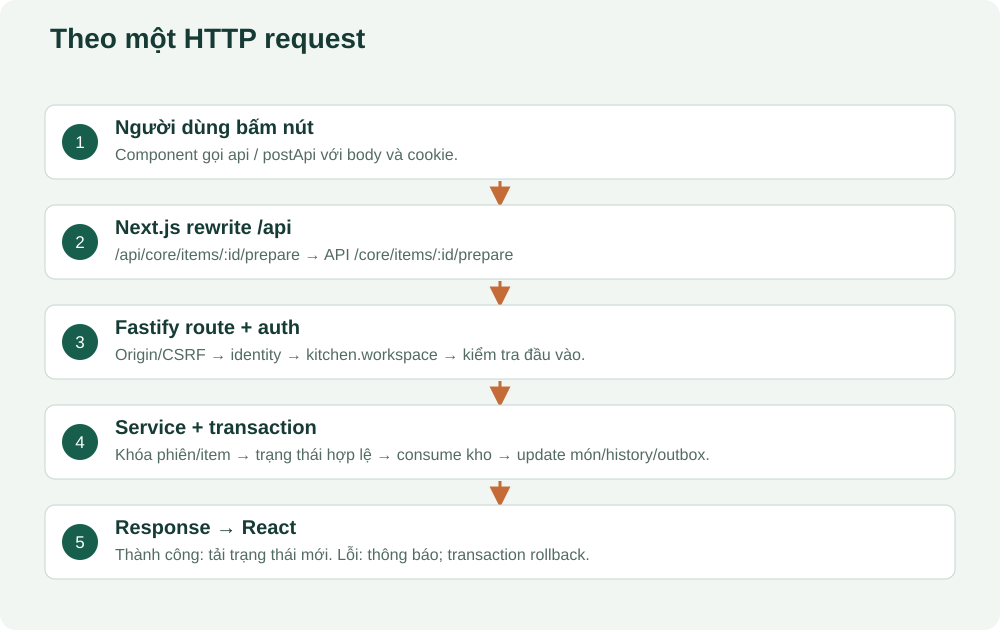

# 02. Kiến thức nền đủ để đọc dự án

## Một lần bấm nút đi qua những đâu?

Bạn bấm “gửi món”. JavaScript trong trình duyệt lấy các dòng đã chọn, tạo một đối tượng dữ liệu, chuyển thành JSON rồi gửi HTTP request. Next.js chuyển `/api/...` tới Fastify. Fastify kiểm tra cookie, quyền và nghiệp vụ, gọi PostgreSQL, rồi gửi HTTP response. React nhận kết quả và vẽ lại màn hình.



Giao diện không kết nối trực tiếp PostgreSQL. Database không biết người dùng vừa bấm nút màu gì; nó chỉ nhận truy vấn và dữ liệu từ backend.

## Những từ cần biết trước khi mở code

| Từ | Hiểu trong dự án này |
|---|---|
| File / folder | Tệp / thư mục chứa mã, cấu hình hoặc tài nguyên |
| Function | Một nhóm lệnh có tên, nhận đầu vào và có thể trả kết quả |
| Variable | Tên đại diện cho giá trị đang dùng, như `sid` là mã phiên |
| Object | Nhóm thuộc tính, ví dụ `{ quantity: 2, note: 'ít cay' }` |
| Array | Danh sách, ví dụ nhiều dòng món trong `items` |
| TypeScript | JavaScript có mô tả kiểu để phát hiện nhiều lỗi trước khi chạy |
| TSX / component | Cú pháp và khối mã mô tả giao diện React |
| State | Dữ liệu React dùng để vẽ màn hình; thay đổi state có thể khiến giao diện vẽ lại |
| async / await | Chờ công việc như gọi mạng/database hoàn tất, không giả vờ kết quả đã có |
| import / export | Lấy hàm từ tệp khác / cho tệp khác dùng hàm |
| npm package | Thư viện phụ thuộc. Dự án dùng pnpm để quản lý chúng |
| Build | Chuẩn bị bản web có thể chạy theo cấu hình build; không đồng nghĩa đã triển khai lên Internet |

Ví dụ rút gọn từ cách code dự án hoạt động:

```ts
const quantity = 2;
const body = { productId: 'ID_MON', quantity };
const response = await fetch('/api/guest/cart', {
  method: 'POST',
  headers: { 'Content-Type': 'application/json', 'X-CSRF-Protection': '1' },
  body: JSON.stringify(body),
});
```

Đây là ví dụ cú pháp, **chưa đủ để gọi API thật**: API giỏ còn yêu cầu cookie khách hợp lệ và `cartVersion`. Đừng sao chép đoạn học cú pháp rồi kết luận hệ thống lỗi khi thiếu dữ liệu.

## HTTP: đường dẫn + phương thức + dữ liệu

`GET /core/catalog` đọc danh mục. `POST /guest/orders` tạo lượt gọi. `PATCH /core/products/:id` sửa món. `DELETE /guest/cart/:id` xóa một dòng giỏ. `:id` là chỗ thay bằng UUID thật, không phải chuỗi gõ nguyên xi.

HTTP 200 thường báo thành công, 204 là thành công không có body; 400 sai đầu vào; 401 thiếu/hết phiên; 403 không được phép; 404 không tìm thấy; 409 dữ liệu/trạng thái xung đột; 429 gửi quá nhiều; 503 dịch vụ chưa sẵn sàng. Nên đọc thêm `userMessage` và `errorCode`, không chỉ nhìn số HTTP.

## Cookie và quyền

Cookie là thông tin trình duyệt gửi kèm request đến đúng website. Cookie nhân viên `access` và `refresh` khác cookie khách `guest`. `HttpOnly` nghĩa là JavaScript giao diện không đọc được nội dung cookie đó. Quyền được backend kiểm tra; giấu một nút trên giao diện chưa đủ để bảo vệ API.

## Database và dữ liệu bền vững

Một bảng gần giống bảng tính: có cột và nhiều dòng. Nhưng PostgreSQL có khóa, ràng buộc, giao dịch và quan hệ để giữ dữ liệu nhất quán. Mã nguồn là quy tắc xử lý; database là dữ liệu. Sửa tên một nút không thay schema; thêm cột thường cần migration. Xóa tài liệu không phải xóa database.

## Vì sao tiền lại là chuỗi?

JSON trong nhiều API của dự án dùng `"60000"` cho VND. Backend chuyển sang `BigInt`, PostgreSQL thường lưu tiền nguyên bằng `bigint`. Cách này tránh sai số và mất độ chính xác khi dùng số thực JavaScript. Lượng nguyên liệu có phần thập phân, như `"0.2"` kg, nên xử lý bằng numeric và chuỗi thập phân.

## Bài tập ngắn

Giải thích `await`, `response`, `POST`, `JSON.stringify` trong ví dụ trên. Sau đó mở `apps/web/lib/api-client.ts`: tìm hàm `postApi` và chỉ ra header chống CSRF được thêm ở đâu. Chưa cần hiểu toàn bộ phần chặn phiên hết hạn.
