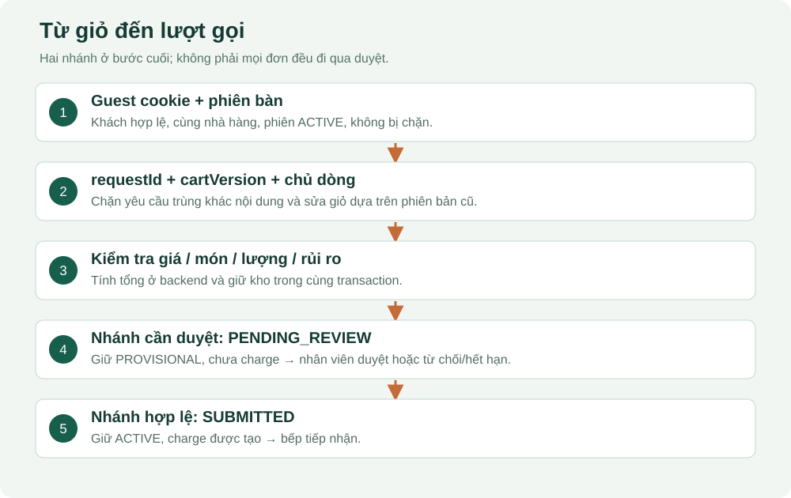

# 04. Từ QR đến một lượt gọi hợp lệ

## Sáu đối tượng phải phân biệt

| Đối tượng | Bảng | Ví dụ |
|---|---|---|
| Bàn vật lý | `dining_table` | A01 |
| Mã QR có lịch sử | `table_qr_token` | Token đang ACTIVE của A01 |
| Một lượt ngồi ăn | `table_session` | Phiên S lúc 19:00 |
| Một khách tham gia | `session_participant` | An trong phiên S |
| Giỏ chung của phiên | `session_cart`, `cart_item` | Dòng của An và Bình chưa gửi |
| Lượt gọi đã gửi | `order_batch`, `order_item` | An gửi hai cơm lúc 19:05 |

## Tham gia bàn

`POST /guest/qr-info` kiểm tra mã và trả tên bàn/khu vực. `POST /guest/join` kiểm tra token còn hiệu lực, nhà hàng/khu vực/bàn hoạt động và bàn không chờ dọn. Backend khóa dòng bàn để hai người quét cùng lúc không tạo hai phiên ACTIVE.

Nếu chưa có phiên, backend tạo phiên; nếu đã có phiên ACTIVE thì tham gia cùng phiên. Giỏ và tài khoản tài chính được tạo nếu chưa có. Khách mới nhận credential ngẫu nhiên trong cookie `guest`; database lưu hash. Tham gia lại cùng phiên bằng cookie hợp lệ có thể trả lại participant hiện có.

Nhân viên mở bằng `POST /core/tables/:id/open` thì phiên được VERIFIED ngay. Khách tự mở thường bắt đầu UNVERIFIED; lần gửi đầu có thể phải duyệt theo chính sách. Xác minh phiên và duyệt một lượt gọi là hai thao tác khác nhau.

## Khách đồng ý quy định một lần

Khách mới nhập tên và tự tick ô đồng ý; ô không được chọn sẵn. Nút cạnh ô mở bản đọc nhanh và quy định đầy đủ, có thể mở lại từ biểu tượng thông tin trên đầu màn hình. Client gửi `acceptedPolicyVersion`; API từ chối nếu thiếu hoặc khác phiên bản `2026-10-v2` hiện hành. Thời điểm lưu do máy chủ ghi, không nhận thời gian do trình duyệt tự khai.

`session_participant.accepted_policy_version` và `accepted_policy_at` cho biết người này tham gia dưới bản nào, lúc nào. Cặp giá trị không được sửa về sau. Dữ liệu khách cũ để NULL vì chưa có bằng chứng xác nhận; không tự điền cho họ. Khách vẫn dùng phiên đang ăn, tải lại hoặc quét lại cùng bàn thì không phải tick lại. QR bàn khác vẫn yêu cầu tham gia rõ ràng.

Không lưu toàn bộ văn bản chính sách trong database. Nội dung, bản tóm tắt và lời nhắc cùng nằm ở `packages/contracts/src/restaurant-policy.ts`; API `GET /guest/policy` và web dùng chính nguồn này.

## Giỏ và phiên bản

Mỗi thay đổi giỏ mang `cartVersion`. Backend đọc giỏ hiện tại và so sánh; nếu phiên bản khác thì yêu cầu bị từ chối. Ví dụ An nhìn phiên bản 5; Bình làm giỏ đổi sang 6; An gửi sửa dựa trên 5 thì cần tải lại. Cơ chế này tránh ghi đè thao tác mới bằng màn hình cũ.

Thêm/sửa/xóa dòng phải kiểm tra món đang hoạt động, danh mục hoạt động, trạng thái bán và chủ sở hữu. Giá trong giỏ là giá xem trước. Backend kiểm tra lại giá khi gửi; nếu giá đã thay đổi thì yêu cầu khách chọn lại theo giá mới.

## Combo cố định — cập nhật 11/10/2026

Combo là một sản phẩm có giá riêng, gồm nhiều món lẻ với số lượng cố định. Khách chọn **2 combo cuốn & trà** thì nhận **4 phần gỏi cuốn và 4 ly trà**, được tính **2 × giá combo**. Phần liệt kê món thành phần giúp khách, phục vụ và bếp đọc đúng số phần; hệ thống không thu thêm giá lẻ của các thành phần.

Đợt poster ngày 12/10 thêm **Combo cuối tuần COMBO-04**: 1 lẩu Thái bò & tôm, 1 mâm cuốn thịt luộc & chả giò và 2 trà dâu, giá khởi tạo 499.000 đ. **Set cơm 69k COMBO-05** gồm cả cơm gà kho gừng, thịt ba rọi mắm ruốc phần cơm và trứng chiên, cùng rau cải xào tỏi, canh rau củ và trái cây; mỗi loại một phần, giá khởi tạo 69.000 đ. Set cơm là phần cố định, không có bước chọn đổi gà/thịt/trứng. Hai combo dùng cùng vòng đời, công thức kho tổng và quy trình hoàn tiền bên dưới. [Danh mục, ảnh và các món còn cần ảnh riêng](20-anh-va-giao-dien.md).

| Thông tin | Nơi lưu | Ý nghĩa |
| --- | --- | --- |
| Loại sản phẩm | `product.product_kind` | `DISH` là món lẻ; `COMBO` là combo |
| Thành phần hiện hành | `product_combo_item` | Mỗi dòng là một món lẻ và số lượng trong một combo |
| Nội dung khách đã gọi | `order_item.combo_components_snapshot` | Chụp mã, tên và số lượng thành phần lúc gửi |
| Loại sản phẩm đã gọi | `order_item.product_kind_snapshot` | Giữ cách hiểu đơn cũ dù thực đơn được chỉnh sửa |
| Công thức dùng cho đơn | `order_item_ingredient_snapshot` | Giữ nguyên liệu và định lượng đã tính cho dòng gọi |

Quản trị tạo combo từ **2–20 món khác nhau**, mỗi thành phần **1–20 phần**. Không chọn chính combo đó, combo khác, món của nhà hàng khác, món hoặc danh mục đã ngừng sử dụng. Món thành phần có quản lý nguyên liệu phải có công thức đang hiệu lực. Sau khi tạo, không chuyển một món lẻ thành combo hoặc ngược lại; cần tạo sản phẩm mới để giữ ý nghĩa lịch sử.

Combo có một vòng đời chung: tiếp nhận → chế biến → sẵn sàng → phục vụ. Hủy, miễn tiền hoặc hoàn tiền xử lý trên cả dòng combo theo nghiệp vụ hiện có. Phiên bản này chưa hỗ trợ đổi món trong combo, phục vụ riêng từng thành phần hoặc hủy/hoàn riêng một thành phần. Bếp và phục vụ đọc nội dung đã chụp lúc đặt, không lấy thành phần mới trong thực đơn để làm lại đơn cũ.

**Giỏ cũ không tự đổi sang combo mới:** giỏ khách giữ `product_version_preview`; lúc gửi, API từ chối nếu combo đã đổi phiên bản, kể cả giá vẫn như cũ. Giỏ hiển thị thành phần hiện hành và nút **Xác nhận combo mới**; khách đọc lại rồi xác nhận để cập nhật dòng giỏ trước khi gửi. Khách vẫn có thể bỏ chọn hoặc xóa combo. Nhân viên gọi hộ gửi `productVersion` để có cùng kiểm tra; khi thành phần hoặc giá đã đổi, phục vụ bỏ dòng cũ rồi chọn lại từ thực đơn. API vẫn nhận yêu cầu nhân viên cũ không có trường này; giao diện hiện hành gửi phiên bản đã xem.

### Giữ kho cho toàn bộ thành phần

Backend tổng hợp công thức của các món thành phần thành công thức combo; cộng cả phần hao hụt và chia theo lượng thành phẩm của từng công thức. Ví dụ hai món cùng dùng thịt lần lượt 0,1 kg và 0,2 kg thì một combo giữ **0,3 kg**; hai combo giữ **0,6 kg**. Không kiểm tra mỗi món riêng rồi cho bán combo khi tổng nguyên liệu không đủ.

Món thành phần tạm hết, danh mục ngừng sử dụng, thiếu công thức hoặc thiếu tổng nguyên liệu đều làm combo không thể gọi mới. Chỉnh công thức món thành phần sẽ tạo phiên bản công thức combo mới trong cùng giao dịch. Không sửa thủ công công thức tổng của combo và không thay định lượng của các đơn đã gửi.

Khi gửi combo, backend khóa các món thành phần trước khi đọc trạng thái và chụp nội dung. Nếu một thành phần đang được điều chỉnh ở giao dịch khác, lượt gửi được từ chối để tải lại, thay vì lấy trạng thái chưa nhất quán. Khóa `FOR SHARE ... NOWAIT` cũng tránh vòng chờ giữa giao dịch gọi món đang giữ combo và giao dịch sửa công thức đang giữ món con; lỗi làm toàn bộ lượt gửi rollback.

Khi bếp dừng combo trước chế biến, toàn bộ nguyên liệu đang giữ được trả lại lượng khả dụng và dòng combo bỏ tính tiền. Nếu khách đã thanh toán dư, quản trị lập phiếu hoàn; nhân viên hoàn theo phiếu được duyệt và xác nhận đã hoàn. Tiền thối của lần thu ban đầu vẫn là khoản riêng, không cộng vào số tiền hoàn do hủy món.

### Kiểm tra đã thực hiện

Ngày 11/10, **10 kiểm thử combo**, **3 kiểm thử cập nhật danh mục**, **22 kiểm thử luồng gọi món/kho/thanh toán** và **17 kiểm thử nền/quyền** đều đạt trên cơ sở dữ liệu tạm. Các trường hợp gồm nguyên liệu chung không bị giữ/trừ hai lần, không bán khi tổng kho thiếu, thành phần và công thức đơn cũ giữ nguyên, chặn giỏ/phiên bản nhân viên cũ, hoàn combo đã trả tiền chỉ sau quản trị duyệt và bảo toàn dữ liệu khi bổ sung danh mục. Đây là kiểm tra API/CSDL; không thay cho nghiệm thu toàn bộ giao diện trên mọi thiết bị.

[Biên bản 52 kiểm thử API/CSDL](evidence/fixed-combo-api-20261011.log).

Rà soát cuối ngày 12/10 bổ sung ba trường hợp: phân biệt trạng thái bán được cấu hình với khả dụng theo kho, ngừng món con đồng thời với gửi combo, và cập nhật công thức đồng thời không tạo vòng chờ khóa. **13/13 kiểm thử combo** đạt trên cơ sở dữ liệu tạm; lint và typecheck của phần backend/test cũng đạt. [Biên bản kiểm tra cuối](evidence/fixed-combo-final-api-20261012.log). Kết quả này là lần chạy riêng 13 ca combo, không cộng lại vào hoặc thay thế biên bản 52 ca của ngày 11/10.

Ngoài kiểm tra API/CSDL, **21 ca browser nội bộ** đã đạt trên desktop, Chrome điện thoại và WebKit điện thoại: tạo/sửa combo, bỏ thay đổi trước khi thay ảnh, công thức tự tổng hợp chỉ được xem, gọi hộ kiểm tra phiên bản và bếp/phiếu giữ thành phần lúc gọi. Có kiểm tra độ rộng 320, 390, 768 và 1440 px. [Biên bản browser combo](evidence/internal-combo-browser-20261011.log) chỉ ghi phạm vi này; không phải kết quả kiểm thử toàn bộ website hoặc build production.

Ngày 12/10 chạy thêm **3 ca browser** cho tình huống món đang thiếu kho: quản trị lưu giá hoặc thay ảnh vẫn giữ lựa chọn **Cho phép nhận món**, không chuyển thành tạm ngừng thủ công. Cả ba trình duyệt đều đạt. [Biên bản trạng thái bán](evidence/internal-combo-alias-browser-20261012.log). Hai lượt chạy tổng cộng 24 ca nội bộ theo các phạm vi trên.

Sau khi bổ sung danh mục theo poster, chạy lại **16 ca combo và 3 ca danh mục: 19/19 đạt** trên DB tạm. Ba ca combo mới kiểm tra script chỉ thêm mã thiếu và ghi tồn mở đầu có nguồn khi tạo nguyên liệu mới; combo cuối tuần/set cơm có đúng thành phần, giá và công thức tổng; gọi hai combo giữ bốn ly trà, hủy trước chế biến trả kho và phiếu vẫn giữ nội dung đã gọi. [Biên bản API/CSDL đợt poster](evidence/poster-combo-api-20261012.log). Kết quả này là hồi quy phần dữ liệu/backend, không thay kết quả giao diện hoặc xác nhận áp dụng DB đang dùng.

Khi set cơm được xác nhận có cả gà, thịt và trứng, chạy lại **18 ca combo và 3 ca danh mục: 21/21 đạt**. Hai ca thêm xác nhận công cụ nâng đúng mẫu cũ lên sáu thành phần, giữ nguyên đơn đã gọi và các dòng tiền, bỏ qua bản quản trị đã tùy chỉnh và chạy lại không tạo thêm phiên bản. [Biên bản set cơm](evidence/poster-set-menu-api-20261012.log). Đơn đã gọi từ set bốn thành phần cũ vẫn giữ bốn thành phần; chỉ lượt gọi mới dùng set đã cập nhật.

## Khi bấm gửi món

1. Xác định khách từ cookie; khóa phiên đang ACTIVE.
2. Kiểm tra phiên không bị SUSPENDED hoặc BLOCKED.
3. Kiểm tra `requestId`: cùng khóa/cùng nội dung trả lại kết quả cũ; cùng khóa/khác nội dung bị từ chối.
4. Kiểm tra phiên bản giỏ và 1–50 dòng được chọn, các dòng phải thuộc người gửi.
5. Đọc giá hiện hành, số lượng, tình trạng bán; tính tổng bằng `BigInt` ở backend.
6. Đánh giá các ngưỡng rủi ro theo quy tắc.
7. Tạo batch và item, chụp tên/giá/cờ quản lý kho và thành phần combo nếu có, giữ nguyên liệu nếu món quản lý kho.
8. Nếu cần duyệt: tạo review, giữ kho PROVISIONAL, chưa tạo khoản phải thu. Nếu không: batch SUBMITTED, giữ kho ACTIVE và tạo charge.
9. Ghi lịch sử và outbox; xóa đúng dòng đã gửi khỏi giỏ; tăng phiên bản giỏ; commit.

Trước nút gửi, web cho xem số phần và tổng tiền của riêng những dòng bạn gửi, kèm quy tắc hủy. Thêm món, sửa số lượng, xem danh mục không mở thêm hộp xác nhận.

Các bước nằm trong một transaction: lỗi giữ kho của một nguyên liệu làm toàn bộ lần gửi rollback. Không có chuyện nửa lượt được tạo âm thầm còn nửa kia mất.

## Rủi ro hiện tại là bộ quy tắc

Mặc định có các điều kiện như lần đầu ở phiên chưa xác minh, một dòng từ 5 phần, một lượt từ 15 phần, giá trị từ 2 triệu, tổng phiên từ 5 triệu, gửi nhanh hoặc nội dung trùng gần đây. Đây là kiểm tra ngưỡng trong `risk/policy.service.ts` và `orders/orders.service.ts`, **không phải mô hình AI**.

Mặc định cách nhau ít nhất 3 giây giữa hai lần gửi; vượt giới hạn 5 lượt đã ghi nhận trong 5 phút của cùng khách có thể khóa gọi món 10 phút. Hard limit một dòng là 99, tổng lượt 200 phần và 10 triệu. Những giá trị này có thể đổi trong cấu hình; thời điểm kiểm tra database chưa có policy override, nên dùng mặc định của code.

Với combo, tổng số phần của lượt được tính bằng tổng số lượng thành phần nhân số combo, để việc gom nhiều món vào một combo không bỏ qua ngưỡng số phần của lượt.

Nhân viên gửi món hộ đi qua cùng dịch vụ `submit`, nhưng nhánh đánh giá rủi ro dành cho GUEST không áp dụng y hệt cho USER. Đừng diễn giải mọi giới hạn khách như quy tắc chung cho nhân viên.

## Duyệt và hết hạn

Nhân viên gọi `POST /core/orders/:id/review`. Duyệt chỉ khi batch và review còn chờ, chưa hết hạn; món phải vẫn được bán. Duyệt chuyển giữ kho tạm sang xác nhận và tạo charge. Từ chối cần lý do, hủy dòng và trả lượng giữ kho. Mặc định review hết hạn sau 10 phút; bảo trì sẽ xử lý và ghi lịch sử hệ thống.

## Rời bàn không phải hủy hóa đơn

Hộp xác nhận rời bàn nói rõ giỏ chưa gửi bị xóa; món đã gửi và tiền không mất. Bấm Hủy không gửi yêu cầu lên backend.

`POST /guest/leave` đánh dấu người tham gia LEFT, xóa dòng giỏ chưa gửi của người đó và xóa cookie. Các món đã gửi và tiền của phiên vẫn tồn tại. Quét QR cũ bị thu hồi không được phép tham gia mới, nhưng không nên suy diễn việc thu hồi QR tự hủy toàn bộ phiên đang ăn.

## Mở mã nguồn

- `apps/api/src/modules/sessions/guest.routes.ts`: join và giỏ.
- `apps/api/src/modules/orders/orders.service.ts`: `submit`.
- `apps/api/src/modules/orders/orders.routes.ts`: route gửi/duyệt.
- `apps/api/src/modules/shared/idempotency.ts`: chống gửi lặp.
- `apps/api/src/modules/catalog/combo.service.ts`: kiểm tra, tổng hợp và chụp nội dung combo.
- `packages/database/prisma/migrations/202610110001_fixed_combos/migration.sql`: ràng buộc combo và công thức tổng.
- `tests/combo.integration.test.ts`: kiểm thử combo, kho, lịch sử và hoàn tiền.
- `apps/web/features/guest/guest-panels.tsx`: giỏ và thanh toán phía khách.

## Bài tập có đáp án

An gửi lại cùng `requestId` sau khi mạng mất phản hồi: backend trả snapshot kết quả thành công cũ nếu cùng nội dung. An đổi số lượng nhưng giữ `requestId`: bị từ chối. Muốn gọi thêm thực sự thì tạo requestId mới. Nút bị vô hiệu hóa trên web chỉ giảm bấm nhầm; ràng buộc backend mới bảo vệ được các lần gọi mạng lặp.
