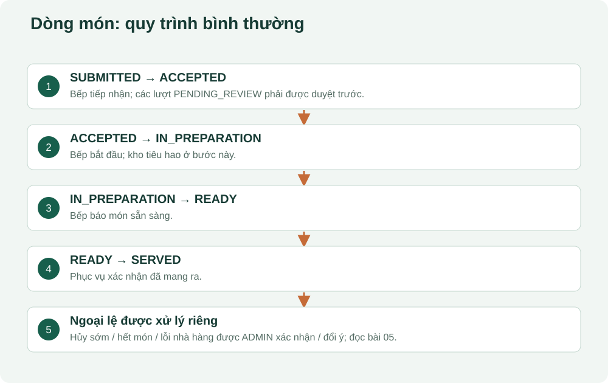

# 05. Vòng đời món, phục vụ và ngoại lệ

## Trạng thái của món là trung tâm

| Từ | Thao tác | Sang | Ai | Tác động quan trọng |
|---|---|---|---|---|
| SUBMITTED | accept | ACCEPTED | Bếp | Ghi thời điểm tiếp nhận |
| ACCEPTED | prepare | IN_PREPARATION | Bếp | Tiêu hao nguyên liệu đã giữ |
| IN_PREPARATION | ready | READY | Bếp | Báo món sẵn sàng |
| READY | serve | SERVED | Phục vụ | Xác nhận đã mang ra |

Một dòng món có số lượng 2 vẫn là một dòng trong luồng này; các endpoint trên chuyển trạng thái dòng, không phải đánh dấu từng chiếc trong số lượng 2. API phục vụ nhiều dòng cùng lúc xác minh các dòng cùng phiên và xử lý trong cùng giao dịch.

Batch có thể PENDING_REVIEW, SUBMITTED, ACCEPTED, IN_PROGRESS, COMPLETED, CANCELLED hoặc REJECTED. Đây là trạng thái tổng hợp. Một batch IN_PROGRESS có thể gồm một món đang nấu và một món chưa bắt đầu. Hàm `aggregateBatch` cập nhật tổng hợp; hàm `transitionItem` mới kiểm tra bước chuyển của từng món.

## Phân biệt hủy sớm, khách đổi ý và lỗi nhà hàng

| Tình huống | Người xử lý | Điều gì xảy ra |
|---|---|---|
| Khách hủy món của mình còn SUBMITTED | Khách | Hủy dòng; trả giữ kho; đảo khoản thu nếu có |
| Món SUBMITTED hoặc ACCEPTED | Nhân viên STAFF | Hủy trực tiếp với lý do; trả giữ kho chưa tiêu hao |
| Bếp nhận rồi phát hiện không thể làm | Bếp, khi ACCEPTED | Đánh dấu UNAVAILABLE; trả giữ kho; đảo charge |
| Khách đổi ý khi IN_PREPARATION / READY / SERVED | ADMIN | Hủy muộn với CUSTOMER_CHANGED_MIND; giữ nguyên tiêu hao và tiền món |
| Bếp phát hiện lỗi khi IN_PREPARATION / READY | KITCHEN báo sự cố | Dừng món → CANCELLED; ghi lỗi + cảnh báo, giữ tiền chờ quản trị |
| Quản trị xác nhận lỗi khi IN_PREPARATION / READY hoặc món bếp vừa dừng | ADMIN | Cùng một thao tác hủy/dừng và bỏ tiền món; không cần waive lần nữa |
| Khiếu nại sau SERVED / ngoại lệ quản lý | ADMIN | Có thể miễn riêng và giữ trạng thái SERVED; kho không hoàn lại |

Khách chỉ hủy món của mình. Nhân viên chọn nhiều dòng có thể nhận kết quả `cancelled`, `skipped`, `alreadyCancelled`; không được chỉ thấy HTTP 200 rồi kết luận tất cả dòng đã hủy. Món không còn đủ điều kiện có thể bị bỏ qua.

## Vì sao hủy muộn không hoàn nguyên liệu?

Hai phần cơm đã dùng nguyên liệu để nấu. Khách trả món không làm gạo và thịt quay lại kho ở trạng thái nguyên liệu dùng được. Khách đổi ý sau chế biến: audit `LATE_CANCEL`, giữ chi phí và khoản phải thu. Lỗi nhà hàng được ADMIN xác nhận: ghi `RESTAURANT_FAULT_CONFIRMED`, bỏ tiền món ngay trong thao tác đó. Bếp chỉ báo lỗi, chưa được tự bỏ tiền. Khiếu nại sau phục vụ hoặc quyết định quản lý khác dùng `waive` riêng. Tiền đã trả thừa luôn cần xử lý hoàn thực tế sau đó.

Đây là tách ba sự thật: **món có được phục vụ không**, **nguyên liệu đã sử dụng chưa**, **nhà hàng có thu tiền món này không**. Một trường `status` duy nhất không mô tả đủ cả ba.

## Khi bếp báo hết món đã thu tiền

Ví dụ đã thu 140.000đ, sau đó một món trị giá 60.000đ bị UNAVAILABLE trước chế biến. Charge giảm còn 80.000đ; paid vẫn 140.000đ; hệ thống tính cần hoàn 60.000đ và có thể tạo cảnh báo REFUND_REQUIRED. Không được sửa giao dịch thu cũ thành 80.000đ để che mất lịch sử nhận tiền.

## Hỗ trợ và bàn giao

Khách tạo yêu cầu ASSISTANCE, WATER, UTENSILS, BILL hoặc OTHER. Trùng loại đang NEW/ACKNOWLEDGED của cùng khách trong phiên được tái sử dụng thay vì tạo vô hạn. Nhân viên claim đổi NEW → ACKNOWLEDGED; chỉ người đang tiếp nhận được resolve. Bàn giao tạo đề nghị PENDING, có người nhận hợp lệ và lý do. Người gửi vẫn phụ trách đến khi đồng nghiệp đồng ý; từ chối hoặc chưa trả lời không đổi owner. Hoàn tất trong lúc chờ sẽ đóng đề nghị. [Ví dụ và CSDL chi tiết ở bài 22](22-ho-tro-va-ban-giao.md).

## Chuyển bàn giữ nguyên phiên

`POST /core/sessions/:id/transfer` nhận bàn đích, bàn nguồn quan sát được, số khách và lý do. Bàn đích phải cùng nhà hàng, hoạt động, khu vực hoạt động, AVAILABLE, không có phiên đang mở và đủ chỗ. Backend khóa theo mã phiên ổn định, rồi khóa các bàn theo thứ tự UUID, kiểm tra lại nguồn để chống hai người chuyển cùng lúc.

Phiên S không đổi ID; khách, giỏ, đơn và tiền tiếp tục đi theo S. `table_session.table_id` đổi, lịch sử vào `table_transfer_history`. Bàn cũ NEEDS_CLEANING, bàn mới OCCUPIED. Mã bàn không phải mã hóa đơn; xem thêm lịch sử chuyển để hiểu bữa ăn bắt đầu ở đâu. [Thực hành chọn bàn và xác nhận ở bài 23](23-chuyen-ban.md).

## Mở mã nguồn và tự kiểm tra

Đọc `orders/reasons.ts`, `orders/issue.routes.ts`, `orders/item-lifecycle.service.ts`, `orders/exception.routes.ts`, `dining/table-transfer.routes.ts`, `dining/dining.routes.ts` dưới `apps/api/src/modules/`.

Tự trả lời: món READY có thể được khách hủy trực tiếp không? Không. Hủy muộn do khách đổi ý có tự miễn tiền không? Không. Xác nhận lỗi nhà hàng trước khi phục vụ có cần thêm waive không? Không; cùng thao tác đã bỏ tiền. Hai thao tác prepare đồng thời có được trừ kho hai lần không? Cơ chế khóa và kiểm tra trạng thái được thiết kế để chặn; kiểm chứng bằng bài test đồng thời và dữ liệu kiểm thử, không thử phá trên phiên khách thật.

## Miễn tiền trực tiếp cho món đã chế biến

ADMIN có thể waive món IN_PREPARATION, READY hoặc SERVED có charge đang ACTIVE, không cần đánh dấu món đã phục vụ thành CANCELLED trước. Món đã hủy muộn cũng có thể được miễn nếu charge vẫn còn. Waive ghi lý do/người thao tác, đảo charge/phân bổ liên quan và giữ nguyên tiêu hao. Phiếu thu vẫn liệt kê món đó với nhãn “Miễn tiền”, giá gốc và thành tiền 0.

Phân biệt **void** trước chế biến với **comp** sau chế biến là cách làm được Square mô tả: vật tư đã dùng vẫn là chi phí dù nhà hàng không thu tiền khách. Dự án áp dụng nguyên tắc này vào vòng đời riêng của mình; không sao chép toàn bộ sản phẩm Square. [Square: comp và void](https://squareup.com/help/us/en/article/5814-get-started-with-comp-and-void).

## Vì sao bếp không tự miễn tiền bằng một lý do?

Bếp có thể dừng món lỗi bằng `POST /core/items/:id/report-issue` khi đang nấu hoặc chưa mang ra. Chỉ nhận ba mã lỗi: KITCHEN_ERROR, QUALITY_ISSUE, WRONG_ITEM; ghi chú thêm không bắt buộc, tối đa 500 ký tự. Backend tạo cảnh báo cần quản trị; STAFF không được tự đóng cảnh báo này. Quản trị nhấn thanh Việc cần xử lý ở mọi mục, mở nhóm bàn bếp báo và duyệt đúng lý do đã lưu trong một bước xác nhận. Phục vụ có việc riêng đến trao đổi trực tiếp với khách; admin duyệt tiền không tự hoàn tất việc đó. [Thực hành bài 24](24-su-co-mon-va-phieu-thanh-toan.md).

Nếu xác nhận lỗi nhà hàng, khoản thu bị đảo và tính lại tiền cần hoàn. Nếu xác định khách đổi ý hoặc sự việc không đủ căn cứ, khoản tiền có thể vẫn giữ, quyết định có audit. Lý do trong code không tự chứng minh lỗi ngoài thực tế là thật. `order_item.cancel_reason_code` lưu loại lý do; lịch sử/audit giữ người thao tác, trạng thái trước và quyết định quản lý.

Cảnh báo sự cố dùng bảng `operational_alert` và `business_audit_event` sẵn có, không thêm hệ thống duyệt tổng quát. [Ma trận và mã lý do](21-chinh-sach-va-ma-tran.md).
