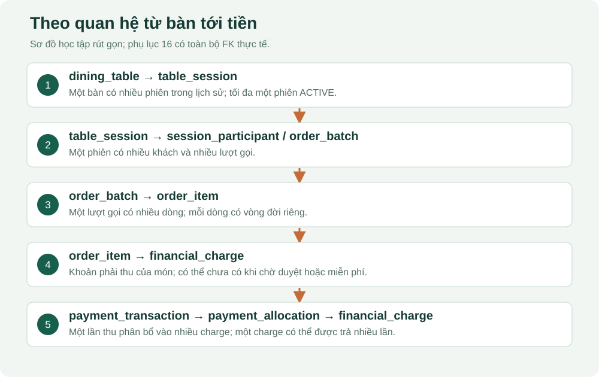

# 07. Học cơ sở dữ liệu theo nghiệp vụ

## Học 8 bảng trước, rồi mở rộng

Đọc lần lượt `dining_table` → `table_session` → `session_participant` → `order_batch` → `order_item` → `financial_charge` → `payment_intent` → `payment_transaction`. Sau đó mới học giỏ, kho, hoàn tiền, nhân sự và các bảng kỹ thuật. [Phụ lục 16](16-tu-dien-du-lieu.md) chứa đủ 56 bảng và 609 cột để tra.

## PK, FK, số lượng quan hệ

PK là khóa chính xác định một dòng. UUID trông dài nhưng bạn có thể coi là mã định danh không trùng. FK là khóa ngoại tham chiếu một dòng hợp lệ ở bảng khác. Ví dụ `order_item.order_batch_id` trỏ đến `order_batch.id`.

Một bàn có nhiều phiên trong lịch sử; một phiên có nhiều lượt gọi; một lượt gọi có nhiều dòng món. Quy tắc “mỗi bàn tối đa một phiên ACTIVE” được bảo vệ bằng unique có điều kiện, không có nghĩa lịch sử bàn–phiên là 1–1. Giỏ phiên có unique trên session_id nên mỗi phiên tối đa một giỏ.

Đọc sơ đồ: cạnh nối từ bảng cha sang bảng con; nhãn đầu con 0..N nghĩa cha có thể chưa có con hoặc có nhiều con. FK bắt buộc cho biết mỗi dòng con cần cha; nó không bắt buộc mọi dòng cha phải có con.



## Schema Prisma, migration SQL và database thật

| Nguồn | Dùng để làm gì | Giới hạn |
|---|---|---|
| `schema.prisma` | Mô hình để tạo Prisma Client và hỗ trợ đọc quan hệ | Đã khai báo các unique/partial index hiện hành; trigger và CHECK vẫn cần đọc SQL |
| `migrations/*/migration.sql` | Các bước nâng cấu trúc theo lịch sử | Có migration sửa quy tắc cũ; không chỉ đọc file đầu |
| Metadata PostgreSQL | Cấu trúc đang tồn tại trên database được kết nối | Phải biết đang nối đúng database nào |
| Dữ liệu từng dòng | Tình trạng nghiệp vụ thực tế | Có thể đổi liên tục, không nên sao chép vào tài liệu tĩnh |

Lần đối chiếu này đã đọc metadata bằng giao dịch READ ONLY. Các comment lỗi thời ở nhóm giỏ/khách/kho/tài chính đã được sửa trong migration mới; comment vẫn chỉ là mô tả, không thay thế việc đọc code. Phụ lục mới diễn giải theo code và cấu trúc, không lấy comment cũ làm bằng chứng chức năng chưa có.

## Đọc một cột

Ví dụ `order_item.unit_price_snapshot`: giá tại thời điểm đặt, kiểu bigint, không phải giá hiện tại trong product. `owner_participant_id` có thể null khi nhân viên nhập hộ. `served_at` có thể null trước khi phục vụ. NULL nghĩa “chưa có/không áp dụng”, không đồng nghĩa 0 hay chuỗi rỗng.

Default chỉ là giá trị mặc định lúc INSERT khi không truyền cột. CHECK giới hạn giá trị hợp lệ. UNIQUE chống trùng. INDEX hỗ trợ tìm nhanh; không phải index nào cũng UNIQUE. Trigger chạy trong database khi có sự kiện ghi; vì vậy kiểm tra ở frontend không phải lớp bảo vệ duy nhất.

## Truy vấn chỉ đọc đầu tiên

Chạy trong công cụ SQL đã kết nối đúng database. Các ví dụ này chỉ đọc; chúng có thể hiển thị dữ liệu nghiệp vụ nên không chia sẻ ảnh kết quả có thông tin riêng.

```sql
BEGIN READ ONLY;
SELECT current_database();
SELECT code, name, table_status FROM dining_table ORDER BY code;
ROLLBACK;
```

Muốn tìm các phiên đang mở cùng mã bàn:

```sql
SELECT s.id, t.code, s.opened_at, s.verification_status,
       s.financial_status
FROM table_session s
JOIN dining_table t ON t.id = s.table_id
WHERE s.session_status = 'ACTIVE'
ORDER BY s.opened_at DESC;
```

`SELECT` chọn cột, `FROM` chọn bảng gốc, `JOIN` nối theo khóa, `WHERE` lọc, `ORDER BY` sắp xếp. `s` và `t` là tên ngắn của bảng để câu truy vấn dễ đọc.

## Theo một dòng món sang tiền

```sql
SELECT b.session_id, i.id, i.product_name_snapshot,
       i.quantity, i.status AS item_status,
       f.amount, f.status AS charge_status
FROM order_item i
JOIN order_batch b ON b.id = i.order_batch_id
LEFT JOIN financial_charge f ON f.order_item_id = i.id
ORDER BY i.created_at DESC
LIMIT 20;
```

LEFT JOIN giữ dòng món dù chưa có charge, ví dụ đang chờ duyệt hoặc món miễn phí không phát sinh charge. Nếu dùng JOIN thường, bạn có thể vô tình làm mất các dòng đó khỏi kết quả và kết luận sai.

## Giao dịch và khóa

Transaction gồm BEGIN → các truy vấn → COMMIT; nếu có lỗi thì ROLLBACK. “Atomic” nghĩa là toàn bộ thay đổi của một công việc cùng thành công hoặc cùng bị bỏ. `FOR UPDATE` giữ khóa dòng khi sửa. Dự án còn dùng advisory lock cho request trùng, chuyển đổi nghiệp vụ lương và một số đối soát.

Ví dụ hai khách tranh nguyên liệu cuối: không thể chỉ kiểm tra menu rồi trừ sau; cả hai cùng có thể nhìn thấy còn món. Backend phải kiểm tra và giữ tồn trong transaction. `available_qty = on_hand_qty - reserved_qty`; nhận diện đúng ba số này trước khi đọc truy vấn kho.

## Nhóm bảng để nhớ

- Danh mục/quyền: nhà hàng, người dùng, role/permission, khu vực, bàn, QR, menu.
- Phục vụ: phiên, khách, giỏ, lượt gọi, món, duyệt/rủi ro/lịch sử, hỗ trợ và chuyển bàn.
- Tiền: tài khoản phiên, charge, intent, transaction, allocation, refund, thiếu tiền.
- Kho: đơn vị, nguyên liệu, vị trí, công thức, nhập kho, số dư, giữ kho, biến động và snapshot nguyên liệu.
- Nhân sự: ca, phân công, chấm công, đơn giá, kỳ lương, phiếu/dòng lương và chi lương.
- Kỹ thuật: idempotency, outbox, webhook, audit, cấu hình và cảnh báo.

## Bài tập

Tìm FK của `order_item` trong phụ lục. Giải thích vì sao tên món lưu snapshot dù đã có product_id. Đáp án: product_id giữ liên kết đối tượng hiện tại; snapshot giữ tên và giá lịch sử để thay menu không làm đổi đơn cũ.

## Vì sao hiện có 56 bảng?

Số bảng không phải thước đo tốt/xấu. Tiêu chí là mỗi bảng đại diện một sự thật có vòng đời riêng, khóa rõ ràng và được một luồng hiện hành sử dụng. Bàn giao có người nhận xác nhận cần thêm support_request_handoff để giữ nhiều lần nhận/từ chối mà không ghi đè yêu cầu gốc. Số bảng tăng theo một sự thật nghiệp vụ có vòng đời riêng, không phải để làm thiết kế trông “doanh nghiệp”. Cũng không nên gộp mọi thứ vào một bảng đơn hàng để giảm số lượng.

| Cặp/nhóm bảng dễ bị hỏi | Vì sao tách | Nếu gộp sẽ mất gì? |
|---|---|---|
| dining_table / table_session | Bàn vật lý tồn tại lâu; mỗi bữa ăn là một phiên | Không lưu được nhiều lần khách ăn trên cùng bàn |
| session_cart / cart_item / order_batch / order_item | Giỏ còn sửa; lượt gửi là cam kết và có giá chụp lúc đặt | Sửa giỏ có thể làm sai đơn bếp đã nhận |
| product / recipe_bom / recipe_bom_item | Món bán, phiên bản công thức, dòng nguyên liệu là các đối tượng khác nhau | Không thể đổi định lượng có lịch sử hoặc có nhiều nguyên liệu/món |
| financial_charge / payment_intent / payment_transaction | Nghĩa vụ phải trả, dự định trả và tiền đã nhận không cùng trạng thái | Dễ nhận nhầm một yêu cầu đang chờ là tiền thật |
| payment_allocation | Một lần trả có thể trả nhiều charge; một charge có thể được trả nhiều lần | Mất truy vết thanh toán chia phần và phần bị đảo |
| refund_case / refund_transaction | Hồ sơ yêu cầu hoàn có thể được xử lý nhiều đợt | Không phân biệt chờ hoàn với đã hoàn thật |
| goods_receipt / goods_receipt_item | Một chứng từ có nhiều nguyên liệu | Lặp người duyệt, nhà cung cấp, trạng thái trên từng dòng |
| inventory_balance / reservation / movement | Hiện có, phần giữ và lịch sử tăng giảm có mục đích khác nhau | Không giải thích được tồn từ đâu hoặc vì sao chưa thể bán |
| work_shift / shift_assignment / attendance_record | Ca chung, ai được phân công, ai thực sự vào/ra | Nhầm lịch dự kiến với công thực tế |
| payroll_period / payroll_slip / payroll_line | Kỳ, tổng mỗi người, căn cứ tính từng khoản | Không giải trình được lương sau khi chốt |
| outbox_event / business_audit_event / order_status_history | Việc cần phát đi, lý do quyết định, bước chuyển món | Một bảng log hỗn hợp khó làm nguồn đối soát cho từng mục đích |

Các bảng connector/webhook được giữ vì có route và kiểm thử nội bộ thực sự tham chiếu; không đồng nghĩa cổng thanh toán online đã xong. Không có bảng chatbot vì chưa có nghiệp vụ đó. Nhà cung cấp hiện được chụp tên trên phiếu nhập; quản trị hồ sơ nhà cung cấp/công nợ mua hàng chưa thuộc phạm vi, nên chưa thêm bảng rồi để trống chức năng.

## Chuẩn hóa: giải thích được bằng ví dụ

**Khóa ứng viên** là tập cột có thể nhận diện duy nhất một bản ghi. `product.id` là khóa kỹ thuật; `(restaurant_id, code)` là khóa nghiệp vụ được UNIQUE bảo vệ. Chỉ đặt UUID không tự làm dữ liệu đạt chuẩn hóa. Cần xét dữ liệu phụ thuộc vào khóa nào và ý nghĩa của nó.

Trong danh mục món: tên/giá hiện tại phụ thuộc món; tên danh mục nằm ở menu_category, không sao chép vào mọi product. Trong công thức: thông tin nguyên liệu nằm ở ingredient; mỗi dòng BOM chỉ giữ liên kết và lượng/hao hụt. Cách tách này tránh cập nhật nhiều nơi khi đổi tên danh mục hoặc nguyên liệu. Các quan hệ nhiều–nhiều dùng bảng nối hoặc bảng chi tiết có khóa/ràng buộc riêng.

Không tuyên bố mọi bảng đều thuần 3NF. Hệ thống có **snapshot lịch sử** và **số tổng hợp có chủ đích**:

| Dữ liệu tưởng như lặp | Ý nghĩa và nguồn kiểm chứng |
|---|---|
| order_item.product_name_snapshot, unit_price_snapshot | Giá/tên của giao dịch lúc đặt; không đồng nghĩa giá/tên hiện tại của product |
| table_session.receipt_snapshot | Bản phiếu thu đóng tại một thời điểm; giữ nguyên khi danh mục thay đổi |
| order_item_ingredient_snapshot | Định lượng/giá vốn khi tiêu hao; không dùng công thức hiện tại để tính lại đơn cũ |
| inventory_balance.available_qty | Tổng hợp on_hand − reserved; cập nhật cùng giao dịch, đối soát movement/reservation |
| session_financial_account | Tổng hợp charges/payments/refunds; service recalculate và truy vấn kiểm tra phải khớp nguồn gốc |
| payroll_line và payroll_slip khi chốt | Chụp căn cứ công/đơn giá/khoản điều chỉnh của kỳ; thay đơn giá tương lai không sửa phiếu đã chốt |

Snapshot không phải cớ để nhân bản tùy ý. Mỗi trường lặp phải trả lời được: chụp lúc nào, ai tạo, có được sửa không, và dữ liệu nào thắng khi có khác biệt. Lần rà soát đã bỏ `ingredient.current_avg_cost` vì trùng ý nghĩa giá vốn nhưng không được cập nhật; giá theo kho vẫn ở `inventory_balance.avg_cost`.

## Ràng buộc nào đặt ở đâu?

| Bất biến | Lớp bảo vệ chính | Ví dụ hỏng nếu chỉ kiểm tra giao diện |
|---|---|---|
| Khóa ngoại trỏ đối tượng tồn tại | FK PostgreSQL | Gửi ID món đã bị xóa trực tiếp vào API |
| Một bàn chỉ có một phiên chưa kết thúc | Partial UNIQUE table_session_one_open | Hai khách quét QR cùng lúc cùng tạo phiên |
| Một công thức ACTIVE/món | Partial UNIQUE core_active_bom | Hai quản trị cùng kích hoạt hai BOM |
| Quan hệ cùng nhà hàng/cùng phiên | Trigger nghiệp vụ + kiểm tra service | ID hợp lệ nhưng thuộc nhà hàng hoặc bữa ăn khác |
| Danh mục cha không chuyển sang nhà hàng khác | Trigger cố định restaurant_id | Di chuyển cha khiến mọi con đang hợp lệ trở thành chéo tenant |
| Không thay đơn vị nền khi nguyên liệu đã được định nghĩa | Trigger cố định base_unit_id | Tồn 10 KG bỗng bị hiểu thành 10 L |
| Tiền không được hoàn vượt hoặc ghi trùng | Khóa phiên, đối soát nguồn, request key và ràng buộc | Hai nhân viên cùng hoàn lại một khoản |
| Mã hoàn chuyển khoản không dùng hai lần trong nhà hàng | Advisory lock + trigger; reference được trim | Hai hồ sơ nhận cùng một mã giao dịch ra |
| Giá và tổng đơn không do khách tự quyết | Backend đọc giá và tạo snapshot trong transaction | Sửa request từ 79.000 thành 1 đồng |

CHECK thích hợp cho điều kiện trong một dòng; quy tắc nhiều dòng/bảng cần FK, unique hoặc trigger/giao dịch phù hợp. FK không tự tạo chỉ mục trên cột tham chiếu phía con trong PostgreSQL. Đây là lý do phải rà riêng danh sách index, không chỉ nhìn đường nối ERD. [Tài liệu PostgreSQL về constraints](https://www.postgresql.org/docs/current/ddl-constraints.html).

## Chỉ mục đã được tinh chỉnh thế nào?

Đợt 30/09 giữ các chỉ mục hỗ trợ FK/tìm kiếm, thêm index cho người đóng/xác minh phiên và người giải quyết cảnh báo, cùng index tra mã hoàn chuyển khoản. Đồng thời bỏ `pdm_bom_active` do trùng hoàn toàn với `core_active_bom`, và bỏ index thường trên session_financial_account.session_id vì UNIQUE của cột này đã hỗ trợ cùng cách tìm.

Prisma đã được bổ sung các unique/partial index từng chỉ có trong SQL, gồm một QR hoạt động/bàn, một vai trò hoạt động/user và các request key. Lệnh migrate diff từ database hiện tại đến schema trả về **empty migration** sau cập nhật. Kết quả này chứng minh sự khớp các cấu trúc Prisma hỗ trợ; không chứng minh nội dung trigger và CHECK đúng, nên vẫn phải đọc migration và chạy các test ghi SQL trái quy tắc.

Không tạo index cho mọi cột: mỗi index tốn dung lượng và công cập nhật. Chọn theo WHERE/JOIN/ORDER BY và đo EXPLAIN khi có dữ liệu lớn. Bộ demo nhỏ chưa phải benchmark hiệu năng doanh nghiệp.

## Đối soát và tình huống đồng thời

Luồng ghi khóa phiên trước khi sửa đơn/tiền; kho khóa số dư để kiểm tra lại lượng khả dụng. Request có idempotency khóa theo danh tính/phạm vi và lưu hash nội dung; gửi lại cùng khóa khác nội dung không được coi là cùng thao tác. Unique và trigger là lớp cuối để chặn đường ghi khác bỏ qua frontend.

Đối soát độc lập nằm ở `scripts/demo-scenarios.ts`, hàm verifySeed. Nó chỉ đọc và báo lỗi nếu số tổng hợp khác sổ gốc; không tự sửa số để làm báo cáo trông đúng. Công thức tiền:

```text
charge_total = tổng financial_charge ACTIVE
paid_total = tổng payment_transaction SUCCEEDED
refunded_total = tổng refund_transaction SUCCEEDED
outstanding = max(charge_total - paid_total + refunded_total, 0)
refund_due = max(paid_total - refunded_total - charge_total, 0)
on_hand = tổng quantity của inventory_movement (có dấu)
reserved = tổng reservation PROVISIONAL hoặc ACTIVE
available = on_hand - reserved
```

`WRITTEN_OFF` là ngoại lệ không thu hồi, không phải khoản đã thu; phiên có thể đóng với lý do ngoại lệ trong khi tài khoản vẫn phản ánh thiếu tiền. Đừng tự sửa paid_total để số dư bằng 0. Tương tự, món đã nấu được miễn tiền vẫn có chi phí kho.

## Câu hỏi giảng viên thường xoáy vào

1. **Sao đã có product_id lại lưu giá?** Giá hiện tại và giá giao dịch là hai sự thật theo thời gian; đơn cũ dùng snapshot.
2. **UUID có chống gọi trùng không?** Không. UUID khác vẫn tạo hai đơn; cần request key, transaction và kiểm tra nội dung.
3. **FK có đủ chống dữ liệu nhà hàng khác không?** Không. FK kiểm tra tồn tại; cùng tenant cần quy tắc bổ sung và ngăn đổi tenant của cha.
4. **Tại sao không gộp phiếu hoàn vào payment âm?** Đang tách nghĩa vụ hoàn khỏi các lần chi thực tế; giữ nguồn và trạng thái xử lý rõ ràng.
5. **Tại sao tồn có ba cột?** Có hàng trong kho chưa chắc bán được nếu đang giữ cho đơn khác; available là tổng hợp được kiểm tra.
6. **Tắt nguyên liệu có cần xóa lịch sử không?** Không. is_active ngăn dùng mới; các chứng từ cũ vẫn cần FK và snapshot.
7. **Cần bảng khách hàng không?** Người quét QR là khách theo phiên, chưa có tài khoản/loyalty. session_participant phù hợp phạm vi hiện tại.
8. **Vì sao có BigInt và Decimal?** VND nguyên dùng BigInt để tránh sai số số thực; lượng KG/L và giá vốn bình quân có phần lẻ dùng Decimal. API chuyển số tiền thành chuỗi để JSON không mất chính xác.
9. **Có cần ENUM PostgreSQL cho mọi trạng thái?** Dự án dùng text+CHECK với tập giá trị hữu hạn. Đây là lựa chọn hợp lệ; bước chuyển còn phải do service/trigger kiểm tra.
10. **Cơ sở nào nói đủ bảng?** Chỉ đủ cho các luồng đã triển khai và test. Thuế/hóa đơn điện tử, nhiều chi nhánh, lô/hạn dùng, mua hàng/công nợ sẽ cần phân tích riêng; không giả vờ đã có chỉ vì tên schema nghe đầy đủ.
11. **Đảm bảo không có lỗi bằng cách nào?** Không có chứng minh tuyệt đối từ test; trình bày bằng chứng cụ thể: migration sạch, schema khớp, test bất biến, test đồng thời và đối soát seed; nói rõ chưa kiểm tải/vận hành dài ngày.
12. **Nếu thêm online/AI phải sửa gì?** Bắt đầu từ use case và ranh giới tin cậy ở bài 14; không cấp quyền ghi SQL hay xác nhận tiền cho chatbot.

Để chuẩn bị bảo vệ, chọn một hóa đơn mẫu A04 có món miễn hoặc A06 có hoàn tiền. Kể lại qua giao diện, rồi chỉ được chuỗi session → order_item → charge → payment/allocation → refund → receipt_snapshot và movement tương ứng. Làm được điều này hữu ích hơn học thuộc số bảng.

## Migration 24: bằng chứng đồng ý và loại lý do

Migration `202610010001_guest_policy_order_reasons` bổ sung hai cột vào `session_participant` và một cột vào `order_item`. Tại thời điểm migration 24, tổng là 55 bảng, 598 cột và 132 FK. Sau migration 25–26 về bàn giao hỗ trợ, số hiện tại là 56 bảng, 609 cột và 137 FK. Hai cột đồng ý phải cùng rỗng hoặc cùng có giá trị; trigger bảo vệ không sửa cặp bằng chứng đó. Mã lý do nếu có phải thuộc danh sách chuẩn. Đây là dữ liệu của lần tham gia và lần xử lý món, không phải bảng lưu văn bản chính sách.

Không sửa migration cũ, không dùng db push. Khách cũ giữ NULL; dữ liệu vận hành và seed không bị xóa trong đợt này. [Từ điển đủ cột/ràng buộc](16-tu-dien-du-lieu.md) và [hồ sơ thay đổi](21-chinh-sach-va-ma-tran.md).

## Quan hệ hỗ trợ và bàn giao

support_request lưu việc khách yêu cầu và người đang phụ trách. support_request_handoff lưu mỗi đề nghị, tối đa một PENDING nhưng giữ nhiều dòng lịch sử. outbox_event thêm support_request_id để publish sự kiện qua tác vụ hiện có. [Bài 22](22-ho-tro-va-ban-giao.md) giải thích cột, FK, partial unique, check trạng thái và khóa cạnh tranh.
