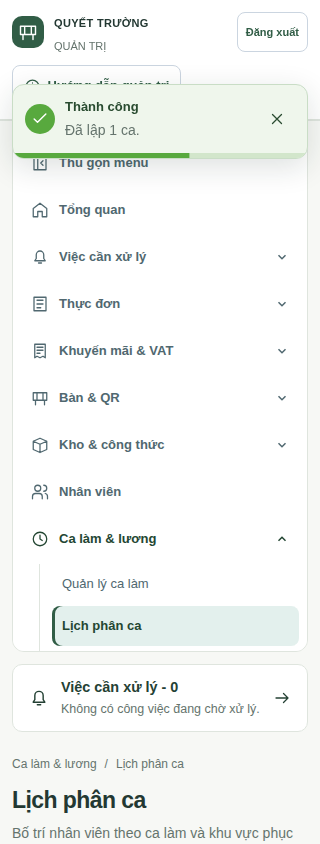
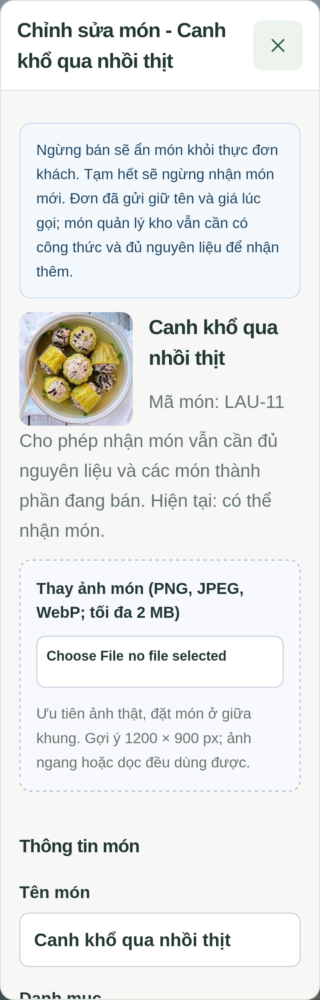
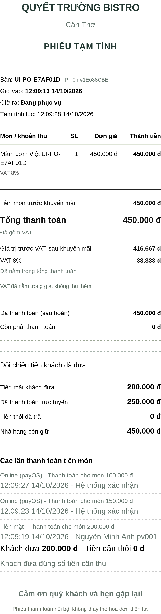
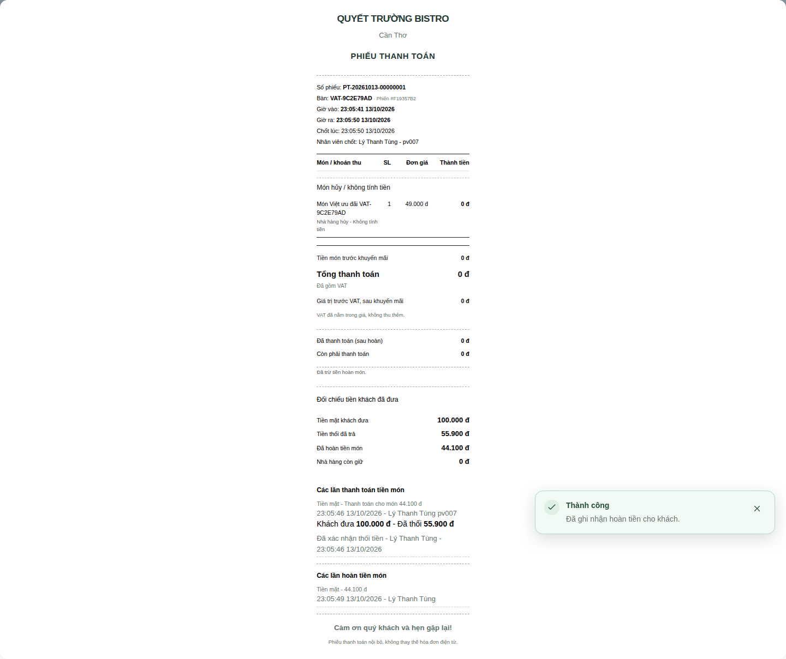

# 15. Hồ sơ đối chiếu và giới hạn xác minh


## Kết thúc kỹ thuật phiên thử đã archive — 26/10/2026

Nhánh `chore/retire-archived-test-sessions` bổ sung công cụ một lần cho đúng UUID A01/A02, lý do `ARCHIVED_TEST_RETIRED` và migration 41 `202610260001_retire_archived_test_sessions` (75 bảng). Không nới guard đóng bàn, không ghi thu/hoàn/write-off; giữ số dư và tiền thật chưa quyết toán. Bàn chuyển NEEDS_CLEANING, nhân viên dọn rồi mở phiên/mã mới, QR giữ nguyên. [Báo cáo, bảng tác động và runbook](reference/payos-test-session-retirement-20261026.md) có preflight schema40, backup/restore, kế hoạch schema41, apply xác nhận và khôi phục không ghi đè giao dịch mới. Chưa thực hiện production; trạng thái/counts thực tế phải do operator xác minh.

## Kiểm chứng công cụ lưu trữ A01/A02 — 25/10/2026

Baseline `aa4eb8a` đã merge PR #5. Bộ lưu trữ dùng migration cộng thêm `202610250002_payos_test_case_archive`, 2 bảng mới (tổng 74), giữ nguyên 19.073 audit gốc theo profile chủ dự án cung cấp. [Biên bản và runbook](reference/payos-test-archive-20261025.md) tách bằng chứng code/lab khỏi trạng thái production chưa truy cập. Kết quả cuối gắn với commit/PR riêng, không dùng checks PR #5 thay thế. Kiểm chứng kết thúc 26/10: 400 unit, toàn bộ 716 API coverage (41 archive mới; lines 92,53%) và 6 browser trọng tâm đạt; rehearsal giữ 74 bảng/19.073 audit, proof/allocator và chặn posting sau restore. [Bằng chứng tổng hợp](reference/payos-test-archive-verification.json).


## Rà soát trước AI — 25/10/2026

Baseline source là `67ad44681e4c43b55478d997ed44ded880034c71`, đã merge PR #3 và #4. Nhánh `chore/pre-ai-system-audit` sửa gọi nhân viên thanh toán, bill khách và quyền STAFF xem QR hiện có. [Biên bản theo phạm vi](reference/pre-ai-audit-20261025.md) ghi kết quả hiện hành và vùng chưa xác minh; các mốc bên dưới là lịch sử, không xác nhận trạng thái production.


## Nghiệm thu nền tảng payOS M2/M3 — 23/10/2026

Nhánh `feat/payos-payment-platform`, PR #3 tiếp tục đầy đủ sau M1. Thay đổi M2 gồm tự động signed GET/primary MB, shared posting và claim ngân hàng xuyên nguồn, ADMIN chứng từ riêng tư/xem trước/xác nhận, chống ghi trùng và audit. M3 gồm UI ba vai trò, kiểm thử browser, migration đóng gói và rehearsal backup/restore/rollback. Đây là nghiệm thu mã và môi trường tổng hợp, không phải xác nhận production hoặc tiền A10 đã được xử lý.

### Nguyên nhân và hành vi trước/sau

Guard cũ đòi webhook làm cầu nối dù signed GET đã khớp đúng kênh/link và primary ngân hàng được cấu hình tin cậy. M2 cho phép GET độc lập khi exact client/restaurant/BIN MB/primary + signed CREATE QR/link đều đúng; VA mâu thuẫn hoặc chữ ký/định danh/tiền sai vẫn chặn. Không dùng độ dài tài khoản, lời xác nhận hoặc output diagnostic làm quyền ghi sổ.

ADMIN có luồng riêng BANK_ADMIN_VERIFIED, không giả provider PAID. Proof 2 MB private/hash; preview 2 phút chưa ghi tiền; confirm kiểm lại quyền/tenant/versions/facts/hash/scope dưới khóa. Claim receiver hash+reference, receipt/allocation/evidence/outbox/audit cùng transaction; refresh/webhook cùng receipt không ghi lần hai. Hai preview hoặc hai nguồn cạnh tranh chỉ có một receipt; lỗi DB rollback toàn bộ. Dữ liệu đổi sau preview đòi xem trước mới.

Bill 20.000đ/quote10.000đ/nhận12.000đ giữ nợ10.000đ và hoàn2.000đ, cả tự động lẫn ADMIN. Duyệt hoàn chưa được đóng đối soát; test thực hiện xác nhận trả tiền **giả lập** rồi mới đóng. Evidence ngân hàng đủ điều kiện đóng phần nghĩa vụ đã xử lý mà không ép provider PENDING thành PAID; worker tiếp tục đối chiếu nguồn. Phiên đã chốt và khoản đến muộn thiếu bằng chứng đúng hạn bị chặn.

### Bằng chứng kiểm chứng

| Nhóm | Kết quả đã quan sát / nơi đọc kết quả tự động |
| --- | --- |
| `pnpm check` | Format, ESLint, typecheck toàn workspace/tools và **384/384 unit /45files** đạt; số tăng từ364 của M1, không xóa/skip test |
| Coverage tương đương CI | **659/659 /47files**, line **92,40%**, ngưỡng70%; gồm toàn backend/integration, không chỉ payOS |
| Bank evidence SQL/API | **35/35**: permissions/tenant/proof/token expiry/stale/replay/concurrency/rollback/timely/closed/cross-source/sourceprivacy/overpay/actualrefund/resolution |
| Shared bank posting | **10/10** PostgreSQL: uniqueidentity, allocationcap, collisiontenant/amount, concurrentclaim, rollback, immutablefacts |
| Automatic MB recovery | **37/37** integration; normalization/binding **47/47** unit; GET-only thật của adaptergiả khớp10k cập nhật STAFF/GUEST và replay giữ một receipt |
| E2E thanh toán | **81/81** trên desktop/Android/Safari; gồm21 bàiADMIN và6 bài provenanceSTAFF/GUEST mới, không thay skip hiện hữu |
| Full E2E + fresh Quality Gate | Workflow hiện hành giữ nguyên, chạy trọn **501 lượt browser**. Bằng chứng PASS/FAIL, tổng số và commit chính xác đọc ở [checks PR #3](https://github.com/lqtruong134/project-qr-restaurant-ordering/pull/3/checks); không dùng run M1 thay cho commit M2/M3. Báo cáo nghiệm thu cuối trên PR gắn run mới sau khi hoàn tất |
| Rehearsal dữ liệu/vận hành | Guardedlab CLI đã pg_dump/restore đủ **71 bảng**; giữ bankproof/preview/evidence/claim, hash/quyền600/700, ledger10k/due10k/refund0; từ chối DB đích không trống/gói hỏng, lỗi giữa chừng giữ writer dừng, archive READONLY và allocator khôngrewind |
| Image/security/toolchecks | Kết quả imageAPI/maintenance/web và smokeUID10001 được ghi theo lượt build của PR; tooltests/secretcheck/audit high phải đạt trước push. Không dùng image M1 làm bằng chứng image M2 |

Test PostgreSQL dùng container tmpfs có nhãn riêng, loopback, credentials tổng hợp; mỗi integration tạo DB ngẫu nhiên rồi dọn đúng DB đó. E2E chạy trong clone riêng với `.env` tổng hợp, không nạp `.env`/production compose của checkout thật. Giao dịch/hoàn trong tests là fixture; không gọi merchant/bank thật. Chẩn đoán browser chỉ ở thư mục lab, không commit scratch hoặc giảm assertion để bỏ lỗi.

### Đối chiếu lỗi browser trước lượt CI cuối

Lượt full local đầu tiên đạt 492/501, lỗi 8 và bỏ qua 1 bài Swagger có sẵn. Cùng commit `8c3d216`, [GitHub run 39928076414](https://github.com/lqtruong134/project-qr-restaurant-ordering/actions/runs/39928076414) đạt 499, lỗi 1 Safari và bỏ qua 1; mọi bước trước E2E đều đạt. Không tính hai lượt này là PASS. Tám tình huống local đã được chạy lại đúng spec/project và đạt **8/8**, giữ nguyên timeout và assertion.

Trace Safari cho thấy một state poll độc lập bắt đầu trong provisional navigation khi test cố ý giữ promotion GET rồi reload. Fixture chỉ tạm dừng timer trong bước kiểm tra hủy này, chờ các state read kết thúc rồi reload thật và bật lại timer; giữ AbortSignal, pagehide và `errors === []`, không lọc lỗi hay thay code sản phẩm. Regression lặp ba lần trên mỗi trình duyệt đạt **9/9**.

Fixture tháng công trước đây dùng upsert cập nhật một ca bất biến khi worker khởi động lại sau lỗi. Nay chỉ tạo ca khi chưa có và đối chiếu toàn bộ cấu hình khi dùng lại; không đổi trigger hoặc nghiệp vụ. Chạy lại beforeAll trên cùng database qua hai lượt bài lịch sử tháng đạt **2/2**. Tổng kiểm tra trọng tâm bổ sung: **19/19**; format, ESLint, tools typecheck và secret check đạt. Rehearsal migrate/seed hai lần, SQL và quyền ba vai trò đạt trong database tổng hợp riêng. Kết quả full Quality Gate mới gắn với commit cuối tại checks PR #3, không suy PASS từ các lượt chạy trọng tâm.

Commit `ab18538` có hai kết quả được giữ riêng: [PR run 39968891726, attempt 2](https://github.com/lqtruong134/project-qr-restaurant-ordering/actions/runs/39968891726/attempts/2) đạt **500 E2E /0 lỗi /1 Swagger skip hiện hữu**, toàn bộ Quality Gate và rehearsal hai vòng đạt; [push run 39968885302](https://github.com/lqtruong134/project-qr-restaurant-ordering/actions/runs/39968885302) đạt499 và lỗi1 chuyển bàn. Trace lỗi thứ hai chứng minh bốn request polling bị treo đúng lúc fixture gỡ interception (Fetch-domain teardown); không có response mới bị code sản phẩm bỏ qua. Fixture nay giữ handler ổn định, chỉ chuyển từ snapshot sang `route.continue()` gọi API thật. Toàn bộ hai kịch bản chuyển bàn, ba browser và ba lần lặp đạt **18/18**, không đổi assertion/timeout. Tổng regression trọng tâm bổ sung là **37/37**. Lượt PR attempt1 đã hủy ở bước tải thư viện Ubuntu chậm trước E2E, sau đó chạy lại trên runner khác; không tính lượt bị hủy là PASS. Commit cuối vẫn phải xem fresh checks, không dùng kết quả cũ thay cho nó.

Cập nhật **24/10/2026**: [PR run39982639261](https://github.com/lqtruong134/project-qr-restaurant-ordering/actions/runs/39982639261) của `83673ed` đạt499, lỗi1 roster Safari và bỏ qua1 bài Swagger cũ. Trace xác nhận PATCH đổi tên đã commit, GET polling kế tiếp trả đúng tên mới; `bringToFront` không bảo đảm focus/refresh ở headless WebKit, nên assertion5s đã chạy đua với chu kỳpoll5s và độ trễrender. Fixture nay chờ response GET thật có đúng danh sách người sau đổi tên/rời bàn rồi giữ nguyên assertion UI; không ép refresh, giả sự kiện, thay response, đổi timeout hay sửa code sản phẩm. Hai kịch bản roster, ba browser, ba lần lặp đạt **18/18**, đưa tổng lượt regression trọng tâm bổ sung lên **55/55**. Full checks của commit cuối vẫn được báo riêng trên PR; không gọi lượt499/1lỗi là PASS.

Cùng ngày, [push run 39982634722, attempt 2](https://github.com/lqtruong134/project-qr-restaurant-ordering/actions/runs/39982634722/attempts/2) của `83673ed` đạt 499, lỗi một strict locator chuyển bàn và bỏ qua một bài Swagger cũ. Assertion cuối tìm theo tên `P01` đã khớp năm bàn của các fixture trước; các bàn có mã khác nhau dù cùng tên hiển thị. Test nay nhập lại prefix mã bàn duy nhất qua ô tìm kiếm sẵn có trước khi kiểm tra `P01`/`A06`, giữ nguyên strict locator, trạng thái và timeout. Không dùng phần tử đầu, không thay code sản phẩm và không suy đoán nguyên nhân bộ lọc mất giá trị. Toàn bộ hai kịch bản chuyển bàn trên ba browser, lặp ba lần, đạt **18/18**. Tổng lượt regression trọng tâm bổ sung là **73/73** (gồm các lần lặp, không phải 73 test mới). Lượt CI lỗi vẫn được giữ riêng; kết quả Quality Gate của commit cuối đọc tại PR.

### Gói triển khai và các giới hạn bắt buộc

Migration mới **`packages/database/prisma/migrations/202610230001_bank_payment_evidence/migration.sql`** chỉ thêm schema; migration cũ không đổi. Swagger sinh lại **184 thao tác nghiệp vụ /193route**, từ điển/ERD **71 bảng**. [Bài06](06-thanh-toan.md), [API17](17-api.md), [thiết kế](reference/payos-platform-design.md), [runbook](reference/payos-demo-reset-runbook.md) và [triển khai26](26-trien-khai-qtruongres.md) cùng mô tả implementation.

Làm sạch production là **kế hoạch có cổng review**, không reset executor: giữ mọi tiền thật/unknown, ưu tiên migrate DB đang dùng, backup restore đã chứng minh, manifest từng hàng trước khi xét dữ liệu phi tài chính, một webhookwriter và allocator không lùi. Chưa có dispatcher archive tự động; không tự chuyển DB mới cùng channel khi chưa có routing được nghiệm thu. Sau BANK_ADMIN_VERIFIED chỉ rollback tới code M2 tương thích; không restore DB/state cũ đè tiền mới. Chưa có connector xác minh hoàn outbound nên không tự công nhận mã nhập tay là đã hoàn ngoài phiếu đóng.

Không merge/deploy/start-stop production, không đọc/sửa DB production, không đổi secrets và không chuyển/hoàn tiền thật. Chủ dự án review kết quả freshCI, backup/migration/config/watermark rồi tự quyết định triển khai và nghiệm thu A10. Các mục dưới là **lịch sử milestone/nhánh trước**, không phải trạng thái hiện hành của M2/M3.


## Nền tảng payOS M1 — chốt 23/10/2026

Nhánh mới **`feat/payos-payment-platform`**, tạo từ `main` tại `6c45a0156d049027dcc160ccd8efa9a4ee9e9bc6`. Đây là milestone nền tảng của yêu cầu xây dựng lại, **chưa hoàn tất luồng ADMIN xác minh ngân hàng hoặc UI mới, chưa sẵn sàng deploy/cutover**. [Thiết kế thống nhất và giới hạn bằng chứng](reference/payos-platform-design.md), [reset chỉ đọc/backup/archive/rollback](reference/payos-demo-reset-runbook.md), [nghiệp vụ](06-thanh-toan.md), [cấu hình và công cụ maintenance](26-trien-khai-qtruongres.md).

### Phần đã hoàn thành của milestone

- Thay `nextval` trong đường tạo QR bằng allocator SQLite ngoài vòng đời DB vận hành: khóa ghi nguyên tử, high-water theo hash kênh, `max(previous+1, nowMs, databaseFloor+1)`, reserve trước gọi provider; rollback PostgreSQL không tái sử dụng mã. Sequence/schema SQL cũ không bị sửa. Thiếu namespace/store, file hỏng/quyền không phù hợp hoặc hết miền số nguyên an toàn đều chặn tạo khoản mới, không tự bootstrap merchant.
- CLI khởi tạo riêng chỉ đọc max DB trong transaction READ ONLY rồi đóng kết nối, yêu cầu watermark lịch sử do operator kiểm chứng và xác nhận tường minh; không tự suy ra toàn bộ lịch sử từ DB hiện tại. Production Compose dùng `/data/payos-state/order-codes.sqlite` trong volume runtime, UID 10001; service maintenance mặc định chỉ `--help`.
- Runtime backup/restore nhận đúng state file có checksum, quyền 700/600; chặn sidecar, symlink/hardlink và tool state chạy đồng thời. Đây là cold copy sau khi đã fence mọi writer. **Một snapshot hợp lệ nhưng cũ vẫn có thể làm counter lùi**; phải kiểm chứng upper bound độc lập trước khi bật payOS sau restore. Không có cơ chế tự chứng minh archive/provider history mới nhất.
- Công cụ reset chỉ inventory trong READ ONLY/ROLLBACK, xuất counts/boolean/hash review đã khử dữ liệu riêng. Bao gồm hóa đơn đã chốt, lượt gọi món/món, chứng từ, cảnh báo và trường hợp đã ghi sổ một phần nhưng tiền báo nhận vẫn lớn hơn ledger. Mọi payOS/ONLINE/external attempt là PROTECTED/UNKNOWN; bản ghi khác giữ lại, auto-delete bằng 0. Không có executor reset hoặc quyền phê duyệt từ planHash.

### Kiểm tra thực chạy

| Kiểm tra | Kết quả và phạm vi |
| --- | --- |
| `pnpm check` trong môi trường sạch, không nạp env thật | Format, lint, typecheck toàn workspace/tools đạt; **364 unit tests / 44 files đạt** |
| Ba suite `payos.integration`, `payos-provider-recovery.integration`, `payos-protocol.integration` | **122/122 đạt** trên PostgreSQL tmpfs, cổng localhost riêng, credential tổng hợp; SDK/provider giả không gọi merchant thật |
| Node reset/deployment tests, bật smoke image API riêng | **39/39 đạt, 0 skip**; gồm archive roundtrip SQLite, hash/quyền/sidecar/corruption, guards, dữ liệu đầu ra an toàn |
| Build API runtime và maintenance bằng Dockerfile production, tag riêng | Mốc nền tảng `aa1768e` đạt; không tag đè image production hoặc chạy stack live |
| API image smoke | UID/GID 10001, root filesystem read-only, network none; đọc 3210 file/797 thư mục, import dependencies/native addon và health giả đạt; allocator giữ mã với DB floor quay về 0, chặn kênh chưa khởi tạo |
| Maintenance image smoke | UID 10001, filesystem read-only/network none; initializer `--help` và đọc đủ **37 migration SQL** đạt; không chạy Prisma/migration hoặc kết nối DB |
| Production Compose syntax | `config --quiet` với `/dev/null` và env tổng hợp đạt; compose dev không đổi |
| Secret check và diff whitespace | Đạt; đây là kiểm tra cơ bản, không thay thế toàn bộ security audit; không đưa env thật/khóa/chứng từ/SQLite runtime/backup vào commit |

Lần integration đầu thiếu AUTH_SECRET tổng hợp cho fixture mở bàn, gây lỗi trước đường payment; chạy lại với cấu hình test riêng đã đạt. Test PostgreSQL thật của inventory phát hiện SELECT thiếu FROM và tham số webhook so sánh UUID/text; đã sửa truy vấn và chạy lại toàn bộ ba suite đạt 122/122. Không nới guard hay assertion để bỏ qua lỗi. Các test chọn theo tên chỉ phục vụ chẩn đoán; số 122 là lượt đầy đủ cuối của ba suite.

### Phần chưa thực hiện

M2 còn phải xây protected bank evidence, ADMIN preview/confirm, receipt identity chung xuyên phương thức, khóa/dedup giữa ADMIN và webhook, provenance PAYOS_VERIFIED/BANK_ADMIN_VERIFIED và test cạnh tranh. M3 còn UI ba vai trò, E2E sâu, deployment/cutover/rollback rehearsal toàn nền tảng và nghiệm thu thật. Không coi các endpoint đề xuất trong hồ sơ thiết kế là chức năng hiện có.

Chưa chạy E2E hoặc kiểm chứng production của nền tảng mới. Không xác minh merchant/webhook/Cloudflare live; không thực hiện giao dịch, hoàn tiền, reset/archive, chạy migration hoặc truy cập DB production. Không đổi secrets, merge hoặc deploy; Quality gate GitHub giữ nguyên và kết quả CI của PR mới phải đọc riêng sau push. Không kết luận giao dịch A10/A06 thật đã được ghi sổ hoặc đã hoàn.

### Bổ sung sau CI đầu của PR #3

[Run 39823834886](https://github.com/lqtruong134/project-qr-restaurant-ordering/actions/runs/39823834886) dừng tại audit trước mọi test: Next.js 16.3.8 thuộc phạm vi của [GHSA-2464-fhr4-w9xw](https://github.com/advisories/GHSA-2464-fhr4-w9xw) (critical) và [GHSA-p3m5-59mp-jv5r](https://github.com/advisories/GHSA-p3m5-59mp-jv5r) (high). Manifest/lock Next không bị M1 thay đổi trước lượt này; đây là dependency nền bị audit hiện hành chặn.

Commit `23b65a3` nâng riêng Next, @next/env và tám gói SWC tương ứng lên **16.4.1**, là bản sửa được hai advisory chỉ rõ. Giữ nguyên pnpm 12.3.4, React 19.2.8, sharp 0.35.5, integrity, allowBuilds, overrides và ngưỡng audit. Frozen install đạt; audit mức high đạt với **0 high/critical**, vẫn còn **2 moderate của dev dependency @vitest/mocker**. Build web 7 route bằng Next 16.4.1 đạt với output riêng và API endpoint tổng hợp không thể gọi production. Không coi đó là full Docker/web cutover rehearsal; build/smoke Docker M1 trong bảng là mốc trước bản vá CI này.

Khi chạy lại unit, test nhập cùng ảnh song song lộ race có sẵn ở main: writeFile với wx công bố tên tệp khi mới ghi một phần; importer khác gặp EEXIST rồi đọc 34/68 byte và báo nhầm xung đột. Hai regression deterministic tái hiện thất bại trên nguyên bản source cũ, không dùng sleep. Sửa riêng kho ảnh: ghi vào tệp riêng quyền 600, đóng tệp hoàn chỉnh rồi hardlink không ghi đè và dọn staging trong finally. Giữ URL theo nội dung và từ chối nội dung khác dưới tên đã tồn tại. Không đổi ảnh/dữ liệu/URL hiện có hoặc nghiệp vụ tài chính.

Bốn test mới bao phủ không công bố ảnh dở, nhập đồng thời cùng nội dung, dọn staging khi ghi lỗi và khi publish lỗi. Bộ ảnh đạt **12/12**, hai regression song song đạt thêm 5 lượt liên tiếp; toàn repo format/lint/typecheck và **364 unit** đạt. Không xóa/skip/nới assertion để che lỗi. Kết quả GitHub của commit bổ sung cần đọc riêng sau push, chưa được kết luận PASS từ kết quả cục bộ.

## PR #1 — Phục hồi Quality gate toàn hệ thống — 21/10/2026

### Bổ sung sau lượt GitHub đầu của bản sửa

Commit `e6ef98b` đã đạt E2E cục bộ **473 passed / 0 failed / 1 skipped** và rehearsal. [Run GitHub 39584381113](https://github.com/lqtruong134/project-qr-restaurant-ordering/actions/runs/39584381113) sau đó dừng trước test tại audit do [GHSA-587h-7wmj-h5pm](https://github.com/advisories/GHSA-587h-7wmj-h5pm) ảnh hưởng Vite 8.2.2 qua Vitest. Đây là điểm chặn dependency được audit hiện hành phát hiện, không phải lỗi E2E mới.

Thêm override hẹp `vite@8.2 → 8.2.4` và cập nhật integrity trong lockfile bằng pnpm; không nâng package khác, không tắt audit hoặc thêm ngoại lệ advisory. Giữ pnpm 12.3.4, allowBuilds và supply-chain policy. Frozen install, audit mức high, secret check, format/lint/typecheck, **323 unit**, deployment tests, **542 integration/coverage** và build đã chạy lại đạt sau patch. Audit hiện trả **No known vulnerabilities found**; ngưỡng high của gate giữ nguyên.

Không chạy lại E2E cục bộ chỉ vì patch công cụ Vitest; mã ứng dụng và browser tests giữ nguyên so với lượt 473/0/1. GitHub Actions sẽ chạy lại toàn bộ pipeline với lockfile mới sau push; chỉ kết luận PASS từ kết quả run mới. Không sửa production, không merge main hay deploy.

Đợt này tiếp tục nhánh **`fix/payos-payment-experience`**, nền `d6c9bb9d8f6e2cab138f959aa15271f197f0728a`. [Quality gate gốc](https://github.com/lqtruong134/project-qr-restaurant-ordering/actions/runs/39294876107) đạt các bước trước E2E nhưng có **383 passed / 90 failed / 1 skipped**. 90 lỗi tương ứng 30 kịch bản lặp trên desktop, Android Chromium và Safari WebKit; không phải 90 nguyên nhân riêng.

### Log, trace và nguyên nhân

Đã tải và phân tích toàn bộ job log. API artifacts của run gốc trả danh sách rỗng: workflow trước đó không upload trace, nên đường dẫn trace trong log không còn là tệp có thể tải sau khi runner kết thúc. Các ca lỗi được tái hiện trên checkout/DB riêng; trace ZIP và error-context của các lượt này đã được đọc để sửa các điểm chặn tiếp theo. Thêm bước upload trace/context/screenshot/report **chỉ khi gate lỗi**; giữ tất cả bước kiểm tra và cleanup cũ.

| Nhóm nguyên nhân | Ví dụ và cách sửa |
| --- | --- |
| Test theo UI/contract cũ | Trang nội bộ đã tối giản, carousel thay ảnh hero cũ, guide bổ sung chủ đề, nút Làm mới/Gửi yêu cầu, checkbox consent mặc định chưa chọn. Cập nhật kiểm tra theo hành vi hiện hành; giữ keyboard, ảnh lỗi, validation và flow nghiệp vụ |
| Test payOS | Locator tổng tiền khớp hai nơi; scope đúng summary cả bàn thay vì lấy phần tử đầu. Tiền ngân hàng báo 150.000đ vẫn phải đi cùng ghi sổ/phân bổ 0đ và nợ 450.000đ khi chưa đủ xác minh; không đổi ứng dụng thành báo thành công giả |
| Fixture dùng chung | Suite workforce-month đã thêm lịch sử chấm công/lương; test khác không thể giả định nhân viên seed chưa có lịch sử hoặc cho sửa đơn giá hồi tố. Dùng hai nhân viên thử riêng, giữ mọi kiểm tra tiền/quyền/chi từng phiếu; chỉ vô hiệu hóa chính tài khoản thử khi dọn, không xóa lịch sử |
| Môi trường CI và ảnh diagnostic | Screenshot dùng đường dẫn tuyệt đối trên máy Windows. Chuyển sang info.outputPath của từng project. Ảnh fullpage của thực đơn dài vượt giới hạn 32.767px trên WebKit; giữ ảnh viewport CSS cùng toàn bộ assertion giỏ/phiên. Dialog lịch sử dùng clip của vùng nhìn thấy để tránh chờ RAF của tab nền. Sau lịch sử chuyển bàn, xác nhận lịch sử đã gỡ, nút đóng của dialog cha visible/enabled rồi dùng Escape qua native cancel handler và xác nhận dialog cha được gỡ; pointer close vẫn có coverage trong core45/table-access. Không dùng force hoặc tăng timeout |
| Bug chức năng thật | Equal flex cắt tên khách ngắn; sửa kích thước tự nhiên và giữ test không cắt tên. Bill paymentRequests thiếu metadata bàn giao/table/area; reuse supportSelect có tenant/session filter, giữ participant_id và nguyên snapshot phiếu đóng. Request đọc khuyến mãi và công việc khẩn cấp cần được hủy khi pagehide/unmount; không khởi chạy GET đối soát trong finally khi signal đã hủy. Giữ lỗi HTTP/network thật khi component còn hoạt động và không hủy mutation |
| Transport đọc và draft thu tiền | Sửa lifecycle GET/HEAD tại transport chung, gồm thời gian tải body: giữ nguyên Response gốc, theo dõi body clone bằng reader bỏ từng chunk, dọn controller/listener khi EOF/lỗi. Hủy read khi pagehide, chặn read mới trong document đang rời, phục hồi BFCache pageshow; giữ lỗi mạng/body thật, caller deadline và quy tắc auth/replay. POST/PATCH/DELETE không bị hủy bởi pagehide. Chuyển trạng thái request rỗng sang ACK đầu tiên chỉ gắn yêu cầu, không xóa draft tiền khách đưa/mã tham chiếu/ảnh; đổi từ yêu cầu không rỗng vẫn xóa draft như cũ, method/participant vẫn được gắn. Trace cho thấy thời điểm bất lợi và source có đường chạy xóa draft bất đồng bộ; không khẳng định trace chứng minh chính xác setter đã chạy, không quy thành lỗi xác minh ngân hàng |
| Phụ thuộc báo cáo thừa | Admin bootstrap chờ báo cáo toàn phiên dù không có consumer của data.reports; ReportsPanel đã dùng API báo cáo phân trang riêng. Trace trước sửa cho thấy 8 request thừa mỗi browser. Bỏ fetch/field/prop thừa, giữ nguyên API backend và phép tính tiền; regression khẳng định không gọi endpoint thừa, giữ deadline loader 5 giây, bổ sung test.step theo từng trang và kiểm tra không hiện lỗi dữ liệu |
| Race đọc trạng thái và browser lifecycle | Test quan sát tab nền trước chu kỳ polling hoặc sau khi snapshot chưa tải. Đưa tab cần quan sát/chụp ảnh lên foreground, chờ response đã commit hoặc deadline phù hợp chu kỳ (khách 5 giây, bill phục vụ 10 giây) và request đang chạy; vẫn kiểm tra quyền cũ mất, quyền mới đúng và không tạo giao dịch thêm. Cleanup nhân viên dùng HTTP context độc lập, giữ kiểm tra 14 người và toàn bộ số tiền. Card món được chờ ảnh/layout sẵn sàng trước click thật trên mobile |

Đã đối chiếu source/test giữa main và d6c9 ở các điểm public/guide/consent/refresh/workforce/CSS và query bill liên quan để tách thay đổi của PR khỏi sai lệch đã có. Chưa chạy lại toàn bộ E2E trên main nên không khẳng định kết quả runtime baseline. Hai expectation payOS phải theo UI tài chính mới của PR. Bản sửa không phân bổ thêm tiền, không nhận mã gõ tay làm bằng chứng ngân hàng/hoàn tiền, không đổi khóa/merchant/schema.

JSON phân loại đủ30 kịch bản bằng từng file/tên bài, tách lỗi quan sát trong job log gốc khỏi kết luận đối chiếu source/tái hiện cục bộ và các race phát hiện về sau. Không dùng nhãn mặc định chung. Hai block timeout/teardown gốc (hỗ trợ và gọi món hộ) không đủ chỉ ra bước chặn chính xác; rate dialog của quản lý cũng thiếu thông báo validation trong log gốc, dù tái hiện/source xác định được xung đột dữ liệu công/lương dùng chung. Các mục này đánh dấu originalCauseConclusive=false. Các kết quả phát hiện sau hoặc phòng race không được gán ngược thành nguyên nhân đã chứng minh của lượt gốc.

### Kiểm chứng và giới hạn

| Kiểm tra | Kết quả |
| --- | --- |
| Các suite lỗi trước | 17 suite desktop: lượt đầu 55/61; sửa điểm chặn từ trace, nhóm còn lại 7/10 rồi 5/5. Fullrun đầu 465 passed / 8 failed / 1 skipped phơi bày thêm lifecycle/fixture/mobile; đọc trace và sửa. Nhóm 27 bài đạt 26/27; sửa foreground rồi nhóm workforce/chuyển bàn đạt 14/15, còn lỗi giới hạn ảnh WebKit. Sau sửa capture và deadline thông báo cho polling/read đang chạy, nhóm chuyển bàn đạt 6/6 trên ba browser trước fullrun cuối |
| Quality | Format, ESLint, TypeScript và **323/323 unit** đạt |
| Coverage tương đương CI | **542/542 / 41 tệp**, line coverage **92.05%**, vượt ngưỡng70%; gồm integration các module, không chỉ payOS |
| Handoff integration | **33/33**, kiểm participant/table/area/pendingrecipient/acceptedowner, người cũ403 và session ngoài tenant404 |
| Admin/report regression cuối | **15/15** trên ba browser; trace được giữ cả khi PASS để đối chiếu. API báo cáo cũ vẫn có test trực tiếp; giao diện dùng báo cáo phân trang và không gọi bootstrap thừa |
| Core đổi vai trò | **6/6** trên ba browser; khách được đưa lên foreground trước khi quan sát trạng thái đã phục vụ/phiên đã đóng, không ép refresh bằng API hoặc bỏ kiểm tra tiền/phiếu |
| WebKit/lifecycle cuối | **15/15** trên ba browser; GET đối soát được giữ qua reload để kiểm tra abort thật và giữ assertion errors rỗng. Lặp thêm riêng ca chuyển bàn Safari **3/3** |
| Ngân sách ca duyệt công | **6/6** trên ba browser. Trace cho thấy click bắt đầu khi chỉ còn khoảng 43ms của tổng 30s, sau native month fill 19,96s. Đặt riêng luồng duyệt công + snapshot DB thành 60s; mỗi browser dùng tên ca riêng để ca trước còn chờ không làm strict locator khớp nhiều dòng. Giữ nguyên assertion/action timeout và các giá trị 480 phút × 65.000đ = 520.000đ |
| Transport chung và draft thu tiền | **20/20** unit của api-client (thêm12 case, giữ8 case cũ); gồm GET/HEAD, body đang tải, Response gốc, lỗi body thật, caller abort, BFCache, auth/me và mutation không bị hủy/replay. Browser core/operations **9/9**; lặp thêm ca tiền mặt **3/3**, giữ nguyên số tiền món/khách đưa/tiền thừa và assertion lỗi rỗng |
| Định danh read được giữ qua reload | **12/12** trên các project đã chọn. Observer được gắn với chính GET mà route đang giữ, qua header duy nhất chỉ dùng trong test; giữ URL, headers có sẵn, response và cơ chế abort thật. Xác nhận fetch đang giữ kết thúc bằng AbortSignal hoặc rejection AbortError/TypeError trong lúc document rời, cùng pagehide thật; không nhận fulfilled/response thành công. Request đã bị trình duyệt hủy có thể được transport dọn trước pagehide nên không buộc signal đã nghỉ phải đổi cờ. Unit transport kiểm tra riêng hủy chủ động và dọn tài nguyên |
| E2E đầy đủ | **473 passed / 0 failed / 1 skipped**, đủ474 lượt trên ba browser. Skip đã có từ trước ở Swagger mobile, không thêm skip/fixme/only hoặc xóa test |
| Các bước khác | Frozen install + generate + migrate/seed trên DB thử; secret check, audit high, deployment tests, Next production build và rehearsal đều đạt. Deployment suite giữ optional image test skip như cấu hình CI hiện có |

Môi trường thử là clone riêng trong cache của task và PostgreSQL đúng image/digest được workflow ghim, loopback và tmpfs riêng. Không dùng compose có project name production, không nạp .env thật. Một lượt coverage chạy song song ban đầu được dừng riêng do áp lực RAM. Lượt E2E ngày 20/10 từng quan sát 324 passed và một lỗi loader ui-audit; phiên terminal và thư mục /tmp sau đó không còn, nên không có kết quả cuối và không tính lượt đó là PASS. Lỗi loader không tái hiện ở ba trace mới trên DB riêng với dữ liệu khởi tạo; việc loại bỏ API thừa dựa trên source và trace chứng minh overfetch, không khẳng định đã xác định duy nhất nguyên nhân timeout cũ. Lượt tiếp theo ngày 21/10 dừng riêng sau lỗi core khách còn snapshot READY: 42 passed, 1 failed, 1 interrupted và 430 chưa chạy; không phải thêm test skip. Chỉ gửi SIGINT tới Playwright có cwd/binary đúng lab, để runner tự đóng web/API thử. Sau sửa foreground, nhóm core đạt 6/6. Lượt đầy đủ kế tiếp dừng sau lỗi chuyển bàn mobile: 301 passed, 1 failed, 1 interrupted, 1 skipped và 170 chưa chạy. Trace cho thấy STAFF vẫn ở tab nền nên không có GET danh sách bàn sau chuyển phiên bên ngoài; polling phục vụ chỉ chạy khi tab hiện. Đưa STAFF lên foreground trước thao tác trong fixture, giữ nguyên assertion 5 giây. Đồng thời chuẩn hóa bước đưa tab quan sát/đang thao tác lên foreground ở nhóm người cùng bàn, cấp mã và hỗ trợ; các điểm này là phòng race cùng cơ chế, không khẳng định đã thất bại riêng. Nhóm foreground đạt 24/24 trên ba browser. Lượt đầy đủ tiếp theo kết thúc 471 passed / 2 failed / 1 skipped: WebKit kẹt bước kiểm tra ổn định khi bấm đóng sau lịch sử chuyển bàn, và GET đối soát đang chạy bị hủy lúc chuyển trang gây console error. Các kiểm tra tiền/quyền/phiếu trước đó đã đi qua; không tính lượt này là PASS. Lượt targeted đầu sau đó đạt 14/15; assertion focus mới bị callback trả focus của lịch sử ghi đè, nên thay bước dọn dialog bằng Escape bình thường và giữ mọi assertion focus gốc. Sau sửa lifecycle/tương tác, nhóm targeted đạt 15/15 và riêng chuyển bàn WebKit lặp 3/3. Lượt full kế tiếp đạt 470 passed / 3 failed / 1 skipped: desktop vượt tổng 30s khi chỉ còn khoảng 43ms trước click, rồi ca còn chờ cùng tên gây strict locator ở mobile/WebKit. Đặt tổng thời gian riêng ca dài thành 60s và dùng tên ca riêng cho từng project; không đổi assertion/action timeout hoặc lấy phần tử đầu. Sau targeted chấm công 6/6, lượt full tiếp theo dừng riêng sau 111 passed / 1 failed / 1 interrupted / 361 chưa chạy. Trace ô thu tiền cho thấy sau fill rỗng vẫn còn giá trị 5, rồi native typing bắt đầu khoảng 3ms sau và thành 540.000đ; form chặn vì vượt khoản phải thu, chưa ghi giao dịch. Không đủ bằng chứng quy lỗi runtime: đưa đúng tab ra trước và bổ sung assertion ô rỗng trước typing, giữ nguyên các kiểm tra 40.000/50.000/90.000 và tiền thừa. Sau nhóm thu tiền 9/9, lượt full kế tiếp kết thúc 471 passed / 2 failed / 1 skipped trong 44,2 phút: core không còn draft tiền khách đưa lúc xác nhận và operations WebKit báo console access-control cho GET /core/orders trong khi reload/chuyển trang. Trace không ghi được giá trị 100.000đ trước khi draft biến mất, nên không đủ bằng chứng kết luận chính xác setter nào đã chạy. Đối chiếu source cho thấy đường chạy tự động từ request rỗng sang ACK đầu tiên có thể xóa received/reference/image sau khi form đã cho nhập. Guard chỉ bỏ xóa draft ở lần gắn ACK đầu tiên; đổi từ request không rỗng vẫn xóa draft, method/participant vẫn gắn như cũ; không đổi công thức amount hoặc xác minh ngân hàng. Lỗi GET lặp ở module khác cho thấy cần sửa lifecycle tại transport chung: hủy GET/HEAD qua cả body EOF, giữ Response gốc và lỗi thật, dọn listener/controller, chặn read mới sau pagehide và phục hồi pageshow; không hủy mutation. Các unit transport đạt 20/20, browser targeted đạt 9/9. Lần lặp Safari đầu tiếp theo chỉ đạt 2/3: tại cuối core45, đưa tab admin lên trước rồi goto lại chính /workspace/admin tạo provisional navigation đúng lúc focus khởi động GET. WebKit ghi lỗi native access-control trước pagehide; Playwright chuyển console error nguồn JavaScript thành pageerror, nên riêng errors[] chưa chứng minh có unhandled promise hoặc lỗi clone body. Không khẳng định guard pagehide ngăn được mọi request trong provisional navigation trước event. Admin thực tế chưa từng rời workspace, nên bỏ goto thừa, xác nhận URL vẫn đúng rồi dùng chính selectAdmin qua sidebar như luồng người dùng. Giữ nguyên errors[], mọi kiểm tra phiếu/tiền và các regression giữ GET thật qua reload; không lọc lỗi native hoặc nới assertion. Lần lặp đầu sau khi chuyển sang sidebar lại vượt 120s: preview QR của đầu kịch bản vẫn mở, trước đây bị goto/reload đóng ngầm, nên heading của dialog chặn click sidebar. Đây là thiếu bước dọn fixture, không phải bằng chứng lỗi điều hướng ứng dụng. Lượt này được dừng riêng tại 0 passed / 1 failed / 1 interrupted / 1 chưa chạy bằng đúng Playwright runner đã xác minh của lab; không thêm skip. Fixture nay đóng dialog đúng tên QR - mã bàn bằng nút Đóng bình thường sau phần kiểm tra/in QR, xác nhận dialog đã gỡ trước khi bắt đầu luồng khách. Vẫn giữ sidebar thực và toàn bộ assertion gốc. Sau bước dọn QR rõ ràng này, ca tiền mặt lặp 3/3. Lượt full kế tiếp được dừng riêng sau khoảng12 phút tại159 passed / 2 failed / 1 interrupted / 312 chưa chạy. Hai lỗi desktop ở table-queue và workforce đều là abort marker vẫn started thay vì aborted; bài admin mobile đang chạy bị interrupted không được suy thành lỗi độc lập. Transport mới đã dọn signal của GET hoàn tất đúng vòng đời, nhưng wrapper cũ quan sát GET đầu tiên trước lúc route giữ request được cài; route có thể giữ GET kế tiếp, làm hai phía không còn nói về cùng request. Đây là lỗi định danh của phép đo, chưa phải bằng chứng runtime không abort; các unit lifecycle vẫn đạt. Fixture được sửa để ghép observer với chính GET đang bị giữ bằng header test duy nhất, giữ nguyên URL, headers gốc, response và abort của ứng dụng, không tạo response hoặc phát abort giả. Sau nhóm định danh read 12/12, pipeline cuối được chạy lại tuần tự trong lab/log lưu bền và đạt.

Phép đo định danh đầu tiên sau đó đạt 3/9, sáu assertion signal cũ vẫn lỗi. Diagnostic riêng trên Chromium ghi chính GET đang giữ chuyển từ started sang rejected:TypeError ngay trước pagehide; Playwright request.failure() vẫn null. Điều này xác nhận browser có thể kết thúc fetch trước khi listener pagehide chạy, và transport dọn signal đã thất bại đúng thiết kế. Không sửa runtime để giữ signal chết hoặc tự phát abort cho test. Regression cuối theo dõi đúng native fetch và pagehide, vẫn truyền nguyên rejection cho caller và giữ errors rỗng; unit kiểm tra riêng active GET/HEAD bị abort, lỗi thật và cleanup. File diagnostic trong lab đã được khôi phục byte-for-byte, không đưa vào repository và lượt diagnostic lỗi chủ đích không được tính PASS.

Không sửa production database/environment/secrets/volumes, không giao dịch payOS thật, không merge main hoặc deploy; không thêm migration. Báo cáo này chốt bằng chứng **cục bộ tương đương CI** trước khi push; kết quả fresh GitHub run xem trực tiếp tại [PR #1](https://github.com/lqtruong134/project-qr-restaurant-ordering/pull/1). [Phân loại và danh sách file](reference/pr1-ci-recovery-20261021.json) giữ riêng với hồ sơ payment review trước đó.


## Hoàn tất review trải nghiệm payOS — 20/10/2026

Nhánh **`fix/payos-payment-experience`**, nền `5c04e7865b11f827ca65c1d4f80cce37e33d5750`. Bản này chỉ chuẩn bị mã để review. **Không truy cập DB production, không gọi payOS thật, không giao dịch/hoàn tiền thật, không sửa secrets, không chạy migration, không deploy hoặc merge main.**

### Kết luận có bằng chứng và phần chưa xác minh

Đã tái hiện bằng fake payOS và PostgreSQL cách ly: snapshot webhook bỏ bằng chứng recipient/VA đã ký; GET thiếu VA có thể tạo mismatch dù bằng chứng webhook hợp lệ; OPEN cũ/worker terminal làm trường hợp có thể phục hồi bị kẹt; số provider báo có thể còn hiện 0 trước nhánh lỗi; phần được lập khoản mới và nợ món hiển thị lẫn nhau. Việc so cùng primary khi VA được chỉ rõ nhưng sai cũng đã được siết. Mọi khớp dùng đúng order/link/reference/amount/VND/tenant và bằng chứng create độc lập; không lấy GET tự chứng minh chính tài khoản của GET.

**Chưa có truy vết production cho khoản thật 5.000đ của A01/#FFC78214**, nên đây là nguyên nhân ứng viên, không khẳng định khoản đó đã được ghi sổ. Dashboard/redirect/QR biến mất không chứng minh allocation. [SQL chẩn đoán chỉ đọc](reference/payment-readonly-audit-20261019.sql) chỉ xuất số tiền, trạng thái và boolean; ghi chú tự nhập không được xuất. SQL đã chạy READ ONLY/ROLLBACK trên fixture, không chạy production.

### Trước và sau

| Tình huống | Trước | Sau |
| --- | --- | --- |
| Bill 69.000đ, QR chờ 5.000đ | Lựa chọn 64.000đ dễ bị hiểu là đã trả | Nợ vẫn 69.000đ; giữ chỗ 5.000đ; được lập khoản mới 64.000đ cho cả hai scope |
| Đã xác minh và phân bổ 5.000đ | QR mất nhưng số dư/phản hồi có thể không rõ | STAFF/GUEST tự cập nhật đã trả 5.000đ, còn 64.000đ, trạng thái thay QR |
| Ngân hàng báo tiền nhưng thiếu bằng chứng | Thông tin 0đ hoặc cảnh báo khó hiểu | Tách báo nhận/ghi sổ/phân bổ; nhắc không chuyển/thu lại, chưa giảm nợ |
| Có bằng chứng mới hợp lệ sau lỗi recipient | Có thể kẹt OPEN dù provider terminal | Worker/refresh phục hồi có kiểm tra, giữ audit và lịch sử, không đóng khi còn dư/cần hoàn |
| Ngoại lệ thật | STAFF có việc kỹ thuật 0đ, admin nhập mã thủ công | Chỉ ADMIN tiếp nhận, xác minh lại, hoàn đúng nguồn, đóng khi backend cho phép; dữ liệu biết sẵn chỉ đọc |
| 12.000đ cho quote 10.000đ/bill 20.000đ | Quy tắc 18/10 phải được bảo toàn | Phân bổ tối đa 10.000đ, còn nợ 10.000đ, cần hoàn 2.000đ; không tự bù sang món khác |
| Phiên đã chốt/tiền cách ly đến muộn | Có form nhập mã hoàn ngoài | Không xem mã nhập tay là bằng chứng; chưa có xác minh outbound thì giữ chặn, phiếu cũ bất biến |

STAFF chỉ nhận việc/lập khoản đúng phạm vi và thực trả hoàn đã duyệt; không xác nhận online thủ công. GUEST nhận lời hướng dẫn ngắn, không lộ thuật ngữ kỹ thuật/tham chiếu/khóa. ADMIN có trung tâm ngoại lệ trong Việc cần xử lý, badge OPEN, tiếp nhận riêng với xác minh/đóng, toàn bộ OPEN được trả dù trên 100 hồ sơ; lịch sử giới hạn 100. Các đường báo cáo cũ mở cùng trung tâm. Chỉ gộp điều hướng việc trùng đã được ngoại lệ bao phủ, không xóa cảnh báo kế toán.

### Kiểm chứng cuối

| Nhóm | Kết quả và phạm vi |
| --- | --- |
| Quality gate | `pnpm check`: format, ESLint, TypeScript và **311/311 unit / 41 tệp** đạt |
| Integration | **428/428 / 27 tệp** đạt trên PostgreSQL tmpfs riêng; gồm **45 payOS domain + 34 protocol + 28 recovery**. CASH/manual bank, refund, VAT/promotion, đóng phiên, báo cáo và các module khác còn đạt |
| Browser | **60/60 lượt cuối**: 48 ca thuộc ba suite payment/admin/live-flow và 12 ca phục hồi legacy, trên desktop/Android/Safari; có hai Page thật dùng chung trạng thái và một luồng browser → Fastify → PostgreSQL → fake provider |
| Docker | API/web production Dockerfile đều build image review thành công từ context Git đã lọc secrets; không đổi Dockerfile. API runtime **22/22 deployment tests**, UID10001 đọc 3.202 file/796 thư mục, import/native addon/Fastify health đạt; web UID10001 đọc 1.342 file/303 thư mục và GET /login trả 200, read-only/network none |
| Diagnostic | SQL READ ONLY/ROLLBACK kiểm tra tiền 5.000đ/69.000đ trong fixture, chống lộ free-text/account/reference/link; không sửa ledger/ghi chú. Đã kiểm riêng sau privacy fix |
| API docs | Generator đăng ký route bằng DB giả localhost:9, không listen/handler: **179 nghiệp vụ / 188 route** (7 auth/workspace + 2 health), không tính HEAD tự sinh |
| Phạm vi bảo toàn | Không thêm migration, schema/37 SQL migration/lockfile/compose/dev workflow/deployment config không đổi. Phiếu đã đóng được giữ nguyên; secret check và staged diff được kiểm trước commit |

Hai ca integration cũ được chỉnh vì trước đó coi webhook đã có chữ ký là đủ dù mất phản hồi create và chưa có recipient kỳ vọng. Ca timeout nay lưu bằng chứng create thật trước khi gây timeout GET; ca mất create giữ bank-reported 5.000đ nhưng ledger 0/OPEN. Không nới recipient guard, không bỏ race test. Test cũ kỳ vọng mã hoàn gõ tay đóng hồ sơ được thay bằng assertion 409/OPEN/phiếu không đổi. Hai browser admin cũ được thay bằng tám ca admin mới; không chỉ đổi chữ để làm xanh.

Các bộ kiểm thử bao gồm replay/concurrent refresh/lease, GET đi sau webhook, sai VA dù cùng primary, mất create, under/overpay, trễ/hủy/hết hạn, lỗi ghi sổ rollback rồi retry, chứng cứ cũ không đóng ngoại lệ mới, hoàn từng nguồn/đóng đối soát, privacy/role/tenant, reload/offline/visibility/reconnect và nhiều tab. Hai tab dùng shared mock store; luồng tiền thực của domain dùng provider giả, không mô phỏng được tốc độ/nghiệp vụ chấp nhận tiền của ngân hàng thật hoặc chạy bền dài ngày.

### Tái chạy bộ browser review bằng cấu hình cách ly

`playwright.payment-review.config.ts` không nạp `.env`, không khởi động API thật; web chỉ chạy trên localhost:3334 và API_BASE_URL trỏ localhost:9. Cần một PostgreSQL kiểm thử riêng trên loopback có quyền tạo/xóa database tạm và bộ Playwright browser đã cài. Gán `PAYMENT_REVIEW_DATABASE_URL` bằng URL của **server thử riêng**, không dùng URL ứng dụng/production. Runner tự tạo khóa auth ngẫu nhiên, tắt merchant/model, từ chối URL remote/query override và từ chối các tệp env tự nạp trong apps/web. Từng fixture sở hữu database tên ngẫu nhiên và dọn sau chạy.

```bash
# Biến này phải trỏ PostgreSQL kiểm thử riêng do reviewer chuẩn bị.
export PAYMENT_REVIEW_DATABASE_URL='<URL_POSTGRESQL_KIEM_THU_LOOPBACK>'
pnpm exec playwright test --config playwright.payment-review.config.ts tests/browser/payment-experience.spec.ts tests/browser/payment-admin.spec.ts tests/browser/payos-live-flow.spec.ts
```

Lệnh trên chạy 48 ca trên ba browser. File payos-ui.spec.ts vẫn thuộc testMatch để chọn regression legacy theo tên; không cần giữ các config scratch trong .runtime. Các bài kiểm thử 69k/5k và admin/domain cùng chứng minh yêu cầu theo nhiều lớp; E2E Fastify/PostgreSQL hiện dùng bill 450k với CASH và nhiều lần online, chưa có một E2E duy nhất gom cả ba UI cho đúng bill 69k.

### Review mã và nâng cấp

Các nhóm chính: payments core (normalization/service/position/reported-funds/resolution); finance read bill/guest/catalog/alerts routes; contracts; STAFF bill/QR/thu tiền; GUEST status/summary; shared polling/verification; ADMIN exception centre; unit/integration/browser tests; API generator và tài liệu 00/06/15/17/25. [Manifest và kết quả đã lọc](reference/payos-experience-review-20261020.json) liệt kê toàn bộ file trong đợt này.

Không có migration mới. Chỉ sau một phê duyệt triển khai riêng: review diff, backup theo runbook, build API/web cùng commit, xác nhận migration nền hiện có bằng quyền operator, giữ phương án rollback image và theo dõi ngoại lệ. Không seed/reset hoặc sửa lịch sử để khớp UI. Bằng chứng recipient v1 bị mất không tự được dựng lại từ cấu hình hiện tại; cần phản hồi create gốc hoặc fresh signed replay hợp lệ. Khoản cách ly sau chốt vẫn cần workflow/chứng từ outbound thực sự, phiên bản này không tự giải quyết bằng mã nhập tay.

Checklist nghiệm thu thật 5.000đ cho operator nằm tại [bài 25](25-thu-tien-tai-ban.md): trước chuyển nợ chưa giảm → sau xác minh/phân bổ cả hai vai trò 5.000đ/64.000đ → không có việc admin/STAFF kỹ thuật → reload/replay không nhân tiền → giữ nguyên chứng cứ và dừng nghiệm thu nếu sai. Đợt review này không thực hiện checklist thật.


## Sửa chuyển dư khoản thu có giới hạn — 18/10/2026

Follow-up trên nhánh **fix/payos-payment-flow**, nền **8bfb0f4**. Đã tái hiện lỗi trên DB kiểm thử cách ly: hóa đơn 20.000đ, STAFF lập 10.000đ, ngân hàng nhận 12.000đ; transaction giữ 12.000đ và allocation đúng giới hạn 10.000đ, nhưng công thức tổng cũ báo thiếu 8.000đ/cần hoàn 0đ. Vì resolve chỉ đối chiếu gross với provider và số cần hoàn tổng ấy, admin có thể đóng RECONCILED khi còn 2.000đ chưa được xử lý.

Bản sửa tính dư nợ từ charge/allocation và tiền cần hoàn từ từng nguồn thu. Kết quả đúng: đã nhận 12.000đ, đã tính vào món 10.000đ, còn thu 10.000đ, cần hoàn 2.000đ. Không tự phân bổ khoản dư. Tạo/duyệt/thực hiện hoàn đều bị giới hạn bởi ngân sách đúng nguồn; phiếu được duyệt hoặc giao dịch hoàn FAILED không làm giảm nghĩa vụ. Sau hoàn thật 2.000đ mới đóng đối soát; bàn vẫn chưa thể đóng khi còn nợ 10.000đ. Thu khoản mới đúng phạm vi không tạo dư nợ giả sau hoàn.

Đã sửa cả báo cáo Đối soát phiên: còn thu/cần hoàn, bộ lọc và tổng hợp dùng hai nghĩa vụ riêng, không bù tổng để giấu phiên có net bằng 0 nhưng vẫn còn phân bổ/hoàn chưa xử lý. Số chênh lệch dòng tiền chỉ để đối chiếu, không chứng minh đã cân đối. Sổ thu/hoàn và snapshot phiếu đã đóng giữ nguyên; không thêm migration.

| Kiểm tra cuối | Kết quả |
| --- | --- |
| Quality gate | Format/lint/TypeScript và **272/272 unit / 38 tệp** đạt |
| Integration | **400/400 / 26 tệp**, gồm **45 payOS**; nguồn hoàn, đối soát phiên, đóng bàn, CASH/manual/VAT/khuyến mãi đều đạt |
| Browser | **102/102 / 9 suite liên quan** trên desktop/Android/WebKit iPhone: STAFF/GUEST hiển thị riêng tiền nhận/phân bổ/còn thu/cần hoàn; admin chưa có form đóng khi dư ghi sổ chưa hoàn; cash/refund/receipt/pricing còn tương thích |
| Build | Next production compile/typecheck/static 7 route đạt; payOS tắt, AI OFF, cache kiểm tra riêng |

Regression mới bao gồm TABLE/PARTICIPANT chuyển dư quote một phần, chuyển dư cả bill, hoàn từng phần/lặp/thất bại, sai nguồn tại cả ba bước, miễn món sau thu, quote hủy trước tiền đến, replay sau đối soát và báo cáo net-zero. Các test cũ từng mong tiền hoàn bị tự bù vào món mới được đổi sang xác nhận charge mới vẫn chưa trả và nguồn cũ vẫn phải hoàn; kiểm tra idempotency, tiền thật và chặn đóng vẫn giữ, không xóa test để làm xanh.

Chỉ dùng provider giả và database kiểm thử riêng có dọn sau chạy. **Không truy cập production DB, không gọi provider thật/chuyển hoặc hoàn tiền thật, không đổi secrets, không merge main, không deploy.** Migration 202610170001_payment_system_resolution có sẵn trên nhánh trước follow-up không được chạy production. Log cuối: [quality](evidence/payment-overpay-check-20261018.txt), [integration](evidence/payment-overpay-integration-20261018.txt), [browser](evidence/payment-overpay-browser-20261018.txt), [build](evidence/payment-overpay-build-20261018.txt); [audit JSON](reference/payment-audit-20261017.json) giữ hồ sơ 17/10 và bổ sung follow-up riêng.


## Chuẩn bị nhánh review payment — 18/10/2026

Nhánh `fix/payos-payment-flow` chỉ phục vụ review mã nguồn và tài liệu của bản sửa đã kiểm thử ngày 17/10. Bước công bố Git không merge vào main, không deploy/restart, không áp migration production, không gọi provider hoặc thực hiện giao dịch thật. Các kết quả và câu “chưa commit/push” ở biên bản bên dưới là trạng thái tại thời điểm kiểm thử, trước bước công bố nhánh.

Điểm được ghi nhận tại bước chỉ công bố mã, **đã sửa trong follow-up 18/10 ở đầu bài**: một khoản thu riêng 10.000đ trên hóa đơn 20.000đ nhận 12.000đ có thể ghi sổ 12.000đ nhưng chỉ phân bổ tối đa 10.000đ theo khoản thu. Tại thời điểm 17/10 chưa có regression riêng cho tình huống này; bộ kiểm thử và hành vi mới ở đầu bài thay cho giới hạn ấy. Không diễn giải số liệu 17/10 như kết quả của bản bổ sung.

## Audit và sửa thanh toán payOS production — 17/10/2026

Đối chiếu working tree trên commit nền `666ea4b`. Domain/merchant hiện do chủ dự án vận hành; đợt này chỉ chẩn đoán production bằng log tổng hợp và SQL READ ONLY, không gọi provider thật, không áp migration/restart, không chuyển/hoàn tiền, không thay khóa/tenant. **Bản sửa chưa deploy, chưa commit/push.** Không đưa log payload/bản ghi riêng từ production vào repository.

Root cause xác nhận: webhook đã vào API nhưng luồng đối chiếu tài khoản nhận chặn ghi sổ. Mã cũ so khớp primary cứng; bản mới chấp nhận exact primary/virtual identity hợp lệ sau chữ ký, không bỏ recipient guard. Chưa GETprovider thật để kết luận trường virtual cụ thể của giao dịch hiện hành. Các lỗi tái hiện thêm: lease làm refresh bỏ qua âm thầm, lỗi provider bị nuốt/503 biến500, snapshot GET đi sau webhook bị đánh dấu đối soát vĩnh viễn, dữ liệu phiếu không cập nhật parent/checklist, Guest thiếu read model/props, và legacy CHECK chặn SYSTEM hoàn tất lời gọi.

| Kiểm tra | Kết quả |
| --- | --- |
| Quality gate | Format/lint/TypeScript và **256 unit test / 38 tệp** đạt |
| Tích hợp toàn dự án | **390/390 ca / 26 tệp**, gồm **35 ca domain payOS**; CASH/manual bank/split/refund/VAT/khuyến mãi/đóng phiên/AI vẫn đạt |
| Protocol và unit mới | SDK chữ ký/integrity, virtual recipient, unpaid transactions object, namespace, scheduler timeout/singleflight/StrictMode, guest read privacy; protocol 34 ca trong integration |
| Browser | **54/54** trên desktop/Android/WebKit iPhone; luồng fakeprovider thực qua API+DB, partial/multiple-transfer/duplicate, STAFF/GUEST auto update, manual503, hidden/focus/unmount |
| Build | Next production compile/typecheck/static 7 route đạt, cache riêng, merchant tắt/AI OFF khi kiểm tra |
| Migration | Source có 37 migration; mới chỉ áp vào DB thử: legacy CHECK được thay, giữ ownership và chặn USER thiếu người xử lý / actor NULL / SYSTEM có người xử lý / sai chủ sở hữu; USER/SYSTEM hợp lệ đều hợp lệ |
| Bảo toàn | .env dev và compose khớp baseline; productionenv không đổi trong validation; migration cũ/schema/auth/deployconfig không sửa; secrets/buildartifacts không đưa vào Git |

Luồng mới: webhook SDK verify → normalize/đối chiếu identity/reference/amount/currency → khóa phiên và tham chiếu ngân hàng → transaction/allocation → recalculate account → auto-complete đúng request → đọc model STAFF/GUEST. UI polling chung 3 giây khi online đang chờ, nhẹ hơn cho đơn/hỗ trợ bình thường, có pause/backoff/focus/cleanup; không phải SSE/push tức thời. Nút refresh chỉ là phục hồi, không tạo link, không tăng tiền lặp. Lỗi 409/503 có thông báo rõ và UI vẫn tải lại snapshot.

Đã kiểm race: 10 webhook trùng, webhook+refresh đồng thời, GET chậm/cũ/404 khi webhook đã thu, lease chỉ giải phóng đúng chủ, PAID không bị downgrade, PAID thiếu giao dịch ngân hàng không báo nhận tiền, tiền đã ghi trước hết hạn không bị gắn late giả. Nhiều lần chuyển ghi mỗi reference đúng một lần; xung đột tham chiếu ngân hàng toàn hệ thống không tạo SUCCEEDED bằng cách đóng đối soát. Phiếu đóng không đổi; tiền mới đến muộn giữ riêng và chỉ operator trả ngoài. Giải quyết hồ sơ cập nhật đồng bộ domain/provider view, không giữ warning vĩnh viễn hoặc biến tiền quarantine thành đã trả bill.

Browser lượt đầu phát hiện thiếu dây prop onlinePayments thực tế, cùng fixture/selector/association chưa khớp API; đã sửa và chạy sạch lại toàn bộ 54 ca. Sau review SQL NULL của CHECK, bổ sung guard rõ và chạy lại 35 ca domain cùng toàn bộ 390 integration test, không nới assertion để bỏ lỗi. Không coi số lượng test là benchmark provider thật hoặc chứng nhận sẵn sàng vận hành.

[Biên bản và danh sách tệp](reference/payment-audit-20261017.json) · [Check](evidence/payment-audit-check-20261017.txt) · [Integration](evidence/payment-audit-integration-20261017.txt) · [54 browser test](evidence/payment-audit-browser-20261017.txt) · [Build](evidence/payment-audit-build-20261017.txt) · [Checklist deploy và thử 5.000đ](26-trien-khai-qtruongres.md).

Khoản đối soát thật hiện có cần operator mở lại đúng khoản, đọc trạng thái provider sau deploy rồi xử lý hồ sơ; không tự chốt đã thu/hoàn dựa trên test. [Nghiệp vụ và giới hạn](06-thanh-toan.md), [luồng tại bàn](25-thu-tien-tai-ban.md).

## Deployment qtruongres — hồ sơ chuẩn bị trước khi mở public, 17/10/2026

Đã thêm stack production riêng **Cloudflare Named Tunnel → Caddy → Next.js/Fastify → PostgreSQL**, Docker images, persistent volume và CLI vận hành/backup/restore. Giữ nguyên `.env`, compose dev, schema/migration, AI v2 và các assertion nghiệp vụ. Đây là chuẩn bị và diễn tập local, **chưa công bố Internet, chưa chuyển database đang vận hành**. Biên bản kiểm thử được ghi trước bước công bố mã nguồn. Bước chốt Git chỉ commit/push deployment và tài liệu lên `main`; thao tác này không công bố website hoặc bật các dịch vụ bên ngoài. Dùng commit chứa tài liệu này để đối chiếu phiên bản.

| Kiểm tra | Kết quả |
| --- | --- |
| Quality gate | `pnpm check` đạt format/lint/TypeScript và **213 unit / 34 tệp**; tăng đúng 3 ca proxy so với 210/33 của AI v2, không xóa test cũ |
| Ops và integration | **18/18** node:test; **373/373 / 26 tệp** tích hợp trên DB thử; không dùng tiền thật |
| Build/config | Bốn Docker image API/maintenance/web/Caddy đạt; Next production **7 route**; Compose cả profile maintenance/tunnel và Caddyfile validate đạt |
| Runtime local | Cả 4 service healthy; web/live/ready qua Caddy 200; PostgreSQL truy vấn thật; DB network internal; chỉ Caddy bind loopback; app/proxy không root |
| Persistence/riêng tư | Row DB và hai hash tệp giữ sau recreate; ảnh món public đúng bytes; chứng từ không bị public file serving |
| Backup/restore thật | Dump/archive vào backup riêng, restore vào project trống khác giữ row/36 migration/hai hash; từ chối writers đang chạy hoặc DB không trống |
| Sự cố và trust | PostgreSQL dừng: live 200/ready 503, sau restart phục hồi; header giả từ localhost bị bỏ, chỉ peer connector cố định được tin |
| Bảo toàn | `.env` thật và `compose.yaml` dev khớp hash baseline; AI/schema/migrations không có diff; secret check cơ bản đạt; không stage credentials hoặc model artifacts |

Nghiệm thu Docker dùng source copy riêng trên Windows do socket Docker Desktop của Ubuntu WSL thiếu; chưa sửa cấu hình WSL toàn máy. Hai project thử riêng đã dừng, dữ liệu hiện hành không bị restart/reset/restore. Đã sửa ba lỗi tìm được trong build/runtime: Prisma hardlink khi đóng gói pnpm, gọi pnpm ở maintenance production và file capability của binary Caddy khi bỏ toàn bộ capabilities. Archive restore dùng scratch riêng trên volume dữ liệu thay tmpfs giới hạn 64MiB; CLI chặn ambient env ghi đè cấu hình production.

Giới hạn: backup loại `.env`/token hạ tầng nhưng vẫn có bản ghi/hash tài khoản/chứng từ nhạy cảm; AUTH_SECRET nguồn phải bảo quản riêng để QR cũ giải mã được. Database và file không có transaction chung; lỗi phục hồi có thể cần đích mới trống. Chưa chạy tunnel/DNS/TLS thật, 4G/5G, HTTPS login, payOS thật hoặc git-pull update trên production. Laptop sleep/tắt/mất mạng thì dịch vụ ngừng. Không có model/Ollama/GPU/UI AI; AI OFF.

[Runbook đầy đủ 13 bước và lệnh vận hành](26-trien-khai-qtruongres.md) · [Biên bản kèm image ID và kết quả runtime](reference/qtruongres-deployment-20261017.json) · [Check](evidence/qtruongres-check-20261017.txt) · [Ops](evidence/qtruongres-ops-20261017.txt) · [Integration](evidence/qtruongres-integration-20261017.txt) · [Build](evidence/qtruongres-docker-build-20261017.txt) · [Migration](evidence/qtruongres-migrate-20261017.txt).

## AI advisory v2 — 16/10/2026

Đã thay ranh giới v1: provider chủ động đọc ba tools thực đơn và sở hữu hiểu câu hỏi, lựa chọn, ngân sách, giải thích/hội thoại. API chỉ giữ guard kỹ thuật/bảo mật và trả nguyên decision đúng định dạng. Giá/tổng sai, UUID bịa hợp cú pháp, vượt ngân sách, sai sở thích, món hết, dòng trùng và Unicode không bị backend sửa. Core giỏ/đơn/kho/tiền hiện có tiếp tục authoritative khi thực hiện hành động thật. [Thiết kế và giới hạn](14-mo-rong.md).

| Kiểm tra | Kết quả bản v2 |
| --- | --- |
| Mã nguồn | `pnpm check` đạt format/lint/TypeScript và **210 unit tests / 33 suite**; sau review số học/notebook, 21 ca contracts/evaluation cùng kiểm tra format/lint/type phạm vi sửa đạt. Các ca v1 yêu cầu sửa nội dung đã được thay bằng ca kiểm raw v2 |
| Tích hợp toàn dự án | **373/373 ca / 26 suite** trên database tạm, gồm **41 ca AI** (29 API và 12 read surface) |
| Đọc và bảo mật | Explicit public fields; tenant/guest/CSRF; xác thực từng read và sau inference; READ ONLY từ chối DML/DDL; không đổi last_seen; clone đối số trước validate/await; call/byte/deadline/concurrency/revoke đạt |
| Core authority | AI lỗi vẫn đọc menu/state/payment và đặt món hợp lệ; món lạ, giá/version đổi và thiếu kho vẫn bị core chặn khi có hành động |
| Dataset | **24 train / 6 validation / 6 evaluation** tách nhóm/ID; 41 assistant turns huấn luyện. TypeScript và Python CPU preflight đạt; raw/facts/tool trace tách riêng |
| Notebook | **7 code cell** parse/chạy với cờ ML tắt. Test double CPU xác nhận model chọn lượt đọc khác gold, không đưa facts/gold vào initial prompt, giữ raw final sai và từ chối tool ghi; không chạy model hoặc GPU |
| Build và dịch vụ | Production build **7 route** đạt với cache riêng; web, API live/ready HTTP200; generator **177 business / 186 total route** |
| Bảo toàn | Hash **597 tệp được bảo vệ** và `.env` không đổi; core, schema/migrations, seed, tests ngoài AI giữ nguyên. Không chạy migration/seed/ghi nghiệp vụ trên database đang dùng |

Read surface là capability trong API dùng query tĩnh có tham số và transaction READ ONLY; **chưa có PostgreSQL login ACL riêng hoặc sandbox chống adapter Node độc hại**. SQL đã gửi có thể tiếp tục đến statement timeout sau khi tools bị thu hồi. Tài liệu ghi rõ giới hạn này thay vì coi một role mới đã được triển khai.

Lượt gọi Vitest trực tiếp đầu tiên thiếu nạp môi trường nên dừng ở setup, không chạy ca nào; lượt cuối bằng launcher có `.env` đạt các kết quả trên. Review độc lập phát hiện và sửa nguy cơ đổi đối số tool trong lúc chờ; notebook cũng giữ các special token thừa của model, chỉ loại EOS kết thúc theo quy ước framing. Evaluator không cho các câu không đề xuất món làm tăng metric giá/grounding/số học. Dự đoán thiếu được kiểm tra như fixture âm, không coi đó là benchmark model.

Không train, tải model, gọi inference thật, bật Ollama, UI AI hoặc production; không có kết quả chất lượng model/base-vs-adapter. Chưa GPU/tokenizer-validated, chưa chạy lại browser/coverage trong task này vì không đổi UI hoặc core. `MENU_ASSISTANT_MODE` mặc định OFF. Biên bản kiểm thử được ghi trước bước công bố mã nguồn. Bước hoàn tất chỉ commit/push mã AI v2 cùng tài liệu lên main theo yêu cầu, không thực hiện deployment; dùng commit chứa tài liệu này để đối chiếu phiên bản.

[Biên bản v2](reference/ai-advisory-v2-20261016.json) · [Mã nguồn](evidence/ai-advisory-v2-check-20261016.log) · [373 ca tích hợp](evidence/ai-advisory-v2-integration-20261016.log) · [Build](evidence/ai-advisory-v2-build-20261016.log) · [Dataset](evidence/ai-advisory-v2-dataset-20261016.log) · [Notebook CPU](evidence/ai-advisory-v2-notebook-cpu-20261016.json) · [Bảo toàn](evidence/ai-advisory-v2-preservation-20261016.json).

### Đối chiếu unit test 225 → 210

| Tệp unit test | Trước | Sau | Chênh lệch |
| --- | --- | --- | --- |
| `packages/contracts/src/menu-assistant.test.ts` | 20 | 7 | −13 |
| `packages/contracts/src/menu-assistant-evaluation.test.ts` | 18 | 14 | −4 |
| `apps/api/src/modules/assistant/assistant-provider.test.ts` | 11 | 13 | +2 |
| 30 tệp ngoài AI | 176 | 176 | 0 |
| Tổng, vẫn 33 tệp suite | 225 | 210 | −15 |

Contract gộp các ca tham số budget/people vào vòng lặp, thay kiểm tra từ chối tên/giá/nội dung/trùng bằng kiểm tra giữ nguyên raw, bỏ blanket staff gate và thêm tool protocol. Evaluator gộp kiểm tra schema/nguồn/split và mẫu số thiếu prediction, chuyển các guard sửa nội dung sang chấm facts/trajectory độc lập. Provider giữ 8 ca cấu hình, điều chỉnh 3 fixture đọc và thêm 2 ca hỏi lại/dị ứng. Không xóa tệp suite hoặc sửa 176 unit test ngoài AI.

Đây không phải tập assertion hoàn toàn giống nhau chỉ đổi cách đếm: một số literal biên cũ không còn liệt kê riêng. Không phục hồi ca chỉ để tăng số lượng. [Danh sách tên ca hiện tại, các nhóm cũ được gộp/thay/bỏ và giới hạn đối chiếu](reference/ai-advisory-v2-unit-accounting-20261016.json).

## Công bố toàn bộ mã nguồn — 16/10/2026

Sau hai commit công bố tài liệu, bản cập nhật này đưa mã nguồn ứng dụng, migration, tài nguyên ảnh cài đặt, kiểm thử và nền tảng trợ lý vào cùng repository. Tài khoản Git đã xác thực là `TruongB2306646`; email tác giả commit được cấu hình theo chủ dự án là `truongb2306646@student.ctu.edu.vn`. Không công bố `.env`, database đang vận hành, ảnh tải lên, chứng từ riêng, cache, mô hình AI hoặc thư mục xử lý ảnh trung gian.

Đã cập nhật các bản vá tương thích của Next.js/Fastify và phụ thuộc liên quan; lần quét cuối không còn cảnh báo được biết đến. CI rehearsal đối chiếu danh sách bảng với schema thay cho con số cũ, kiểm tra đầy đủ món và combo. Giới hạn hai worker cho integration/coverage để giảm tải database; chỉ ca kiểm tra cả thực đơn có thời hạn riêng 30 giây. Các assertion nghiệp vụ giữ nguyên.

| Kiểm tra | Kết quả |
| --- | --- |
| Format/lint/TypeScript/unit | 225 ca / 33 suite đạt |
| Backend và tích hợp có coverage | 428 ca / 35 suite đạt, gồm 367 ca tích hợp; độ bao phủ dòng 91,3% |
| Build production | 7 route đạt với Next.js 16.3.8 |
| Cài từ database mới | Hai lượt migrate/seed, chạy lại giữ dữ liệu và quyền ba vai trò đạt |
| Trình duyệt trọng tâm | 14 ca khác nhau đạt, 1 ca Swagger mobile bỏ qua theo cấu hình; desktop, Android, Safari |

Lượt trình duyệt trọng tâm đầu đạt 11, lỗi 3 ca CORE và bỏ qua 1; sau khi sửa selector cũ và kiểm tra các bước trả thối/giao phiếu hiện hành, cả 3 ca CORE đã đạt khi chạy lại. Đây là tổng hợp các tình huống khác nhau qua hai lượt. Bộ đầy đủ thu thập được 411 ca; lần công bố này nghiệm thu nhóm trọng tâm nói trên. Một lượt coverage trước đó bị lỗi kết nối/timeout; lượt cuối sau khi giới hạn worker và đặt thời hạn cho ca toàn thực đơn đạt toàn bộ. Không hạ ngưỡng coverage hoặc bỏ assertion để báo đạt.

Môi trường đang dùng tiếp tục có web/API HTTP200; không reset database nghiệp vụ, bật merchant payOS thật hoặc model AI thật. Hướng dẫn clone mới có ở README gốc; dữ liệu PostgreSQL và kho upload cần sao lưu/chuyển riêng nếu triển khai máy khác.

[Biên bản](reference/code-publication-20261016.json) · [Kiểm tra mã](evidence/code-publication-check-20261016.log) · [Coverage](evidence/code-publication-coverage-20261016.log) · [Phụ thuộc](evidence/code-publication-dependency-audit-20261016.log) · [Build](evidence/code-publication-build-20261016.log) · [Cài mới](evidence/code-publication-rehearsal-20261016.log) · [CORE ba trình duyệt](evidence/code-publication-core-browser-20261016.log).


## Hồ sơ nền tảng AI v1 — 15/10/2026, chỉ để đối chiếu lịch sử

Bản v1 dùng contract productId/quantity/reasonCode và backend dựng, kiểm tra lại đề xuất. Thiết kế đó **đã được thay bằng v2 ngày 16/10**, mô tả ở đầu bài và [bài 14](14-mo-rong.md). Những kết quả/guard v1 trong biên bản cũ là bằng chứng lịch sử, không phải yêu cầu hoặc mô tả runtime hiện hành. Không sửa các log/biên bản đã lưu để biến chúng thành kết quả v2.

[Biên bản v1](reference/ai-menu-foundation-20261015.json) · [225 unit tests thời điểm v1](evidence/ai-menu-foundation-check-20261015.log) · [367 tích hợp thời điểm v1](evidence/ai-menu-foundation-integration-20261015.log) · [Build v1](evidence/ai-menu-foundation-build-20261015.log) · [Dữ liệu v1](evidence/ai-menu-dataset-20261015.log) · [Notebook CPU v1](evidence/ai-menu-notebook-20261015.json).

## Thông báo thao tác 5 giây — 15/10/2026

Thông báo dùng chung có thanh thời gian, nút ×, tự đóng sau 5 giây và tạm dừng khi đang đọc bằng chuột/bàn phím hoặc tab bị ẩn. Khách dùng cùng component với nội bộ; giữ thông báo lỗi tại biểu mẫu và dòng trạng thái món riêng.

Đạt **21/21 ca browser** trên desktop, Android và Safari: thêm món/chuyển bàn, hủy một phần trong hộp thoại, lập/sửa/hủy ca, từ chối trùng lịch, bộ đếm giảm và hết 5 giây, thông báo mới thay cũ, tạm dừng/tiếp tục và đóng bằng nút/bàn phím. Kiểm tra chiều rộng 320px; TypeScript frontend/công cụ, lint/format phạm vi sửa, production build 7 route và quét bí mật cơ bản đạt. Các request ghi nghiệp vụ trong browser được giả lập, không thêm món/ca/giao dịch thử vào database đang dùng.

Đồng hồ giả lập kiểm tra thời gian ở chế độ giảm chuyển động để không đo nhầm chuyển tiếp CSS theo thời gian thực; các ca hiển thị khách/phục vụ chạy giao diện bình thường. Lượt nghiệm thu cuối chạy tuần tự vì đăng nhập song song cùng tài khoản sẽ vô hiệu phiên cũ theo quy định bảo mật hiện có. [Bằng chứng](reference/toast-countdown-20261015.json) · [21 ca browser](evidence/toast-countdown-browser-20261015.log) · [Build](evidence/toast-countdown-build-20261015.log).



## Bổ sung đủ năm ảnh còn lại — 15/10/2026

Đã nhập và gắn **5 ảnh PNG** do chủ dự án gửi theo đúng thứ tự cho `CHINH-07`, `KHAI-09`, `LAU-09`, `LAU-10`, `DESSERT-13`. Manifest cài đặt và database đang dùng cùng URL ảnh trong kho chung; hiện **91/91 sản phẩm có ảnh**, không còn ảnh chờ bổ sung. [Metadata ảnh](../packages/database/resources/menu-images/owner-additions-20261015.json) ghi nhận nguồn chủ dự án cung cấp và ảnh minh họa, không tự xác nhận giấy phép.

Đối chiếu khi cập nhật xác nhận hash **65 bảng được bảo vệ** không đổi; các trường nghiệp vụ của sản phẩm giữ nguyên ngoài `image_url`, phiên bản và thời điểm cập nhật. Không reset/seed lại dữ liệu, không đổi tên, giá, danh mục hoặc công thức để khớp ảnh. Các kết quả kiểm thử ngày 14/10 phía dưới thuộc lần nghiệm thu trước; không tính là kết quả của đợt bổ sung ngày 15/10.

Kiểm tra đợt 15/10: **5/5 ca tích hợp catalog** trên database tạm và **6/6 ca browser** trên desktop, Android, Safari đạt. Browser giả lập dữ liệu nghiệp vụ để không ghi vào dữ liệu đang dùng, nhưng tải tệp ảnh thật qua HTTP; cả năm ảnh mới tải thành công, đúng hash và kích thước, không tràn ngang ở 320/390/1440px. [Bằng chứng tổng hợp](reference/menu-five-photos-20261015.json) · [Tích hợp](evidence/menu-five-photos-integration-20261015.log) · [Browser](evidence/menu-five-photos-browser-20261015.log).

## Hồ sơ nghiệm thu ảnh và phân loại món — 14/10/2026

Đã rà toàn bộ **91 sản phẩm**, phân thành **11 danh mục**, sửa nhóm cho **26 món** và bổ sung **28 ảnh** từ thư mục chủ dự án cung cấp. Tại thời điểm nghiệm thu 14/10, dữ liệu đang dùng và nguồn khởi tạo đồng nhất; **86/91 sản phẩm có ảnh**. Năm ảnh còn thiếu của đợt này đã được chủ dự án gửi bổ sung và gắn ngày 15/10 theo [bài 20](20-anh-va-giao-dien.md), không thay công thức để ép khớp ảnh.

| Kiểm tra        | Kết quả                                                                                                                                                                                                  |
| --------------- | -------------------------------------------------------------------------------------------------------------------------------------------------------------------------------------------------------- |
| Mã nguồn        | Format, ESLint, TypeScript và **176 unit tests / 30 suite** đạt                                                                                                                                          |
| API/CSDL        | **332 integration tests / 24 suite** đạt; gồm seed mới phân đúng toàn bộ món và chạy lại giữ ID/dữ liệu vận hành                                                                                         |
| Khách và admin  | **6 ca browser** trên desktop/Android/Safari đạt: 91 sản phẩm, Combo cạnh Tất cả, Canh 11/Lẩu 5, ảnh thực và chiều rộng 320px                                                                            |
| Ảnh công khai   | **85 URL ảnh khác nhau** HTTP 200; nội dung khớp filename immutable và đọc được kích thước                                                                                                               |
| Bảo toàn        | 64 bảng được so hash trong transaction không đổi; các trường ngoài category/image/version/timestamp của product giữ nguyên. Không đổi giá, công thức, tồn kho hoặc chứng từ; 7 ID danh mục cũ giữ nguyên |
| Thay đổi UI nhỏ | Ghi chú dưới ảnh ở hộp sửa món dùng cả hàng trên mobile, tránh chữ bị ép vào cột hẹp                                                                                                                     |
| Build           | Production build cuối 7 route đạt trong cache riêng; web/API health HTTP 200, quét bí mật cơ bản và diff check đạt                                                                                       |

Không reset/seed lại database đang dùng. Có bản lưu catalog trước chỉnh và dấu vết SYSTEM cho cập nhật danh mục/ảnh. Ảnh OneDrive gốc không bị sửa hoặc di chuyển; các ảnh có watermark giữ nguyên. Ảnh là tài nguyên do chủ dự án cung cấp, không tự gán giấy phép chưa xác minh. Các lần fixtures đầu thiếu mốc thống kê/nhầm tên truy cập bộ lọc đã sửa trước lần cuối đủ 6 ca đạt.

[Bằng chứng tổng hợp](reference/menu-category-photos-20261014.json) · [Kiểm tra source](evidence/menu-category-photos-check-20261014.log) · [332 ca tích hợp](evidence/menu-category-photos-integration-20261014.log) · [6 ca browser](evidence/menu-category-photos-browser-20261014.log) · [Build cuối](evidence/menu-category-photos-build-20261014.log).



## Nghiệm thu payOS — 14/10/2026

Đã áp dụng migration `202610140001_payos_online` vào database hiện hành sau sao lưu và kiểm thử. Không seed/reset. Tích hợp dùng SDK chính thức `@payos/node@2.0.5`, cùng sổ tiền/khóa phiên/allocation hiện có.

| Nội dung               | Kết quả xác nhận                                                                                                                                                                                                                                            |
| ---------------------- | ----------------------------------------------------------------------------------------------------------------------------------------------------------------------------------------------------------------------------------------------------------- |
| Mã nguồn               | `pnpm check` đạt format, lint, toàn bộ TypeScript và **176 unit tests / 30 suite**                                                                                                                                                                          |
| API/CSDL               | Toàn bộ **330 integration tests / 24 suite** đạt, gồm **52 ca payOS** về chữ ký, trả từng phần, đồng thời, retry, quyền, hết hạn/hủy, quota/VAT, đối soát và giữ phiếu đóng                                                                                 |
| Giao diện fixtures     | **36 ca** trên desktop, Android và Safari; QR, số tiền, refresh, trạng thái lỗi/thiếu cấu hình, đối soát và chiều rộng 320px                                                                                                                                |
| Giao diện với API thật | **3 ca** trên DB tạm với provider ngân hàng giả, các handler/auth/ledger thật: khách gọi → phục vụ nhận → CASH 200.000đ + online 150.000đ + online 100.000đ → webhook ký/replay → giao phiếu/đóng phiên. Không dùng phản hồi tài chính fixtures ở luồng này |
| Phiếu                  | In 80mm đạt ba browser; VAT nằm trong giá, từng khoản online ghi Hệ thống xác nhận; tiền mặt/tiền thối/hoàn phân biệt rõ                                                                                                                                    |
| Ngoại lệ cuối          | Tiền về trong lúc create chưa trả lời vẫn giữ PAID; trạng thái PROCESSING tiếp tục đối chiếu, FAILED đã xác minh giải phóng khi chưa nhận tiền; miễn món về 0đ vẫn chặn đóng nếu hủy QR chưa rõ                                                             |
| Bảo toàn dữ liệu       | Hash theo mọi cột cũ của **66 bảng / 1.084.509 dòng** khớp trước/sau migration; **4.264 phiếu đóng, 4.576 giao dịch thu, 515 giao dịch hoàn** giữ nguyên                                                                                                    |
| Build và dịch vụ       | Production build 7 route đạt trong cache riêng; web và API health HTTP 200. Quét bí mật cơ bản và diff check đạt                                                                                                                                            |

Các lần chạy lại browser đồng bộ thao tác nhận việc và request polling trước reload trên WebKit; không lọc bỏ pageerror để báo đạt. 36 ca fixtures và 3 ca DB tạm là 39 tình huống khác nhau đã chạy, không cộng các lần chạy lặp.

[Bằng chứng tổng hợp](reference/payos-20261014.json) · [Kiểm tra mã nguồn](evidence/payos-check-20261014.log) · [330 ca tích hợp](evidence/payos-integration-20261014.log) · [Giao diện fixtures](evidence/payos-ui-20261014.log) · [Build](evidence/payos-build-20261014.log).



**Chưa nghiệm thu merchant thật/public HTTPS:** không sao chép credential từ ảnh, không sửa `.env` thật, không gọi API merchant hoặc chuyển tiền thật. `payos:check` xác nhận môi trường hiện tại đang tắt online và chưa có các biến cần thiết; tiền mặt/chuyển khoản thủ công vẫn dùng. Người vận hành thực hiện hướng dẫn HTTPS/webhook/test thật ở [bài 12](12-van-hanh.md). Không có payout tự động, hóa đơn điện tử, thẻ quốc tế hoặc cam kết tải vận hành dài ngày. Hộp thư thông báo chưa khớp chỉ đọc: người phụ trách còn phải kiểm tra dashboard và sao kê, không tự gán giao dịch cho bàn.

## Nghiệm thu khuyến mãi, VAT và phiếu — 13/10/2026

Đã triển khai và áp dụng migration `202610130001_discount_vat` vào database đang dùng, không seed/reset. Giá thực đơn đã gồm VAT theo mô hình doanh nghiệp; admin quản lý chương trình giảm và thuế theo thời điểm. Khách/phục vụ sử dụng điều kiện do server kiểm tra; hoàn sau hủy tính theo tiền sau giảm. [Nghiệp vụ và nguồn tham khảo ở bài 06](06-thanh-toan.md).

| Nội dung                           | Kết quả đã xác nhận                                                                                                                                                                                                                                                           |
| ---------------------------------- | ----------------------------------------------------------------------------------------------------------------------------------------------------------------------------------------------------------------------------------------------------------------------------- |
| Mã nguồn                           | `pnpm check` đạt format, lint, TypeScript và **164 unit tests / 29 suite** sau sửa cuối                                                                                                                                                                                       |
| API/CSDL                           | Toàn bộ **277 integration tests / 22 suite** đạt; sau sửa phần tra cứu tiền sau giảm, **6 kiểm thử tập trung** đạt, gồm 1 trường hợp mới. Tổng tình huống tích hợp khác nhau đã chạy: 278; không cộng lần chạy lặp                                                            |
| Giao diện dữ liệu nhiều trạng thái | **30 ca browser** dùng API fixtures chặn ghi dữ liệu thật, desktop/Android/Safari: mã/quota/khóa, VAT nhiều mức, lịch sử thiếu VAT, biểu mẫu admin, báo cáo, phiếu 80mm và chiều rộng 320px                                                                                   |
| Luồng trình duyệt với API thật     | **3/3 đạt** trên database tạm: QR/tham gia → gửi món → nhập mã trên giao diện → phục vụ thu/thối → bếp dừng → admin lập phiếu → phục vụ xác nhận hoàn → xử lý việc còn lại → giao phiếu/đóng và xem phiếu chốt. Không mock API, không ghi giao dịch thử vào database vận hành |
| Ví dụ tiền thật trong kiểm thử     | Món 49.000đ − giảm 4.900đ = 44.100đ gồm VAT 3.267đ; khách đưa 100.000đ, thối 55.900đ; hủy sau thu hoàn 44.100đ. Kiểm tra riêng hai tờ 100.000đ, thu 84.600đ/thối 115.400đ/hoàn 84.600đ                                                                                        |
| Bảo toàn trước/sau migration       | Hash theo mọi cột cũ của **62 bảng**, tổng 1.084.507 dòng, khớp hoàn toàn. **4.264 phiếu đóng**, 4.576 giao dịch thu và 515 giao dịch hoàn giữ nguyên. Không suy diễn VAT cho phiếu cũ                                                                                        |
| Cấu trúc hiện tại                  | **66 bảng,759 cột, 159 khóa ngoại,35 migration**. Từ điển và ERD sinh từ metadata thật;4 bảng mới cho chương trình/phiên/lượt request/chính sách VAT                                                                                                                          |
| API docs                           | **179 thao tác đăng ký**, gồm 170 nghiệp vụ, 7 auth/workspace, 2 health; Swagger 177 vì gộp 3 route workspace thành 1 route có tham số. Không tính HEAD tự sinh                                                                                                               |
| Build và dịch vụ                   | Production build sau sửa cuối đạt đủ 7 route trong cache riêng; web và APIhealth HTTP 200. Quét bí mật cơ bản và `git diff --check` đạt                                                                                                                                       |

Đối chiếu hash ngay sau migration khớp toàn bộ dữ liệu cũ. Ở lượt kiểm tra vận hành sau đó, chỉ hash token phiên nội bộ và thời điểm cập nhật tài khoản thay đổi do gia hạn đăng nhập; so sánh với backup xác nhận danh tính, hồ sơ, mật khẩu và các bảng nghiệp vụ còn lại không đổi. Không phục hồi đè token đang dùng của người sử dụng.

[Bằng chứng tổng hợp](reference/promotions-vat-20261013.json) · [Mã nguồn](evidence/promotions-vat-check-20261013.log) · [277 ca tích hợp](evidence/promotions-vat-integration-20261013.log) · [Hồi quy cuối](evidence/promotions-vat-regression-20261013.log) · [Trình duyệt thật](evidence/promotions-vat-browser-20261013.log) · [Build](evidence/promotions-vat-build-20261013.log).



Phiếu là chứng từ thanh toán nội bộ, **không thay thế hóa đơn điện tử**. Chưa tích hợp phát hành hóa đơn với cơ quan thuế, kiểm thử tải hoặc nghiệm thu vận hành dài ngày. Các biên bản lịch sử phía dưới giữ phạm vi/thời điểm của từng đợt; không coi số ca đã chạy là chứng minh đã phủ mọi tình huống.

## Nghiệm thu đồng nhất danh mục, ảnh và dữ liệu — 13/10/2026

Bộ dữ liệu mới **đã kích hoạt tại `qr_restaurant_ordering`**. Đây là dữ liệu vận hành mô phỏng từ **01/08 đến hết 12/10/2026**, dùng để kiểm tra hệ thống; danh mục và dữ liệu nhập qua ADMIN cùng sử dụng các thực thể/quy tắc hiện hành. Không coi các giao dịch này là phát sinh thật tại nhà hàng.

| Nội dung           | Kết quả đã kiểm tra                                                                                                                                                                       |
| ------------------ | ----------------------------------------------------------------------------------------------------------------------------------------------------------------------------------------- |
| Danh mục           | 86 món Việt + 5 combo, 113 nguyên liệu, 91 công thức hoạt động, 24 bàn, 3 khu vực và 3 kho; toàn bộ sản phẩm mở bán và đủ khả dụng                                                        |
| Gọi món            | 4.264 phiên đã đóng, 8.528 lượt gọi, 34.156 dòng món; 91/91 sản phẩm có lịch sử bán                                                                                                       |
| Tiền               | 4.576 giao dịch thu, 515 giao dịch hoàn; tiền khách đưa, tiền thối, tiền thu cho món và tiền hoàn được đối soát riêng                                                                     |
| Nhân sự            | 174 ca, 1.044 phân công, 876 công đã duyệt; 42 phiếu lương, 28 ghi nhận chi tháng 8–9; tháng 10 nháp; lịch dự kiến 13–26/10 không có chấm công tương lai                                  |
| Bảo toàn           | 2 tài khoản ADMIN giữ danh tính và thông tin bảo mật; hồ sơ nhà hàng và 24 QR bàn giữ nguyên                                                                                              |
| Ảnh                | 58/91 sản phẩm có ảnh; 57 URL ảnh món/banner khác nhau đã trả HTTP 200 sau kích hoạt, 33 sản phẩm cần bổ sung ảnh                                                                         |
| Mã nguồn           | `pnpm check` đạt định dạng, lint, TypeScript và **137 unit tests**; production build vào cache riêng đạt                                                                                  |
| API/CSDL           | **252/252 integration tests** trên 20 suite độc lập; kiểm tra thêm 25 điều kiện lịch sử, 11 điều kiện công/lương và 9 đối chiếu độc lập không có vi phạm                                  |
| Trình duyệt        | **39 ca khác nhau** trên desktop, Android/Chrome điện thoại và WebKit: 33 ảnh/banner/giỏ và 6 công/lương; 6 ca ảnh được chạy lại sau sửa CSS cuối                                         |
| Dữ liệu lớn        | 19 tuyến GET quản trị, phục vụ, bếp, báo cáo/lịch sử được thử trên bộ dữ liệu đầy đủ, đều HTTP 200; báo cáo doanh số toàn kỳ dưới 1 giây tại máy thử, không phải cam kết tải trên mọi máy |
| Sau chuyển dữ liệu | Web `/`, `/guest` và `/api/health/ready` HTTP 200, API đã khởi động lại; không còn thư mục public ảnh món cũ trong đường hiển thị                                                         |

Công thức mới và ảnh được đối chiếu ở [bài 20](20-anh-va-giao-dien.md). Nguồn ảnh, tác giả và giấy phép vẫn giữ trong metadata. Không gán ảnh sai món để lấp danh sách; không tính poster combo thành ảnh riêng của mọi món thành phần.

Tiền mặt trong toàn bộ bộ dữ liệu: **khách đưa 2.246.100.000 đ = thu cho món 2.060.744.750 đ + tiền thối 185.355.250 đ**. Tổng thu mọi hình thức **3.435.464.000 đ − hoàn món 40.927.000 đ = tiền món sau điều chỉnh 3.394.537.000 đ**. Tiền thối không được cộng vào tiền hoàn món hoặc doanh thu. Các số trên là tổng hợp mô phỏng, không phải doanh thu thực tế của nhà hàng.

Việc thay dữ liệu thực hiện bằng database ứng viên: thử, sửa thứ tự thời gian khoản thu sau duyệt, kiểm tra rồi chuyển tên trong bước bảo trì riêng. Database thử cũ và tệp sao lưu vẫn giữ riêng để khôi phục, không xuất hiện trong giao diện hiện hành. Không tắt trigger bất biến hoặc xóa lịch sử bằng CASCADE. Kiểm thử danh mục xác nhận gọi được từng món trong các lượt dưới giới hạn 50 dòng của API rồi hủy/trả kho chính xác.

[Bằng chứng tổng hợp](reference/restaurant-unification-20261013.json) · [Kiểm tra mã nguồn](evidence/restaurant-unification-check-20261013.log) · [252 ca tích hợp](evidence/restaurant-unification-integration-20261013.log) · [Build](evidence/restaurant-unification-build-20261013.log). Tệp tổng hợp không chứa mật khẩu, token hay bản ghi riêng; backup và manifest chi tiết nằm ngoài thư mục public/tài liệu.

Phạm vi trình duyệt của đợt này tập trung các phần ảnh/banner, giỏ, chấm công và phiếu lương vừa thay đổi. Những biên bản cũ bên dưới giữ nguyên thời điểm/phạm vi; không coi số lượng kiểm thử là chứng minh mọi lỗi giao diện hoặc mọi tình huống triển khai đã được kiểm hết.

Đối chiếu lại 03/10/2026. Commit nền: 7b6301aeb2b7bd6bc519b8cc018506d2ab92f649. Database: qr_restaurant_ordering. PostgreSQL 18.6. Working tree bao gồm sửa lỗi/CSDL/seed ngày 30/09 và giao diện/giờ hiển thị ngày 01/10; chưa commit. Thay đổi người dùng có sẵn trong test được bảo toàn, cập nhật thêm chính sách QR, lý do xử lý món và các bước xác nhận giao dịch. Đợt hỗ trợ thêm bàn giao có xác nhận, lịch sử và bảo vệ trách nhiệm.

## Công lương theo nhân viên, chính sách và lịch nghỉ — hoàn tất đối chiếu 11/10/2026

Phần này là hồ sơ bổ sung mới nhất cho nhóm ca làm và lương, đối chiếu kết thúc ngày 11/10/2026. Migration công lương được áp dụng ngày 10/10/2026. Các số bảng, cột, API và kết quả 03/10 ở những mục bên dưới thuộc lần kiểm tra lịch sử đó, không phải số liệu được đếm lại cho toàn bộ hệ thống trong đợt này.

Lương cơ bản được đặt riêng cho từng người. Chính sách có ngày áp dụng quy định tiền làm đêm, làm thêm, ngày nghỉ hằng tuần và ngày lễ; lịch nghỉ hằng tuần gắn với từng nhân viên, không mặc định Chủ nhật. Quản trị chọn các khoảng tính công và khoảng nghỉ, xác nhận giờ làm thêm với nhân viên, xem kết quả tính tại máy chủ rồi duyệt. Giờ chấm công gốc được giữ nguyên. Nghỉ lễ hưởng lương được ghi riêng với giờ làm trong ngày lễ; công và phiếu lương lưu các khoản cùng căn cứ đã áp dụng.

Khi số tiền tính lại lúc xác nhận khác kết quả đã xem, API chặn duyệt để quản trị xem dự kiến mới. Các bản công cũ đã duyệt và phiếu đã chốt không bị tính lại. Ghi nhận chi thực hiện trên phiếu riêng từng người, không xác nhận chi đồng loạt cả kỳ.

| Kiểm tra                       | Kết quả đã xác nhận                                                               | Phạm vi và giới hạn                                                                                                                                                                                                                                                                                                                     |
| ------------------------------ | --------------------------------------------------------------------------------- | --------------------------------------------------------------------------------------------------------------------------------------------------------------------------------------------------------------------------------------------------------------------------------------------------------------------------------------- |
| Unit, kiểu dữ liệu và mã nguồn | `pnpm check` đạt: định dạng, ESLint, TypeScript và 117 kiểm thử unit              | Gồm công thức phân loại giờ, tỷ lệ đêm/làm thêm/lễ, phân bổ làm tròn và các kiểm thử nền. Không coi đây là chứng nhận tuân thủ pháp lý đầy đủ.                                                                                                                                                                                          |
| API/CSDL nhân sự và công lương | 39 kiểm thử đạt: 18 mới và 21 hồi quy cũ                                          | Các tệp `tests/workforce-pay.integration.test.ts` và `tests/workforce.integration.test.ts`, database kiểm thử riêng. Hồi quy ca kết thúc đúng 00:00 xác nhận được đổi lịch/đơn giá của ngày sau; ngày đã dùng trong công duyệt vẫn bị chặn 409, snapshot giữ nguyên.                                                                    |
| Trình duyệt liên quan          | 12 tình huống khác nhau đạt; 3 trường hợp phiếu lương đã lưu chạy lại đạt         | Chính sách, lịch ngày lễ/ngày nghỉ, khoảng công, dự kiến tiền, lỗi giữ dữ liệu, duyệt và giao diện cá nhân. Phiếu đã lưu được đối chiếu trên Chrome desktop, Android Chrome và WebKit: số tiền nằm trong hộp thoại ở 320 px. Không cộng lần chạy lại thành tình huống mới; không tuyên bố đã chạy lại toàn bộ trình duyệt của hệ thống. |
| Migration vận hành             | 32 migration đã áp dụng; gồm `202610100001_classified_workforce_pay`              | Thêm hai bảng chính sách/lịch nghỉ và các cột căn cứ công, dòng lương. Khởi tạo chính sách mặc định từ ngày áp dụng tại múi giờ nhà hàng; không reset dữ liệu vận hành.                                                                                                                                                                 |
| Bảo toàn lịch sử               | Đối chiếu hash trước/sau giữ nguyên 368 bản công đã duyệt và 377 dòng lương đã có | Không xuất tên tài khoản, số tiền cá nhân, chứng từ hoặc nội dung bản ghi riêng vào tài liệu. Không tính lại công/lương lịch sử để làm theo công thức mới.                                                                                                                                                                              |
| Bảo toàn đơn giá và lịch ca    | 14 bản đơn giá cá nhân và 151 lịch ca giữ nguyên                                  | Không đổi lương thỏa thuận hoặc giờ ca đã tạo để chuyển sang chính sách mới.                                                                                                                                                                                                                                                            |
| Giao diện vận hành             | Trang web và CSS trả HTTP 200; không xuất hiện lỗi biên dịch                      | Đối chiếu ứng dụng đang chạy sau các sửa cuối; kiểm tra này không thay kết quả production build.                                                                                                                                                                                                                                        |
| Production build               | Bản cuối đạt: Next.js biên dịch, TypeScript và tạo đủ 7 route; exit 0             | Build sau các sửa mốc 00:00 và bố cục phiếu lương; không ghi đè cache dev.                                                                                                                                                                                                                                                              |

Lần chạy bổ sung phiếu lương đã lưu ban đầu dừng vì bộ định vị `.wf-table-scroll` khớp hai vùng trong hộp thoại. Sau khi chọn đúng vùng bằng `.first()`, cả ba dự án trình duyệt đều đạt; đây là sửa bộ kiểm thử, không phải lỗi sản phẩm. Số tình huống trình duyệt khác nhau của đợt này vẫn là 12.

Migration và seed cho cài đặt mới chỉ khởi tạo chính sách mặc định khi nhà hàng chưa có chính sách: cộng đêm 30%, làm thêm ngày thường 150%, ngày nghỉ 200%, ngày lễ 300%, có hiệu lực từ ngày khởi tạo ở múi giờ nhà hàng. Ca trước ngày áp dụng và các công đã duyệt giữ cách tính, snapshot lịch sử. Seed không được dùng để thay các đơn giá hoặc phiếu đã có.

Lịch ngày lễ, Tết, nghỉ bù và nghỉ hằng tuần vẫn do quản trị xác nhận, chưa tự đồng bộ lịch pháp định. Hệ thống chưa tự tính thuế, bảo hiểm, quyền nghỉ theo hợp đồng, hạn mức làm thêm theo ngày/tháng/năm, GPS/vân tay hoặc chi lương nhiều đợt. Khoản hưởng nghỉ lễ cần quản trị xác nhận quyền hưởng; phần mềm chưa tự suy ra từ hợp đồng. Kiểm thử kỹ thuật không thay nghiệm thu tại quán hay rà soát chế độ lao động thực tế.

[Hướng dẫn nghiệp vụ và công thức](09-nhan-su.md) · [Biên bản kiểm thử](reference/workforce-pay-20261011.json) · [Phiếu lương ở 320 px](evidence/workforce-pay-slip-320.png) · Mã tính: `apps/api/src/modules/workforce/pay-calculation.ts`, `pay.service.ts`, `pay.routes.ts` · Kiểm thử giao diện: `tests/browser/workforce-pay.spec.ts`.

## Đã kiểm tra bằng cách nào

- Đọc các route/service backend, các màn hình và client gọi API, cấu hình runtime, schema và 27 migration hiện hành.
- Đăng ký Fastify với hook onRoute để thu 128 thao tác thực tế; không suy ra bằng tên tài liệu cũ.
- Đọc metadata PostgreSQL bằng BEGIN READ ONLY, lấy 56 bảng, 613 cột, 138 FK, constraint/index/trigger; không xuất bản ghi người dùng/khách hoặc .env.
- Đọc quyền: mỗi role ADMIN/STAFF/KITCHEN chỉ có workspace tương ứng; không giả định quyền kế thừa.
- Kiểm tra migration ghi nhận: 27 migration có finished_at và không bị rollback; hai bản ghi thử trước đó đã rollback. Không có lần thất bại chưa xử lý.
- Cấu hình risk_policy_config chưa có override cho nhà hàng cấu hình ở lúc đọc.

## Kiểm tra đợt rà soát hệ thống

| Kiểm tra                                                 | Kết quả                   | Phạm vi                                                                                                                                                                                                                                                                                                                                                                                                                                           |
| -------------------------------------------------------- | ------------------------- | ------------------------------------------------------------------------------------------------------------------------------------------------------------------------------------------------------------------------------------------------------------------------------------------------------------------------------------------------------------------------------------------------------------------------------------------------- |
| Thẻ bàn và trạng thái số tiền 0 — 03/10/2026             | ĐẠT SAU KIỂM TRA LẠI      | Format/ESLint/TypeScript và 33 unit đạt; 121/121 API trên 9 tệp đạt khi chạy tuần tự. Trình duyệt: toàn bộ 75 có 71 đạt, 3 test UI cũ sự cố chưa đạt, 1 Swagger mobile chủ động bỏ qua; kiểm tra lại 6/6 sự cố và hỗ trợ trên bản cuối đạt, hợp nhất 74 tình huống đạt/1 bỏ qua. Build production, secrets, diff đạt. 246 tệp khớp SHA256; metadata giữ 56 bảng, 613 cột, 138 FK, 27 migration thành công, 128 API; không reset dữ liệu vận hành. |
| Hỗ trợ có bàn giao xác nhận — 01/10/2026                 | ĐẠT                       | Baseline check 21 unit/62 integration. Sau triển khai 29 integration mới; toàn bộ 91/91 trên 7 tệp. E2E 53 đạt/1 Swagger mobile chủ động bỏ qua (54), support riêng 3/3; check 21 unit, build 7 route, diff không khác biệt, secrets đạt. Hai migration hỗ trợ; dữ liệu vận hành không reset.                                                                                                                                                     |
| Chính sách 01/10 — Schema/API hiện tại                   | ĐẠT                       | PostgreSQL qr_restaurant_ordering: 55 bảng, 598 cột, 132 FK, 24 migration hoàn tất; 118 thao tác API. Thêm ba cột, không thêm bảng hoặc reset dữ liệu vận hành.                                                                                                                                                                                                                                                                                   |
| Chính sách 01/10 — pnpm check                            | ĐẠT                       | Sau sửa cuối: Format, ESLint, TypeScript và 21 unit test trên sáu tệp đạt.                                                                                                                                                                                                                                                                                                                                                                        |
| Chính sách 01/10 — integration                           | 62/62 ĐẠT                 | Sáu tệp, gồm 11 bài mới về xác nhận chính sách, quyền/mã lý do, hủy/lỗi, kho đã tiêu hao, tiền đã thu/cần hoàn, audit/alert/chống gửi lặp. Database thử riêng.                                                                                                                                                                                                                                                                                    |
| Chính sách 01/10 — SQL migration                         | 6/6 ĐẠT                   | Database tạm migrate deploy: cặp version/time, khách cũ NULL, bất biến bằng chứng và cập nhật tên hợp lệ.                                                                                                                                                                                                                                                                                                                                         |
| Chính sách 01/10 — browser toàn hệ thống                 | 50 ĐẠT / 1 BỎ QUA / 0 LỖI | 50 đạt / 1 chủ động bỏ qua / 0 lỗi, 51 trường hợp; 4.3m. Desktop, Android Chrome và WebKit mobile; DB/ảnh thử riêng. Swagger mobile chủ động bỏ qua. Lần trước có một lỗi bảng công mobile đã sửa; xem bài 21.                                                                                                                                                                                                                                    |
| Chính sách 01/10 — nhân sự sau sửa mobile                | 9/9 ĐẠT                   | Chạy riêng sau chuyển bảng duyệt công thành thẻ mobile; xác nhận nút nằm trong màn hình, không ép click xuyên phần che. Ba dự án trình duyệt, 39 giây.                                                                                                                                                                                                                                                                                            |
| Chính sách 01/10 — build và secrets                      | ĐẠT                       | ĐẠT; bản production đủ 7 route, dùng thư mục build riêng. pnpm check:secrets đạt.                                                                                                                                                                                                                                                                                                                                                                 |
| Lịch sử — Schema thực tế                                 | ĐẠT                       | PostgreSQL 18.6: 55 bảng,595 cột, 132 FK, 23 migration hoàn tất. Prisma migrate diff database→schema trả empty migration; CHECK/trigger kiểm tra riêng bằng SQL/test.                                                                                                                                                                                                                                                                             |
| Lịch sử — pnpm check                                     | ĐẠT                       | Chạy lại 01/10/2026 sau thiết kế lại toàn giao diện: Format, ESLint, TypeScript và 19 unit test đạt.                                                                                                                                                                                                                                                                                                                                              |
| Lịch sử — pnpm test:integration                          | ĐẠT                       | Chạy lại 01/10/2026: 51/51 test trên 5 tệp, kiểm tra quyền, gọi món, giữ/tiêu hao kho, thu/hoàn, cùng tenant/phiên, công/lương và SQL bất biến. Database thử riêng được dọn sau.                                                                                                                                                                                                                                                                  |
| Lịch sử — pnpm test:e2e — 01/10, giao diện toàn hệ thống | 47 ĐẠT / 1 BỎ QUA         | 48 trường hợp trên desktop, Android Chrome và WebKit mobile. Gồm các luồng QR/gọi món/bếp/thu/đóng/dọn, kho, ca/công/lương, 8 mục ADMIN, các mục STAFF/KITCHEN/cá nhân/khách và ảnh. Swagger mobile chủ động bỏ qua. Kiểm tra nhiều độ rộng từ 320px đến 1440px; không reset database vận hành.                                                                                                                                                   |
| Lịch sử — Thay ảnh và bảo vệ dữ liệu chưa lưu            | 3/3 ĐẠT                   | Một kịch bản trên ba dự án trình duyệt: phân trang 12 món, tìm/lọc, mở sửa; từ chối file sai định dạng; giữ mô tả chưa lưu khi hủy thay ảnh; tải ảnh PNG dọc, đối chiếu URL ADMIN với khách và hộp chọn món; ảnh tải lỗi chuyển hình giữ chỗ. File ảnh kiểm thử lưu trong thư mục tạm riêng và dọn sau.                                                                                                                                           |
| Lịch sử — Ảnh đối chiếu luồng gọi món sau thiết kế       | 6/6 ĐẠT                   | Chạy lại riêng core45.spec.ts sau bổ sung chờ đúng trạng thái trước chụp ảnh bếp và tách thời gian chờ khỏi tên món. Desktop/Android/WebKit; luồng nghiệp vụ và kho/tiền vẫn đạt. Hai tệp CSS đã kiểm tra định dạng sau chỉnh sửa cuối.                                                                                                                                                                                                           |
| Lịch sử — pnpm test:e2e — 01/10, sau đổi kho             | 44 ĐẠT / 1 BỎ QUA         | 45 trường hợp trên desktop/Android/WebKit: 6 bài kho mới, luồng QR/gọi món/bếp/thu/đóng/dọn, quyền, phân ca/công/lương và toàn bộ mục ADMIN/STAFF/KITCHEN. Swagger mobile chủ động skip. Database thử tạo và dọn riêng.                                                                                                                                                                                                                           |
| Lịch sử — Giao diện kho mới — 01/10                      | 6/6 ĐẠT                   | Lọc kho/tình trạng, tìm kiếm, phân trang; đọc/thay công thức, bảo vệ thay đổi chưa lưu; danh mục; lập/sửa/duyệt/hủy phiếu. Đối chiếu số tồn qua API: nháp chưa tăng, duyệt tăng đúng 3 đơn vị, phiếu đã duyệt không còn nút duyệt; hủy nháp không đổi tồn. Kiểm tra không tràn ở desktop/mobile và 1024/801/800/540/320px.                                                                                                                        |
| Lịch sử — pnpm test:e2e — 01/10, trước đổi kho           | 38 ĐẠT / 1 BỎ QUA         | 39 trường hợp trên desktop, Android và WebKit: luồng QR/gọi món/bếp/thu/đóng/dọn; quyền/xác thực; kho; ca/công/lương; 8 mục ADMIN với menu mở/thu gọn, tải lại và hộp sửa bàn; màn hình STAFF/KITCHEN và vùng cá nhân; 5 mục khách. Swagger mobile chủ động skip. Database kiểm thử được tạo và dọn riêng; không reset dữ liệu vận hành. Đây là lần chạy trước khi thiết kế lại kho.                                                              |
| Lịch sử — pnpm test:e2e — 30/09                          | 29 ĐẠT / 1 BỎ QUA         | Lần chạy toàn bộ 30/09 trên desktop/mobile/WebKit, 2,3 phút. Gồm 9 bài nhân sự cho ADMIN/STAFF/KITCHEN. Swagger mobile chủ động skip; không tính ca đó là PASS. Không coi đây là kết quả chạy toàn bộ sau cập nhật 01/10.                                                                                                                                                                                                                         |
| Lịch sử — Lịch ngày/tuần — 01/10                         | 9/9 ĐẠT                   | Chạy riêng workforce.spec.ts sau cập nhật, 39,1 giây; desktop/Android/WebKit. Đối chiếu số người/danh sách từng ca với API, lọc bếp, đổi ngày trống, kiểm tra 3 góc nhìn ADMIN và lịch ngày/tuần cá nhân. Đi hết phân ca/công/lương/tự chấm công trên database riêng.                                                                                                                                                                             |
| Lịch sử — Giao diện ca, công và lương                    | 9/9 ĐẠT                   | ADMIN tạo ca, phân công, duyệt công thiếu chấm, lập nháp, thêm thưởng, chốt và ghi nhận chi; nhân viên tự vào/ra, xem lịch/chi tiết/lịch sử và phiếu cá nhân. Kiểm tra ngày kỳ lương tháng 1/2/3 đúng và không tràn ngang. Chỉ dùng database kiểm thử tạo/dọn riêng.                                                                                                                                                                              |
| Lịch sử — Build và quét bí mật                           | ĐẠT                       | Chạy lại sau thiết kế toàn giao diện: Next production build đủ 7 route; pnpm check:secrets đạt. Quét cơ bản không thay thế kiểm toán an ninh chuyên sâu.                                                                                                                                                                                                                                                                                          |
| Lịch sử — Seed và reset                                  | ĐÃ THỰC HIỆN              | Chạy thử database riêng trước, rồi thay toàn bộ dữ liệu nghiệp vụ trong qr_restaurant_ordering.16 tài khoản, 24 bàn, 48 món, 50 nguyên liệu, 3 kho, 48 công thức; 12 phiên đóng và 3 phiên mở; 16 lần thu và 1 lần hoàn. Không tác động database khác.                                                                                                                                                                                            |
| Lịch sử — Đối soát seed                                  | ĐẠT                       | Movement/reservation khớp balance; charge/payment/refund khớp tài khoản phiên. Chạy bootstrap lần hai giữ số liệu và có test giữ tên/bàn/giá/mật khẩu/tồn đã sửa.                                                                                                                                                                                                                                                                                 |
| Lịch sử — Kiểm tra giao diện thủ công                    | ĐẠT TRONG PHẠM VI ĐÃ XEM  | Mở dashboard, menu, tìm món, kho, lịch ca, bàn/QR và menu khách với seed mới. Desktop 1280×900 và mobile 390×844; không tràn ngang toàn trang. Sửa bố cục số tiền dashboard.                                                                                                                                                                                                                                                                      |
| Lịch sử — API và tài liệu                                | ĐẠT                       | 116 thao tác đăng ký Fastify; từ điển đủ55 bảng/595 cột và sơ đồ 132 FK. Cập nhật phần miễn món/write-off/seed/thiết kế database.                                                                                                                                                                                                                                                                                                                 |
| Lịch sử — Dọn tài liệu/Notion trước đó                   | ĐÃ THỰC HIỆN 29/09        | Thay 33 tệp docs và 45 tệp Tai-lieu; cây Notion dự án trong Thùng rác, không dựng bộ mới. Không phải thao tác lặp lại ngày 30/09.                                                                                                                                                                                                                                                                                                                 |
| Lịch sử — Menu thu gọn và giờ vận hành — 01/10           | ĐÃ SỬA VÀ KIỂM TRA        | Nút tải lại và trạng thái đang tải chỉ hiện icon khi thu gọn, có tên hỗ trợ/tooltip; các mục canh giữa và không tràn. Kiểm tra thêm chiều rộng 320/540/800/801/1024/1280px. Giờ gọi món, giao dịch, kho, phiên và chuyển bàn thống nhất UTC+7; test kiểm tra qua ranh giới ngày với múi giờ thiết bị khác.                                                                                                                                        |
| Giới hạn                                                 | CHƯA KIỂM                 | Chưa kiểm tải, vận hành nhiều ngày tại quán, gateway online, AI chat, hóa đơn thuế hoặc tuân thủ tính lương pháp lý. Kết quả hiện tại không phải cam kết không còn lỗi.                                                                                                                                                                                                                                                                           |

Đợt 30/09 đã sửa runtime, áp dụng hai migration và thay dữ liệu theo yêu cầu; đợt giao diện 01/10 không lặp lại reset dữ liệu. Kết quả test là bằng chứng cho các tình huống đã chạy; chưa thực hiện kiểm thử tải dài ngày hoặc nghiệm thu tại quán thật. Mã nguồn nền chưa bao gồm các thay đổi chưa commit.

## Những thay đổi đã áp dụng

- Chặn đổi nhà hàng của dữ liệu cha và đổi đơn vị nền của nguyên liệu; cố định liên kết khách/giỏ với phiên.
- Kiểm tra refund cùng phiên, cùng nguồn allocation; chặn trùng mã hoàn chuyển khoản trong nhà hàng.
- Bỏ cột ingredient.current_avg_cost không dùng; bỏ hai index trùng chức năng; đồng bộ unique/partial index vào Prisma.
- Write-off chặn support/refund/alert chưa xong, ghi business audit và giải quyết cảnh báo thiếu tiền.
- ADMIN có thể miễn món đã phục vụ mà giữ đúng trạng thái bếp và tiêu hao; phiếu thu thể hiện món miễn.
- Guest hết phiên được trả 401 và dừng polling; món dùng nguyên liệu ngừng hoạt động hoặc BOM rỗng bị báo không khả dụng.
- Seed mới, lệnh reset có kiểm tra đúng database, và kịch bản qua API có đối soát kho/tiền.
- Dashboard đổi số cột theo kích thước để đọc được số tiền đầy đủ.

## Nguồn kiểm thử để đọc tiếp

### apps/api/src/modules/orders/reasons.test.ts

[apps/api/src/modules/orders/reasons.test.ts](../apps/api/src/modules/orders/reasons.test.ts)

- rejects unknown/prototype reasons and reasons outside the actor scope
- requires fault/other notes, bounds notes and does not grant fault status to legacy text

### apps/web/features/guest/payment-status.test.ts

[apps/web/features/guest/payment-status.test.ts](../apps/web/features/guest/payment-status.test.ts)

- distinguishes partial refunds from fully returned money on a zero bill
- still requests new charges after a prior refund and explains an adjusted paid bill

### apps/web/features/shared/restaurant-time.test.ts

[apps/web/features/shared/restaurant-time.test.ts](../apps/web/features/shared/restaurant-time.test.ts)

### apps/web/features/workforce/format.test.ts

[apps/web/features/workforce/format.test.ts](../apps/web/features/workforce/format.test.ts)

### apps/web/features/workforce/schedule-data.test.ts

[apps/web/features/workforce/schedule-data.test.ts](../apps/web/features/workforce/schedule-data.test.ts)

### apps/web/features/workspace/receipt-lines.test.ts

[apps/web/features/workspace/receipt-lines.test.ts](../apps/web/features/workspace/receipt-lines.test.ts)

- zeroes a reversed charge in the same row without changing the original unit price or exposing internal notes
- keeps a late customer cancellation payable and groups adjusted dishes after normal dishes
- deduplicates charge, waived and cancelled representations while retaining free dishes and cancellations without charge
- reads a legacy frozen receipt without altering it or guessing an unknown cancellation source
- keeps the temporary charge while a kitchen issue awaits a decision, without labelling it as an approved customer cancellation

### apps/web/lib/auth-renewal.test.ts

[apps/web/lib/auth-renewal.test.ts](../apps/web/lib/auth-renewal.test.ts)

- coalesces concurrent polling and mutation renewal into one refresh
- uses cross-tab lock and rechecks current cookies before rotating
- refresh revocation is terminal, while temporary server failure preserves the login and never replays
- does not renew guest credentials or replay a mutation after a network failure

### tests/browser/dish-issue.spec.ts

[tests/browser/dish-issue.spec.ts](../tests/browser/dish-issue.spec.ts)

- kitchen quick issue, global admin entry, durable staff conversation and aligned zero-price receipt

### tests/browser/interface.spec.ts

[tests/browser/interface.spec.ts](../tests/browser/interface.spec.ts)

- catalog filters, editing and uploaded photographs work for guest on phones and desktops

### tests/browser/inventory.spec.ts

[tests/browser/inventory.spec.ts](../tests/browser/inventory.spec.ts)

- inventory tasks have readable stock filters, pagination, recipe details, history and setup on every viewport
- receipt draft is readable, editable, approved once into stock and cancellable without changing stock

### tests/browser/operations-experience.spec.ts

[tests/browser/operations-experience.spec.ts](../tests/browser/operations-experience.spec.ts)

- four compact role layouts, precise paid-but-unserved blockers, shared cleaning and cross-tab renewal

### tests/browser/payment-collection.spec.ts

[tests/browser/payment-collection.spec.ts](../tests/browser/payment-collection.spec.ts)

- guest calls staff without amount; cash partial/full collection clearly separates tender, change and invoice credit
- one work queue shares ownership across two staff accounts, table map and payment; accepted handoff transfers rights
- bank screenshot or reference supports own-dish collection, without allocating to the earlier guest

### tests/browser/policy.spec.ts

[tests/browser/policy.spec.ts](../tests/browser/policy.spec.ts)

- policy validation, keyboard/mobile reading, cart review, payment/leave confirmations and kitchen-admin fault decision

### tests/browser/refund-experience.spec.ts

[tests/browser/refund-experience.spec.ts](../tests/browser/refund-experience.spec.ts)

- staff opens real refund flow with admin reason; guest sees pending, partial and full refund history

### tests/browser/support.spec.ts

[tests/browser/support.spec.ts](../tests/browser/support.spec.ts)

- guest support, duplicate notice, owner-only actions, recipient acceptance/decline, history and responsive keyboard UI

### tests/browser/table-queue.spec.ts

[tests/browser/table-queue.spec.ts](../tests/browser/table-queue.spec.ts)

- one compact neutral card per table with several jobs; empty, cart, provisional and cancelled bills never claim payment

### tests/browser/table-transfer.spec.ts

[tests/browser/table-transfer.spec.ts](../tests/browser/table-transfer.spec.ts)

- picker filters and capacity, keyboard confirmation, same guest cart, immediate tables and history on all viewport sizes
- empty filter, occupied destination error with refreshed selection, and externally moved source

### tests/browser/ui-review.spec.ts

[tests/browser/ui-review.spec.ts](../tests/browser/ui-review.spec.ts)

- all admin sections remain usable with an expanded or collapsed sidebar, dialogs and narrow layouts

### tests/browser/workforce.spec.ts

[tests/browser/workforce.spec.ts](../tests/browser/workforce.spec.ts)

- manager schedules, reviews attendance and closes a readable payroll; employees see only their own finalized slip

### tests/payment-collection.integration.test.ts

[tests/payment-collection.integration.test.ts](../tests/payment-collection.integration.test.ts)

- guest calls staff once with preferred method and reserves no money, including concurrent retries
- own-dish collection allocates only to that guest, even when another guest ordered first
- cash 500000 for a 40000 payment records 40000 revenue and 460000 change; retry records once
- participant from another table and over-collection cannot reserve or pay
- another staff cannot collect a claimed payment request without handoff
- bank payment accepts a private screenshot in place of typed reference; image alone is not payment
- proof rejects unsupported file content and duplicate successful screenshot
- full payment completes all typed cash calls; partial payment leaves other guests waiting
- a typed payment call requires explicit acceptance, cannot be bypassed by direct collection, and two claims have one owner
- handoff transfers payment confirmation, proof upload and cancellation rights only after acceptance
- an old unlinked intent cannot confirm after a payment call is claimed by another employee
- ending a call without collecting money requires a reason and leaves the invoice unpaid
- settling the table ends other payment calls, keeps unrelated support open and records money once
- a legacy bill call without a preferred method follows the same acceptance and collection ownership rules
- paid before kitchen acceptance shows exact blockers and closing creates shared cleaning work for both employees
- close preview lists unpaid food, pending collection and support together without masking the cooking reason
- staff uses the saved admin decision for refunds; guest sees safe partial/full history and alerts clear only after return
- does not invent an admin refund decision when none exists

### tests/policy.integration.test.ts

[tests/policy.integration.test.ts](../tests/policy.integration.test.ts)

- requires the current policy on new join, rejects before insertion and exposes the same public policy
- stores server acceptance time and immutable version without demanding acceptance on active state/profile access
- preserves legacy participant evidence as unknown and leaves its live session usable
- keeps leave behavior: deletes only unsent own cart, retains orders, acceptance and debt, clears cookie
- guest cancels only own submitted items, and staff cancels accepted items with release, reversal and audit
- kitchen out-of-stock is allowed before preparation only and does not consume stock or charge twice
- admin can stop an unreported faulty dish with one operation and no waiver
- late customer change retains charge; rejecting a kitchen claim records the managerial decision
- served complaint needs admin waiver, retains lifecycle and COGS, and reduces served net sales without changing cash history
- kitchen reason alone creates two durable tasks; staff communication never waives money
- concurrent admin approval adopts the saved kitchen reason once and preserves the separate guest task
- admin first, staff second: unresolved guest communication blocks close until confirmed and freezes a correct bill
- an already declined kitchen report cannot later be approved with a stale quick action
- pending kitchen reports are not hidden by more than 200 recent normal items
- admin can inspect and complete a real refund without gaining staff order or kitchen permissions

### tests/review.integration.test.ts

[tests/review.integration.test.ts](../tests/review.integration.test.ts)

- keeps edited master data when bootstrap seed is repeated
- prevents moving parent entities across restaurants and changing the base unit behind stock history
- expires stale guest credentials and hides recipes using inactive ingredients or no ingredients
- requires outstanding service work before write-off and closes only the debt alert with an audit record
- comps a served item without falsifying its lifecycle or restoring consumed stock, and includes it on the frozen receipt
- rejects refunds pointing to another session item or another source allocation at the SQL boundary
- deduplicates outgoing bank references across refund cases and records each refund only once

### tests/support.integration.test.ts

[tests/support.integration.test.ts](../tests/support.integration.test.ts)

- creates NEW and exposes only safe guest fields
- reuses NEW including two simultaneous submissions and creates one event
- reuses ACKNOWLEDGED and PENDING without altering owner
- allows a new same-type request after RESOLVED
- requires OTHER content, rejects unknown types and caps notes
- claims once with assigned identity and first claim time
- two different staff claim concurrently: one winner and clear loser
- non-owner cannot resolve or propose handoff
- owner resolves with timestamp and resolved identity
- proposes PENDING with required reason, preserving owner and first claim timestamp
- accept changes ownership only to recipient and former owner loses resolve
- decline keeps old owner with reason and permits another handoff
- third party and sender cannot accept or decline recipient handoff
- resolve closes pending atomically and rejects stale accept
- two concurrent proposals produce only one PENDING
- resolve vs accept race ends in a coherent owner and handoff state
- sender can cancel; recipient cannot; cancelled cannot be accepted
- rejects self, inactive, kitchen and admin handoff recipients
- inactive recipient cannot accept; old owner still resolves
- rejects resolved claim and handoff
- guest state follows NEW/ACK/RESOLVED and excludes other participants and handoff internals
- records actor/timestamps/reasons and all support outbox events including decline
- active staff fallback sees requests without shift; kitchen/admin cannot claim; admin can view history
- blocks account lock or role removal while owner has unresolved tasks
- SQL unique guard blocks duplicate active requests and second pending; history is immutable
- SQL pending owner guard rejects ownership gaps and session cannot close with active support
- prioritizes checked-in staff in table area, while every valid colleague remains visible
- rejects cross-restaurant handoff at API and SQL boundaries
- publishes support events through existing outbox maintenance with resolvable tenant

### tests/table-transfer.integration.test.ts

[tests/table-transfer.integration.test.ts](../tests/table-transfer.integration.test.ts)

- preserves session, participants, unsent cart, orders, account, payments and support; freezes the final destination on receipt
- rejects occupied, cleaning, inactive, inactive-area, cross-restaurant and same-table destinations without partial writes
- enforces guest-count bounds and destination capacity with a clear message
- validates coded reasons and OTHER note, stores readable text and supports the existing reason contract
- allows exactly one of two staff moving the same session from the same source
- allows exactly one of two active sessions moving to the same available table
- rejects a target that gained an active session even if its status data is stale
- rejects stale source and closed sessions and denies ADMIN/KITCHEN/guest transfer
- keeps transfer history immutable at the SQL boundary
- keeps the guest credential valid when state waits behind a concurrent transfer

### apps/api/src/app.test.ts

[apps/api/src/app.test.ts](../apps/api/src/app.test.ts)

- preserves body limit and content-type errors instead of returning 500

### apps/web/lib/api-client.test.ts

[apps/web/lib/api-client.test.ts](../apps/web/lib/api-client.test.ts)

- permission denial preserves session and subsequent requests
- locked account is terminal; CSRF and network failures are not logout
- late success cannot revive the screen after another request blocks it
- keeps invalid login editable and guest expiry outside the employee auth boundary

### tests/browser/auth-blocking.spec.ts

[tests/browser/auth-blocking.spec.ts](../tests/browser/auth-blocking.spec.ts)

- global locked screen removes business data, traps escape, and has a single login action
- incorrect login preserves input and permission denial keeps authenticated workspace

### tests/browser/auth.spec.ts

[tests/browser/auth.spec.ts](../tests/browser/auth.spec.ts)

- internal login, role workspace, direct forbidden navigation and logout

### tests/browser/core45.spec.ts

[tests/browser/core45.spec.ts](../tests/browser/core45.spec.ts)

- CORE screens support QR guest order through review, kitchen, settlement and close
- admin records stock waste with reason and sees immutable movement history

### tests/browser/foundation.spec.ts

[tests/browser/foundation.spec.ts](../tests/browser/foundation.spec.ts)

- public landing renders restaurant entry while API is ready

### tests/browser/swagger.spec.ts

[tests/browser/swagger.spec.ts](../tests/browser/swagger.spec.ts)

- Swagger Execute uses real cookie auth: 401, login, 200, 403, refresh, logout

### tests/core45.integration.test.ts

[tests/core45.integration.test.ts](../tests/core45.integration.test.ts)

- executes a reviewed guest order, stock consumption, split payment, snapshot and close without duplicates
- cancels a paid unprepared order and refunds once with a reconciled zero balance
- expires reviews and payments, releases stock and publishes the committed outbox
- rolls back partial expired-review cleanup and retries exactly once
- enforces guest ownership and version conflicts, stock rollback, revoked QR and support claiming
- versions policies and staff roles while never exposing password hashes
- verifies connector signatures, deduplicates webhook events and retains late money for reconciliation
- preserves ledger snapshots and guards allocation totals at the database boundary
- restricts debt write-off to admin and only after the kitchen has finished
- lets guests withdraw their own pending batch and closes only truly idle empty sessions
- allows distinct employee IDs with the same name and revokes a disabled account
- rejects expired or inactive-area QR while allowing an existing table session to finish
- keeps hidden categories consistent across menu, cart edits and order submission
- can reserve one serving of every seeded dish without adding ingredients or recipes manually
- UAT v2: item ownership, partial cancellation, individual acceptance and atomic same-session serving
- UAT v2: unmanaged menu, late cancellation retains stock and money, explicit waiver and partial refund
- hands support over only by its owner, validates service permission and records the handover
- edits draft stock receipts with version guards and cancels without posting stock
- records counted stock and waste exactly once, rejects stale stock and protects reserved quantities
- prevents counted stock below reserved stock and concurrent adjustments from stale observations

### tests/database.integration.test.ts

[tests/database.integration.test.ts](../tests/database.integration.test.ts)

- readiness succeeds against the actual PostgreSQL database

### tests/sprint1.integration.test.ts

[tests/sprint1.integration.test.ts](../tests/sprint1.integration.test.ts)

- migrates exactly 56 business tables and seed twice preserves counts and passwords
- repeated seed preserves changed stock, table state, prices and disabled employees
- three roles allow their own workspace and deny the other two at backend
- unauthenticated is 401 and a newly added undeclared business route is deny by default
- rejects CSRF, malformed input, unknown and wrong credentials without account disclosure
- enforces five login attempts per account across IPs and per IP across accounts
- rotates refresh atomically; old token cannot be reused; logout revokes both credentials
- access expires at 15 minutes, refresh at absolute seven days; login invalidates prior access
- disable and password change revoke refresh and access even after re-enabling
- revoked role is effective immediately while role assignment history remains readable
- database enforces unique, FK, tenant isolation, nonnegative VND and active QR/session/cart rules
- two concurrent session opens have exactly one winner
- production cookies are Secure, HttpOnly and SameSite Strict
- an authenticated route still enforces its declared permission
- classifies credentials, permission, locked and expired failures and clears HttpOnly cookies
- expired access preserves the refresh cookie and rejects a mutation before business execution
- renewal through an eight-hour shift keeps the original absolute expiry and rejects revoked refresh

### tests/workforce.integration.test.ts

[tests/workforce.integration.test.ts](../tests/workforce.integration.test.ts)

- prevents concurrent overlapping assignments, cross-restaurant links and unauthorized management
- records self attendance with server time and rejects another employee and safely replays check-in
- snapshots approved pay, handles multiple shifts, locks payroll and keeps employee payslips private
- deletes and rebuilds drafts without losing approved attendance; rejects negative net pay
- moves the whole live session and preserves guest/cart/order/payment/history; rejects stale or busy targets
- reverses an unavailable paid dish and freezes a printable final receipt after refund and close
- suggests paid attendance only inside the scheduled overnight shift and separates breaks
- requires explicit exceptional-hours approval and retains original attendance and audit

## Ảnh kiểm tra trên dữ liệu mới

[Dashboard desktop](evidence/admin-desktop.png) · [Menu khách điện thoại](evidence/guest-mobile.png) · [Phiếu có món miễn](evidence/receipt-waived.png)

[Bằng chứng đối soát cuối dạng JSON](reference/review-20260930.json)

Bản HTML được kiểm tra liên kết và cú pháp JavaScript. Lần kiểm tra cuối không tải lại file HTML trong trình duyệt Codex vì chính sách chặn giao thức file://; ảnh tài liệu ngày 29/09 là bằng chứng của bản trước, không được coi là ảnh nghiệm thu bản cập nhật 30/09. Giao diện ứng dụng localhost đã kiểm tra riêng.

## Migration đã ghi nhận

| Migration                               | Hoàn tất                                 |
| --------------------------------------- | ---------------------------------------- |
| 202609100001_c0_c1                      | 2026-09-23T17:33:01.152Z                 |
| 202609220001_core45                     | 2026-09-23T17:33:01.290Z                 |
| 202609220002_core45_guards              | 2026-09-23T17:33:01.300Z                 |
| 202609220003_core45_session_guard       | 2026-09-23T17:33:01.306Z                 |
| 202609230001_core_ledger_guards         | 2026-09-23T17:33:01.312Z                 |
| 202609230002_review_withdrawal          | 2026-09-23T17:33:01.318Z                 |
| 202609230003_qr_token_recovery          | 2026-09-23T17:33:01.323Z                 |
| 202609240001_unavailable_inventory      | 2026-09-24T06:32:52.271Z                 |
| 202609240001_workforce_table_transfer   | 2026-09-24T02:08:24.487Z                 |
| 202609240002_receipt_snapshot           | 2026-09-24T06:32:52.298Z                 |
| 202609240003_payroll_snapshot_guard     | 2026-09-24T06:32:52.315Z                 |
| 202609270001_uat_item_lifecycle         | 2026-09-27T11:26:28.851Z                 |
| 202609270002_partial_refunds            | 2026-09-27T11:26:28.876Z                 |
| 202609270003_product_policy             | 2026-09-27T11:26:28.890Z                 |
| 202609270004_attendance_outcome         | 2026-09-27T11:26:28.906Z                 |
| 202609270005_operation_audit            | 2026-09-27T11:26:28.916Z                 |
| 202609270006_payroll_payment_audit      | 2026-09-27T11:26:28.943Z                 |
| 202609270007_receipt_draft_guard        | 2026-09-27T11:26:28.959Z                 |
| 202609270008_refund_request_key         | 2026-09-27T11:26:28.969Z                 |
| 202609270009_staff_code                 | 2026-09-27T16:16:23.435Z                 |
| 202609280001_stock_adjustment_trace     | 2026-09-27T17:58:48.766Z                 |
| 202609300001_review_integrity           | 2026-09-29T18:24:42.649Z                 |
| 202609300002_schema_alignment           | 2026-09-29T18:27:24.527Z                 |
| 202610010001_guest_policy_order_reasons | 2026-10-01T10:32:07.283Z                 |
| 202610010002_support_handoffs           | Thử đã rollback 2026-10-01T13:36:51.341Z |
| 202610010002_support_handoffs           | Thử đã rollback 2026-10-01T13:41:33.433Z |
| 202610010002_support_handoffs           | 2026-10-01T13:41:43.829Z                 |
| 202610010003_support_outbox_guards      | 2026-10-01T14:19:28.983Z                 |
| 202610020001_payment_collection         | 2026-10-02T08:44:47.476Z                 |

## Dọn bộ tài liệu cũ

Đã thay 33 tệp cũ trong docs và 45 tệp trong Tai-lieu; README gốc được viết lại. Cây Thesis Project – QR Ordering AI trên Notion cùng các trang con/backlog đã chuyển vào Thùng rác. Notion hiển thị sẽ xóa vĩnh viễn sau 30 ngày. Không dựng bộ Notion mới.

Việc dọn Notion được ghi nhận bằng chữ; ảnh không gian cá nhân và mã trang riêng không đưa vào bản công khai. [Bản đọc trên điện thoại](evidence/docs-mobile.png)

Danh sách tệp đã xử lý nằm trong reference/cleanup.json; mã trang riêng được lược bỏ khi công bố. Không tạo bản sao lưu tài liệu cũ. Các tệp nguồn trong sources/ của ChatGPT project là tài liệu đồng bộ chỉ đọc theo AGENTS.md nên không thuộc phạm vi sửa/xóa được ở workspace này. Git có lịch sử tự nhiên của repository; nhiệm vụ không viết lại lịch sử Git hoặc xóa commit.

## Giao diện nhân sự được thiết kế lại 30/09/2026

ADMIN xem lịch tuần theo nhân viên, lọc công cần duyệt, kiểm tra một phiếu lương tại một thời điểm và quản lý đơn giá giờ. STAFF/KITCHEN có ba mục cá nhân, ưu tiên ca hiện tại và nút vào/ra ca. Biểu mẫu tạo, phân công và duyệt mở riêng, không trải dài trên màn hình.

[Biên bản kiểm thử giao diện](reference/workforce-ui-20260930.json) · [Lịch ADMIN](evidence/workforce-admin.png) · [Nhân viên](evidence/workforce-staff.png) · [Bảng lương](evidence/workforce-payroll.png) · [Điện thoại](evidence/workforce-mobile.png)

Mẫu tổ chức thông tin được tham khảo từ [7shifts Employee Dashboard](https://kb.7shifts.com/hc/en-us/articles/4417519877011-Employee-Dashboard-Overview) và [7shifts Scheduling](https://www.7shifts.com/restaurant-employee-scheduling-software/). Giao diện được viết cho nghiệp vụ hiện có của dự án; không sao chép sản phẩm hoặc thêm tích hợp dịch vụ đó.

## Cập nhật lịch theo ngày và ca 01/10/2026

Lịch ADMIN mặc định theo ngày, hiển thị tổng nhân viên khác nhau, số lượt phân công, phục vụ/bếp và các ca chưa có người. Mỗi ca có hai danh sách vai trò riêng. Bảng tuần theo ca gom khung ca vào cùng một hàng; chọn ô để mở ngày. Vẫn có tuần theo nhân viên và bộ lọc vai trò/khu vực/tên. STAFF/KITCHEN có lịch ngày cá nhân và nút chuyển sang cả tuần.

Kiểm tra lại riêng nhóm nhân sự: 9/9 kiểm thử trình duyệt đạt trên desktop, Android và WebKit; pnpm check đạt với 17 unit test; production build đủ 7 route. Test xác nhận tổng người theo API, danh sách từng ca, lọc bếp, đổi sang ngày không có ca, cùng tạo/phân công/duyệt/lương và tự chấm công. Ca qua đêm, kết thúc 00:00 và một người có nhiều phân công được kiểm tra riêng bằng unit test. Không chạy lại toàn bộ 30 bài trình duyệt trong đợt này; kết quả 29 đạt/1 bỏ qua bên trên thuộc lần 30/09.

[Biên bản 01/10](reference/staffing-ui-20261001.json) · [Ngày theo ca](evidence/staffing-day-admin.png) · [Tuần theo ca](evidence/staffing-week-shifts.png) · [Cá nhân theo ngày](evidence/staffing-personal-day.png) · [Điện thoại](evidence/staffing-day-mobile.png)

Tham khảo thêm [7shifts: bố cục theo khung ca](https://kb.7shifts.com/hc/en-us/articles/31636487946387-How-to-customize-your-Schedule-layout), [Deputy: các góc nhìn lịch](https://help.deputy.com/hc/en-au/articles/4688713423759-Schedule-overview) và [Sling: lịch cá nhân](https://support.getsling.com/en/articles/5232837-my-schedule). Đây là nguồn tham khảo tổ chức thông tin, không phải dịch vụ tích hợp vào dự án.

## Rà soát giao diện và sửa menu thu gọn 01/10/2026

Sửa nút tải lại bị xuống chữ theo chiều dọc khi menu ADMIN thu gọn. Nhãn và trạng thái đang tải được ẩn đúng ở chế độ biểu tượng; tên hỗ trợ và tooltip vẫn có. Biểu tượng mở/thu gọn riêng; Ca làm & lương dùng hình đồng hồ để phân biệt với Nhân viên.

Sửa giờ hiển thị đang phụ thuộc múi giờ thiết bị ở lịch sử kho, ngoại lệ báo cáo, món khách, lượt món bếp/phục vụ, giao dịch thu tiền, giờ mở/đóng phiên và chuyển bàn. Các màn hình này nay dùng giờ Việt Nam UTC+7, thống nhất với phiếu thanh toán.

Sau sửa: pnpm check đạt với 19 unit test; bộ API/database chạy lại đạt 51/51; toàn bộ Playwright đạt 38/39, một Swagger mobile chủ động bỏ qua; production build đủ 7 route và quét bí mật đạt. Rà 8 mục ADMIN, 4 mục phục vụ, bếp, vùng cá nhân và 5 mục khách; kiểm tra menu mở/thu gọn, nút tải lại, tìm kiếm, hộp thoại và tràn ngang. Đây là các tình huống kiểm thử đã chạy, không phải cam kết mọi tình huống đều không lỗi.

[Biên bản lần rà soát](reference/ui-review-20261001.json) · [Menu thu gọn đã sửa](evidence/admin-sidebar-fixed.png) · [ADMIN điện thoại](evidence/admin-review-mobile.png)

## Thiết kế lại giao diện kho 01/10/2026

Kho có năm mục theo công việc: Tồn kho, Phiếu nhập, Công thức món, Lịch sử kho, Danh mục. Mặc định xem lượng còn dùng ở từng kho, có số liệu tổng quan, lọc và tìm kiếm. Danh sách phân trang 12 dòng; trên điện thoại chuyển sang khối có nhãn. Phiếu và công thức mở chi tiết riêng, các biểu mẫu không dồn trên trang.

Luồng nhập vẫn là nháp → kiểm tra → duyệt; chỉ duyệt mới tăng tồn. Sửa và hủy nháp cần lý do; phiếu đã duyệt chỉ xem. Công thức được đọc từ hai danh sách bổ sung trong GET /core/inventory rồi tạo phiên bản mới bằng API sẵn có. Không sửa quy tắc ghi kho, không thêm bảng/migration hoặc reset dữ liệu vận hành.

Sau thay đổi: pnpm check đạt với 19 unit test, API/database 51/51, toàn bộ Playwright 44 đạt/1 chủ động bỏ qua (45 trường hợp), production build 7 route và quét bí mật đạt. Gồm 6 bài kho trên desktop/Android/WebKit: lọc/phân trang, đọc công thức, bảo vệ dữ liệu chưa lưu và đối chiếu tăng tồn đúng sau duyệt; nháp/hủy không đổi tồn. Ảnh được xem lại để kiểm tra bố cục.

[Biên bản kho](reference/inventory-ui-20261001.json) · [Tồn kho](evidence/inventory-stock.png) · [Phiếu nhập](evidence/inventory-receipt.png) · [Công thức](evidence/inventory-recipes.png) · [Điện thoại](evidence/inventory-mobile.png)

Tham khảo tổ chức thông tin từ [Restaurant365 Items Grid](https://docs.restaurant365.com/doc/docs/items-grid), [Restaurant365 Recipes](https://docs.restaurant365.com/docs/recipe-items-page) và [MarketMan Inventory](https://www.marketman.com/platform/restaurant-inventory-management-software). Áp dụng danh sách có lọc/tìm kiếm và chi tiết mở riêng vào các chức năng hiện có của dự án.

## Lịch sử: giao diện và ảnh thật trước đợt chính sách — 01/10/2026

Thiết kế hiện hành dùng nền sáng, chữ xanh đậm, điểm nhấn cam; khách có tông ấm. Khách/phục vụ ưu tiên điện thoại với điều hướng dưới, nút thao tác dễ chạm. Bếp chia ba nhóm trạng thái và bộ lọc. ADMIN có menu gọn, danh sách/chi tiết tách riêng, thực đơn 12 món mỗi trang, báo cáo năm mục và chính sách ba nhóm. Nhân sự/kho dùng cùng hệ màu; lịch sử công cá nhân đổi sang thẻ có nhãn trên điện thoại.

Thành phần ảnh dùng chung nhận URL tải lên hoặc ảnh theo mã món trong media.ts. Thiếu ảnh/lỗi tải dùng hình giữ chỗ có nhãn; hình minh họa cũ không được mô tả là ảnh thật. ADMIN có thể thay ảnh PNG/JPEG/WebP tối đa 2 MB; thông tin chưa lưu được bảo vệ trước khi tải ảnh. Thư mục ảnh và cách thay ảnh thật được giải thích ở bài 20.

Kết quả toàn bộ sau đợt giao diện, trước đợt chính sách: pnpm check đạt với 19 unit test; API/database 51/51; Playwright 47 đạt/1 Swagger mobile chủ động bỏ qua (48 trường hợp); production build 7 route và quét bí mật đạt. Riêng kịch bản ảnh 3/3 trên desktop/Android/WebKit; kiểm tra ảnh PNG dọc, URL khách/ADMIN, object-fit và ảnh lỗi. Chạy lại riêng luồng core45 sau điều chỉnh thời điểm chụp ảnh bếp: 6/6 đạt. Sau lần chạy toàn bộ, tách thời gian chờ mang món ra khỏi tên món bằng CSS và chạy lại 6 bài core45; định dạng CSS đạt. Thêm chú thích để máy chủ phát triển biên dịch lại; trang localhost đã mở lại thành công.

Các bài dùng database kiểm thử riêng; ảnh kiểm thử dùng thư mục tạm riêng. Không lặp lại reset seed hoặc thay schema/migration của database vận hành. Metadata đọc lại vẫn là 55 bảng, 595 cột, 132 khóa ngoại và 23 migration.

[Biên bản giao diện](reference/interface-redesign-20261001.json) · [Hướng dẫn ảnh và từng vai trò](20-anh-va-giao-dien.md)

[Khách điện thoại](evidence/redesign-guest-mobile.png) · [Phục vụ điện thoại](evidence/redesign-staff-mobile.png) · [ADMIN điện thoại](evidence/redesign-admin-mobile.png) · [Thực đơn ADMIN](evidence/redesign-menu-admin.png) · [Bếp](evidence/redesign-kitchen.png) · [Kho](evidence/redesign-inventory.png)

Ảnh này dùng dữ liệu kiểm thử có tên/mã tự sinh, để đối chiếu bố cục. Kết quả kiểm tra giới hạn ở các thiết bị/kích thước và tình huống đã chạy; không thay thế nghiệm thu dài ngày tại quán.

## Chính sách khách và xử lý lỗi nhà hàng — 01/10/2026

Có thêm migration 24, ba cột bằng chứng/lý do, API chính sách công khai và API bếp báo sự cố. Nội dung chính sách có một nguồn code. Quản trị xác nhận lỗi nhà hàng bỏ tiền món trong một quyết định; bếp không tự miễn. Tiêu hao và lịch sử thu giữ nguyên, hoàn thực tế theo hồ sơ riêng. Các mục trước đây là kết quả lịch sử từng đợt, không phải kết quả chạy lại của bản này.

[Hồ sơ triển khai, ma trận và kiểm thử hiện tại](21-chinh-sach-va-ma-tran.md) · [Biên bản](reference/policy-review-20261001.json)

## Hỗ trợ và bàn giao có xác nhận — 01/10/2026

29 integration mới; 91/91 toàn bộ API/database; giao diện 53 đạt/1 Swagger mobile bỏ qua, 54 trường hợp; check 21 unit, build 7 route, schema diff và secrets đạt. Hai migration hỗ trợ, 56 bảng/613 cột/138 FK/27 migration thành công/124 API. Không reset seed vận hành.

[Báo cáo 13 mục và ví dụ](22-ho-tro-va-ban-giao.md) · [Biên bản](reference/support-review-20261001.json)

## Chuyển bàn — 02/10/2026

Chọn bàn bằng thẻ tìm/lọc đủ chỗ, một bước xác nhận, timeline lịch sử và thông báo khách. Giữ cùng mã phiên và toàn bộ dữ liệu bữa ăn. Sửa khóa phiên ổn định cho các request đang chờ; backend vẫn kiểm tra nhà hàng trước/sau khóa, nguồn cũ, đích và sức chứa. Không thêm migration/reset dữ liệu.

| Kiểm tra                                                                  | Kết quả thực chạy                                                       |
| ------------------------------------------------------------------------- | ----------------------------------------------------------------------- |
| pnpm check                                                                | Format/lint/TypeScript đạt; 21/21 unit; exit 0                          |
| pnpm build                                                                | Production build 7 route; Swagger đã sinh từ tài liệu hiện hành; exit 0 |
| pnpm exec vitest run --config vitest.integration.config.ts --maxWorkers=1 | 101/101 API/database, 8 tệp; gồm 10 test chuyển bàn; exit 0             |
| pnpm test:e2e table-transfer.spec.ts                                      | 6/6, desktop/Android/WebKit mobile; exit 0                              |
| pnpm test:e2e                                                             | 59 đạt/1 Swagger mobile chủ động bỏ qua; 60 trường hợp; exit 0          |
| pnpm check:secrets                                                        | Quét bí mật đạt; exit 0                                                 |
| HTML cục bộ trên trình duyệt                                              | Bài 23 và 15 ở 320/768/1440 px; không tràn ngang; exit 0                |

Lỗi đã phát hiện khi làm: race cùng phiên trả 404 thay vì báo nguồn đã đổi; đã sửa. Fixture ca trực của test hỗ trợ có thể đụng seed theo ngày; đã tách nhân viên test. Trước sửa còn có lần cleanup database test timeout, kịch bản trình duyệt sai nhãn/chưa chờ join và ảnh WebKit vượt giới hạn pixel; kết quả đó không được tính là PASS.

[Báo cáo đủ 14 mục và ví dụ](23-chuyen-ban.md) · [Biên bản/mã thoát](reference/table-transfer-review-20261002.json)

## Sự cố món, báo khách và phiếu thanh toán — 02/10/2026

Bếp chọn lý do nhanh, ghi chú tùy chọn. Admin có thanh cảnh báo chung và hàng đợi theo bàn; duyệt lý do báo cáo đã lưu, không nhập lại. Phục vụ xác nhận đã trao đổi tại bàn độc lập. Phiếu có một dòng tiền/món và nhóm hủy/miễn cuối; thành tiền 0 khi bỏ tiền. Admin/Staff dùng chung đúng các API cảnh báo/phiếu/hoàn tiền, không kế thừa toàn bộ workspace. Cảnh báo hoàn tiền tự hoàn tất sau ghi nhận thực hoàn đủ. Không thêm bảng/cột/migration hoặc reset dữ liệu vận hành.

| Kiểm tra                                   | Kết quả thực chạy                                                                 |
| ------------------------------------------ | --------------------------------------------------------------------------------- |
| pnpm check                                 | Format/lint/TypeScript đạt; 26/26 unit; exit 0                                    |
| API và PostgreSQL toàn bộ                  | 107/107, 8 tệp kiểm thử API/CSDL; exit 0                                          |
| API sự cố món sau sửa nhãn chờ duyệt       | 17/17, gồm phân quyền, gửi lặp, đồng thời, báo khách độc lập và hoàn tiền; exit 0 |
| Luồng mới + chính sách trên ba trình duyệt | 6/6: desktop, Android Chromium và WebKit mobile; exit 0                           |
| Giao diện toàn hệ thống                    | 62 đạt, 1 Swagger mobile chủ động bỏ qua; tổng 63 trường hợp; exit 0              |
| Production build                           | 7 route; thư mục build riêng, không ghi đè máy chủ phát triển; exit 0             |
| Quét bí mật                                | Đạt; exit 0                                                                       |
| Metadata PostgreSQL và ánh xạ source       | 56 bảng/609 cột/137 FK/125 thao tác API; chỉ đọc dữ liệu metadata; exit 0         |
| Bản đọc HTML 24 và 15                      | 320/768/1440 px không tràn ngang; exit 0                                          |

Những lỗi phát hiện trong quá trình làm: admin bị chặn API staff; đã giới hạn quyền chung đúng chức năng tài chính. Test cũ dùng nhãn xác nhận khác; test điện thoại đòi các cảnh báo của bàn khác biến mất; test đóng phiên còn chờ cảnh báo đã hoàn đủ tự giải quyết. Test bàn giao cũ nhận nhầm khung cảnh báo sự cố mới; đã giới hạn vào thông báo bàn giao và chạy lại toàn bộ. Có lần format chưa đạt; các lần đó không được tính PASS. Đã xem lại ảnh desktop/mobile và bản in.

[Hướng dẫn và ví dụ](24-su-co-mon-va-phieu-thanh-toan.md) · [Biên bản kiểm tra](reference/dish-issue-review-20261002.json)

## Khách gọi thu tiền và giao diện phục vụ — 02/10/2026

Khách chọn hình thức, gọi nhân viên và chờ; không nhập số tiền. Nhân viên chọn cả bàn/món của một khách/số tiền khác; tiền mặt tách khoản thu, tiền khách đưa, tiền thối. Chuyển khoản dùng mã hoặc ảnh riêng, nhân viên kiểm tra tiền thực nhận. Chi tiết bàn có bốn mục, việc mới nhất và màu/chữ/icon theo công việc. Thêm 4 cột/1 FK bằng migration 27, không thêm bảng, không reset hoặc seed lại database vận hành.

| Kiểm tra                         | Kết quả thực chạy                                                                                           |
| -------------------------------- | ----------------------------------------------------------------------------------------------------------- |
| Format, ESLint, TypeScript, unit | 26/26 unit trên 7 tệp; format/lint/typecheck đạt; exit 0                                                    |
| API và PostgreSQL                | 115/115 trên 9 tệp; gồm 8 tình huống thu tiền mới; exit 0                                                   |
| Trình duyệt toàn hệ thống        | 68 đạt / 1 Swagger mobile chủ động bỏ qua (69 trường hợp); desktop, Android Chromium, iPhone WebKit; exit 0 |
| Giao diện thu tiền và ảnh cuối   | 6/6 trên desktop, Android Chromium và iPhone WebKit; gồm kiểm tra 320/768/1440 px; exit 0                   |
| Build Next.js                    | Build production thành công; giữ cache dev riêng; exit 0                                                    |
| Kiểm tra bí mật                  | Script check:secrets đạt; exit 0                                                                            |
| Bố cục tài liệu                  | Bài 25, 06, 15 tại 320/768/1440px không tràn; 28 HTML, 1411 liên kết và 128 API được kiểm tra; exit 0       |

Đợt đầu có test cũ còn đòi nhập tiền và hộp xác nhận của khách; đã cập nhật theo UI mới. Một test hợp đồng response cần bổ sung payment_method công khai (không chứa thông tin bàn giao). Các lần chưa đạt không tính PASS. Kiểm thử ảnh dùng dữ liệu thử, không phải bằng chứng ngân hàng thật. Chưa nghiệm thu dài ngày tại quán.

[Hướng dẫn từng bước](25-thu-tien-tai-ban.md) · [Biên bản](reference/payment-review-20261002.json)

## Hợp nhất việc cần làm và trách nhiệm thu tiền — 02/10/2026

Một hàng đợi cho lời gọi khách và các việc phục vụ. Nhận việc ngay trên thẻ hoặc chi tiết thanh toán; tên người phụ trách thống nhất ở hàng đợi, sơ đồ bàn và cửa sổ. Backend chặn thu trực tiếp để bỏ qua lời gọi đang mở; bảo vệ xác nhận, tải chứng từ và hủy khoản thu đã liên kết. Cả BILL cũ chưa có phương thức theo cùng quy tắc. Thu thành công kết thúc lời gọi; các lời gọi khác khi bàn trả đủ được kết thúc đúng trạng thái và lưu người thực thu. Không thêm bảng/cột/migration; không reset/seed lại database vận hành.

| Kiểm tra                         | Kết quả thực chạy                                                                                                                                                        |
| -------------------------------- | ------------------------------------------------------------------------------------------------------------------------------------------------------------------------ |
| Format, ESLint, TypeScript, unit | 26/26 unit trên 7 tệp; format/lint/typecheck đạt; exit 0                                                                                                                 |
| API và PostgreSQL                | 121/121 trên 9 tệp, gồm 14 tình huống thu tiền, ownership, claim đồng thời và bàn giao; exit 0                                                                           |
| Trình duyệt toàn hệ thống        | 71 đạt / 1 Swagger mobile chủ động bỏ qua (72 trường hợp); desktop, Android Chromium, iPhone WebKit; hai STAFF, ownership, bàn giao và giữ tiền nhập qua polling; exit 0 |
| Build Next.js                    | Build production thành công; thư mục build riêng với dev; exit 0                                                                                                         |
| Kiểm tra bí mật                  | Script check:secrets đạt; exit 0                                                                                                                                         |
| Kiểm tra khoảng trắng diff       | git diff --check đạt; exit 0                                                                                                                                             |
| Bố cục tài liệu                  | Bài 22, 25, 15 ở 320/768/1440 px không tràn ngang; exit 0                                                                                                                |
| Đối chiếu tệp nguồn              | 242 tệp khớp SHA256; liên kết mã nguồn có tệp thật; exit 0                                                                                                               |

Kiểm thử mới phát hiện giao dịch thu đủ cả bàn lỗi khi lời gọi khác do người khác nhận: đã sửa, giữ ràng buộc owner khi RESOLVED và ghi CANCELLED có lý do cho lời gọi không còn cần thu. Lỗi ghép mã và selector đóng dialog trong lần thử đầu đã được sửa; các lần chưa đạt không tính PASS. Kiểm tra tự động từng chặn một lệnh sửa có phạm vi quá rộng; bản áp dụng sau được xác minh giữ trọn hàm và chỉ bỏ đoạn JSX lặp.

[Cách nhận và bàn giao](22-ho-tro-va-ban-giao.md) · [Cách thu tiền](25-thu-tien-tai-ban.md) · [Biên bản](reference/work-queue-review-20261002.json)

## Thẻ bàn gọn và thông báo số tiền 0 — 03/10/2026

Mỗi bàn một thẻ trong nhóm đang xem, nhãn màu nhỏ theo việc và một nút Chi tiết bàn. Bỏ hai góc nhìn tổng hợp chồng nhau; giữ bốn nhóm trách nhiệm. Mở xem không nhận việc, thao tác nhận/thu/bàn giao nằm bên trong. Trách nhiệm theo yêu cầu giữ nguyên. Khách phân biệt bàn trống, món trong giỏ, chờ duyệt, món hủy/miễn, cần hoàn và thanh toán đủ thật. Không thêm bảng/cột/migration, không reset/seed lại database vận hành.

| Kiểm tra                                  | Kết quả thực chạy                                                                                                                                                                                                                                                                     |
| ----------------------------------------- | ------------------------------------------------------------------------------------------------------------------------------------------------------------------------------------------------------------------------------------------------------------------------------------- |
| Format, ESLint, TypeScript, unit          | 33/33 unit trên 8 tệp; format/lint/typecheck đạt; exit 0                                                                                                                                                                                                                              |
| API và PostgreSQL                         | 121/121 trên 9 tệp; nhận việc đồng thời, ownership, bàn giao và ghi nhận tiền; exit 0                                                                                                                                                                                                 |
| Trình duyệt toàn hệ thống và kiểm tra lại | Toàn bộ 75: 71 đạt, 3 test sự cố còn dùng thao tác ngoài thẻ chưa đạt, 1 Swagger mobile chủ động bỏ qua. Sau cập nhật bước mở chi tiết và đường dẫn cảnh báo, kiểm tra lại 6/6 sự cố/hỗ trợ trên desktop, Android, iPhone đạt. Kết quả hợp nhất: 74 tình huống đạt, 1 bỏ qua.; exit 0 |
| Build Next.js                             | Build production thành công trong thư mục riêng với dev; exit 0                                                                                                                                                                                                                       |
| Kiểm tra bí mật                           | Script check:secrets đạt; exit 0                                                                                                                                                                                                                                                      |
| Kiểm tra khoảng trắng diff                | git diff --check đạt; exit 0                                                                                                                                                                                                                                                          |
| Bố cục tài liệu                           | Bài 22, 25, 15 ở 320/768/1440 px không tràn ngang; exit 0                                                                                                                                                                                                                             |
| Đối chiếu tệp nguồn                       | 246 tệp khớp SHA256; liên kết mã nguồn có tệp thật; exit 0                                                                                                                                                                                                                            |

Kịch bản dùng database thử riêng và API thật; thời điểm chờ trong test hỗ trợ là response fixture như ghi ở bài 22. Lần kiểm tra đầu phát hiện một helper test chưa dùng và các test sự cố còn tìm thao tác bên ngoài thẻ; đã cập nhật bước mở chi tiết. Rà soát còn sửa đường dẫn cảnh báo để bỏ bộ lọc không phù hợp. Toàn bộ 75 trường hợp chạy một lần; ba tình huống sự cố chưa đạt do bước UI cũ được kiểm tra lại cùng ba tình huống hỗ trợ trên bản cuối. Kết quả hợp nhất giữ nguyên 74 tình huống đạt và một Swagger mobile bỏ qua; không ghi lần toàn bộ ban đầu là PASS. Lần API chạy song song gặp timeout ở dọn database thử dù 121 assertion đạt; chạy lại tuần tự chín tệp đã đạt hoàn toàn. Các lần không đạt không tính PASS.

[Giao diện và nhận việc](22-ho-tro-va-ban-giao.md) · [Thông báo tiền bằng 0](25-thu-tien-tai-ban.md) · [Biên bản](reference/table-queue-review-20261003.json)

## Kết thúc bàn, dọn bàn, đăng nhập và bố cục bốn vai trò — 03/10/2026

Bill và API đóng dùng chung điều kiện theo tên món/giai đoạn, khoản thu, hoàn, hỗ trợ/cảnh báo. Bàn chờ dọn có việc chung cho STAFF khác. ACCESS_EXPIRED được tự gia hạn hợp lệ; các phiên thu hồi/khóa vẫn chặn. Bố cục mới ở cả bốn vai trò, ảnh món trên điện thoại không đè chữ. Không thêm schema/migration, không reset/seed dữ liệu vận hành.

| Kiểm tra                         | Kết quả thực chạy                                                                                                                                                                                                                                     |
| -------------------------------- | ----------------------------------------------------------------------------------------------------------------------------------------------------------------------------------------------------------------------------------------------------- |
| Format, ESLint, TypeScript, unit | Đạt format/lint/typecheck; 41/41 unit trên 9 tệp; exit 0                                                                                                                                                                                              |
| API và PostgreSQL                | 125/125 integration trên 9 tệp chạy tuần tự; gồm chặn đóng theo món/công việc, dọn đồng thời và gia hạn phiên; exit 0                                                                                                                                 |
| Trình duyệt toàn hệ thống        | Kết quả hợp nhất: 77 tình huống đạt, 1 Swagger mobile bỏ qua. Lần toàn bộ: 71 đạt, 6 bước UI cũ chưa đạt. Kiểm tra lại 18: 16 đạt, 2 bước mở phiếu tự hiện cần cập nhật. Sau cập nhật bước, kiểm tra lại cả 6 luồng CORE trên ba cấu hình đạt; exit 0 |
| Build production                 | Next.js build đạt trong thư mục riêng, không ghi vào cache dev; exit 0                                                                                                                                                                                |
| Kiểm tra bí mật                  | Script check:secrets đạt; exit 0                                                                                                                                                                                                                      |
| Kiểm tra diff                    | git diff --check đạt; exit 0                                                                                                                                                                                                                          |
| Bố cục tài liệu                  | 15 phép đối chiếu trang/kích thước ở 320/768/1440px không tràn ngang; exit 0                                                                                                                                                                          |
| Đối chiếu tệp nguồn              | 251 tệp khớp SHA256; mọi liên kết mã nguồn trỏ tới tệp thật; exit 0                                                                                                                                                                                   |

Các bài kiểm thử dùng database và tài nguyên thử riêng. Tám giờ đăng nhập là mô phỏng đồng hồ trong bài API; trình duyệt thử mất access cookie và hai tab, không phải vận hành thực tế tám giờ. Các lần chưa đạt được giữ trong biên bản, không tính PASS.

[Đóng và dọn bàn](06-thanh-toan.md) · [Gia hạn đăng nhập](11-bao-mat.md) · [Ảnh bốn vai trò](20-anh-va-giao-dien.md) · [Biên bản và các lần chạy](reference/operations-experience-review-20261003.json)

Kiểm tra ứng dụng đang chạy sau khi đồng bộ: trang đăng nhập cổng 3000 và API `/health/ready` cổng 4000 đều trả HTTP 200. Tiến trình dev cũ từng giữ lỗi không tìm thấy stylesheet mới; đã làm sạch riêng cache biên dịch `.next/dev` rồi khởi động lại. Không đổi dữ liệu vận hành.

## Hoàn tiền rõ cho khách, đúng đường xử lý cho phục vụ — 03/10/2026

Khách thấy tiền đã trả trước hoàn, đã hoàn lại, còn chờ hoàn, tiền nhà hàng còn giữ và lịch sử tiền mặt/chuyển khoản đã thành công. Các số này thuộc cả bàn, không tự phân bổ một giao dịch hoàn vào từng món. Cảnh báo hoàn tiền của STAFF mở đúng vùng xác nhận, không dùng biểu mẫu kết thúc cảnh báo chung. Lý do từ quyết định ADMIN được backend lấy và lưu vào hồ sơ; nhân viên không gõ lại trong luồng này. Lập hồ sơ chưa ghi nhận đã trả tiền; chỉ bước xác nhận hoàn thực tế mới đổi số dư và tự kết thúc cảnh báo khi hết tiền cần hoàn.

| Kiểm tra                         | Kết quả thực chạy                                                                                       |
| -------------------------------- | ------------------------------------------------------------------------------------------------------- |
| Format, ESLint, TypeScript, unit | Đạt format/lint/typecheck; 43/43 unit trên 9 tệp; exit 0                                                |
| API và PostgreSQL                | 127/127 integration trên 9 tệp; lý do ADMIN, trả từng phần, idempotency và riêng tư dữ liệu; exit 0     |
| Trình duyệt liên quan            | 15/15 tình huống hoàn tiền, sự cố món và thu tiền trên desktop, Android, WebKit mobile; exit 0          |
| Kiểm tra sau chỉnh cuộn mobile   | 3/3 luồng hoàn tiền; lý do nằm dưới tiêu đề hộp thoại, khách thấy chờ → hoàn một phần → hoàn đủ; exit 0 |
| Build production                 | Next.js build đạt với 7 route, thư mục build riêng không ghi cache dev; exit 0                          |
| Kiểm tra bí mật                  | Script check:secrets đạt; exit 0                                                                        |
| Kiểm tra diff                    | git diff --check đạt; exit 0                                                                            |

Lần định dạng đầu có lỗi vị trí đóng section; đã sửa trước khi check đạt. Một bài API ban đầu dùng nhầm ID yêu cầu thanh toán thay ID giao dịch đã thu; sửa đầu vào kiểm thử rồi bộ API đạt 127/127. Các lần chưa đạt được giữ nguyên trong biên bản. Sau xem ảnh mobile, chỉnh vị trí cuộn để lý do không bị tiêu đề hộp thoại che; kiểm tra lại 3/3 luồng hoàn tiền trên ba cấu hình. Không chạy lại toàn bộ bộ trình duyệt trong đợt này. Không thêm migration hoặc reset/seed database vận hành.

[Hướng dẫn và ví dụ hoàn tiền](24-su-co-mon-va-phieu-thanh-toan.md) · [Thu tiền tại bàn](25-thu-tien-tai-ban.md) · [Biên bản kiểm thử](reference/refund-experience-review-20261003.json)
