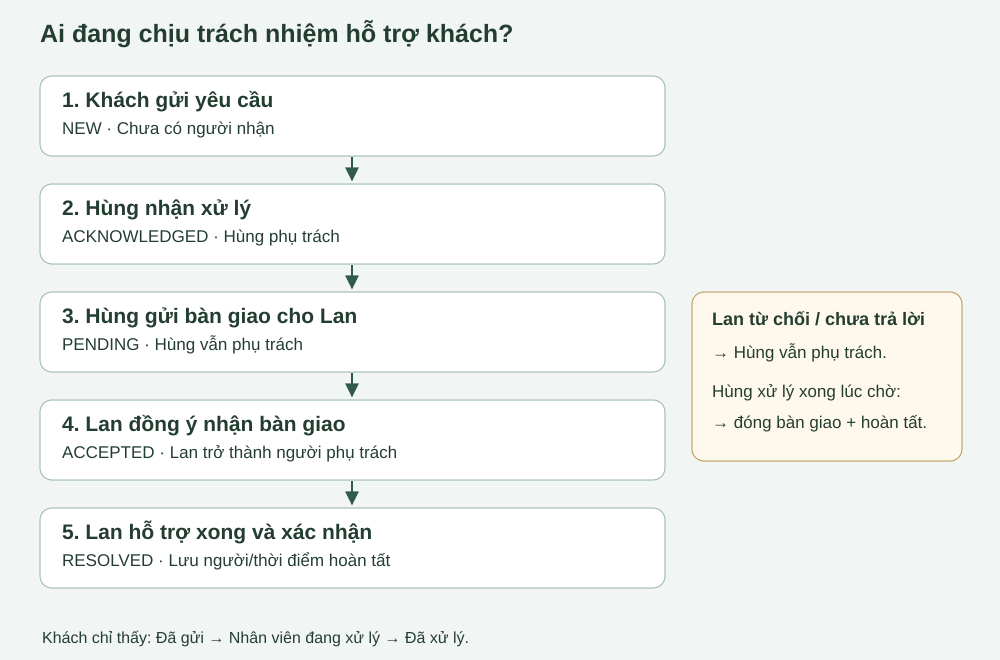
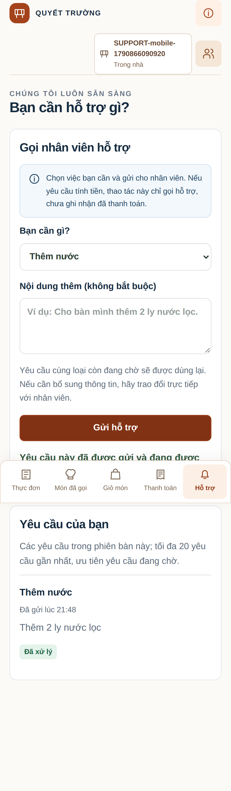
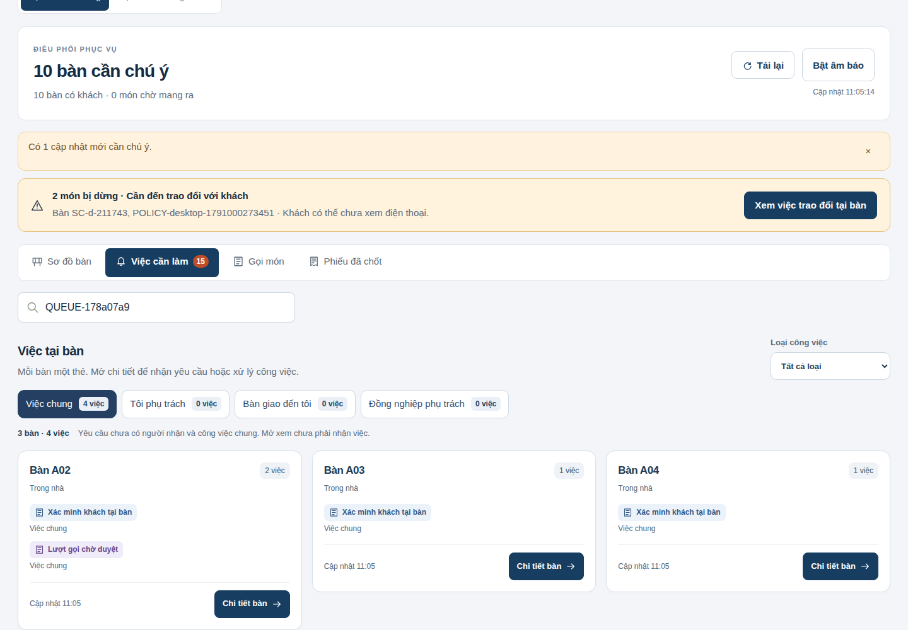
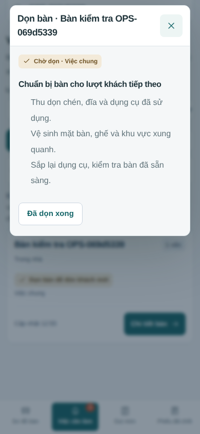

# 22. Hỗ trợ tại bàn và bàn giao có xác nhận

**Điều cần nhớ:** người bấm “Nhận xử lý” chịu trách nhiệm đến khi xử lý xong, hoặc một đồng nghiệp **đồng ý nhận bàn giao**. Gửi đề nghị bàn giao chưa chuyển trách nhiệm.

Luồng giao diện được cập nhật ngày 03/10/2026. Các mục mô tả migration và kiểm thử ngày 01/10 là hồ sơ đợt nền; kết quả kiểm tra mới ở bài 15. Các phần dưới là thiết kế đã triển khai, kèm kết quả chạy kiểm thử và giới hạn. [Hồ sơ đối chiếu chung](15-doi-chieu.md) · [Từ điển CSDL](16-tu-dien-du-lieu.md).

## Ví dụ từ đầu đến cuối

Khách An ở bàn B05 cần thêm hai ly nước. Hùng và Lan là hai nhân viên phục vụ có tài khoản hoạt động.

| Bước | Thao tác | Ai chịu trách nhiệm? | Khách thấy gì? |
|---|---|---|---|
| 1 | An chọn “Thêm nước”, nhập “Thêm 2 ly nước lọc”, gửi | Chưa ai nhận; yêu cầu nằm trong nhóm chờ tiếp nhận | Đã gửi yêu cầu |
| 2 | An bấm gửi lại cùng loại | Dùng lại yêu cầu cũ, giữ nguyên nội dung trước; không tạo thêm việc | Yêu cầu này đã được gửi và đang được xử lý |
| 3 | Hùng bấm “Nhận xử lý” | Hùng | Nhân viên đang xử lý |
| 4 | Lan cũng bấm nhận ở màn hình chưa cập nhật | Hệ thống từ chối lần nhận thứ hai; Hùng tiếp tục giữ việc | Nhân viên đang xử lý |
| 5 | Hùng chọn Lan, ghi “Sắp hết ca”, gửi đề nghị bàn giao | **Hùng vẫn phụ trách**; Lan thấy “Bàn giao đến bạn” | Nhân viên đang xử lý |
| 6A | Lan từ chối, ghi “Đang thu tiền bàn khác” | Hùng; có thể tiếp tục xử lý hoặc gửi đề nghị khác | Nhân viên đang xử lý |
| 6B | Lan bấm “Nhận bàn giao” | **Lan trở thành người phụ trách**; Hùng mất quyền hoàn tất/bàn giao | Nhân viên đang xử lý |
| 7 | Lan mang nước đến bàn, bấm “Đã xử lý” | Lan được ghi là người hoàn tất | Đã xử lý |
| 8 | Một lúc sau An cần thêm nước nữa | Gửi được một yêu cầu mới, có mã/thời gian riêng | Đã gửi yêu cầu mới |

Nếu Lan chưa trả lời, Hùng vẫn cần xử lý. Nếu Hùng mang nước xong trước khi Lan nhận, Hùng bấm “Đã xử lý”: đề nghị bàn giao tự đóng trong cùng thao tác. Lan không thể nhận một bàn giao đã cũ.

## 1. Các tệp được sửa

Đợt nền hỗ trợ ngày 01/10 thêm/sửa 27 tệp mã nguồn, migration và kiểm thử, giữ các thay đổi có sẵn. [Đánh giá sáu phần trước khi code](reference/support-review-before-code.txt) ghi căn cứ thiết kế. Danh sách đầy đủ, có phân biệt tệp mới và tệp đã sửa, nằm trong [biên bản JSON](reference/support-review-20261001.json). Các điểm mở code chính:

- [support.routes.ts](../apps/api/src/modules/support/support.routes.ts): danh sách, nhận/hoàn tất, tạo/phản hồi/rút bàn giao, lịch sử và quyền quản trị đọc.
- [support.service.ts](../apps/api/src/modules/support/support.service.ts): khóa dữ liệu, kiểm tra người phụ trách, outbox/audit, đọc lịch sử nhất quán.
- [guest.routes.ts](../apps/api/src/modules/sessions/guest.routes.ts): chống trùng và response an toàn cho khách.
- [staff-access.routes.ts](../apps/api/src/modules/staff-access/staff-access.routes.ts): chặn khóa/đổi quyền khi nhân viên còn phụ trách hỗ trợ.
- [schema.prisma](../packages/database/prisma/schema.prisma): quan hệ bảng hỗ trợ, bàn giao và outbox.
- [support-policy.ts](../packages/contracts/src/support-policy.ts): năm tên yêu cầu, trạng thái khách, ngưỡng tuổi chờ, chu kỳ polling.
- [guest-support.tsx](../apps/web/features/guest/guest-support.tsx): gửi và theo dõi hỗ trợ cá nhân.
- [support-panel.tsx](../apps/web/features/workspace/support-panel.tsx): các nhóm việc, nhận/hoàn tất/bàn giao/phản hồi.
- [support-history.tsx](../apps/web/features/workspace/support-history.tsx): cửa sổ lịch sử, trả focus cho nút mở.
- [support-report.tsx](../apps/web/features/admin/support-report.tsx): báo cáo hỗ trợ chỉ đọc cho quản trị.
- [service.tsx](../apps/web/features/workspace/service.tsx): banner/badge, polling, nhận lại dữ liệu khi focus/online/hiển thị.
- [support.integration.test.ts](../tests/support.integration.test.ts) và [support.spec.ts](../tests/browser/support.spec.ts): bằng chứng kiểm thử.

Thao tác hỗ trợ được chuyển ra module riêng. API gọi món, tiền, kho và lương vẫn dùng kiến trúc hiện có. Các test cũ được cập nhật kỳ vọng bàn giao có xác nhận và số bảng mới.

## 2. Migration và thiết kế CSDL

Hai migration nền hỗ trợ ngày 01/10 đã áp dụng vào `qr_restaurant_ordering`:

1. [202610010002_support_handoffs](../packages/database/prisma/migrations/202610010002_support_handoffs/migration.sql): bảng bàn giao, partial unique chống trùng, kiểm tra trạng thái người phụ trách, FK outbox và kiểm tra cùng nhà hàng.
2. [202610010003_support_outbox_guards](../packages/database/prisma/migrations/202610010003_support_outbox_guards/migration.sql): mở rộng hai CHECK cũ của outbox để nhận loại SUPPORT_REQUEST; giữ lịch sử bàn giao khỏi thao tác xóa.

Tại đợt hỗ trợ ngày 01/10 có **56 bảng, 609 cột, 137 khóa ngoại, 26 migration đã áp dụng thành công và 124 thao tác API**. Hai lần thử migration đầu gặp lỗi cú pháp, transaction đã rollback và được ghi nhận đã rollback; không còn migration thất bại chưa xử lý. Không sửa/xóa 24 migration nền. Metadata thô giữ cả lịch sử thử, nên số dòng `_prisma_migrations` có thể lớn hơn số migration đang áp dụng.

Không reset hoặc seed lại database vận hành trong nhiệm vụ này. Migration phát hiện trùng yêu cầu active sẽ dừng, không âm thầm xóa yêu cầu khách. Tất cả dữ liệu thử được tạo/dọn trên database riêng.

### Vì sao thêm đúng một bảng?

`support_request` lưu **việc khách cần và người phụ trách hiện tại**. Một việc có thể bàn giao nhiều lần, kể cả các lần từ chối. Nếu thêm vài cột from/to/reason lên yêu cầu, lần sau sẽ ghi đè lần trước. Vì vậy, `support_request_handoff` lưu **mỗi đề nghị bàn giao thành một dòng**, quan hệ một yêu cầu → nhiều đề nghị. Nhật ký nhân viên dùng lại `business_audit_event`; không tạo thêm hệ thống lịch sử riêng.

| Cột bàn giao | Ý nghĩa |
|---|---|
| id | Mã một đề nghị bàn giao |
| support_request_id | Yêu cầu khách đang được bàn giao |
| from_staff_id / to_staff_id | Người gửi / đồng nghiệp được chỉ định nhận |
| reason | Lý do gửi, bắt buộc, tối đa 500 ký tự |
| status | PENDING, ACCEPTED, DECLINED hoặc CANCELLED |
| requested_at | Thời điểm tạo đề nghị |
| responded_at / responded_by | Thời điểm và người phản hồi hoặc đóng đề nghị |
| response_reason | Lý do từ chối/rút/đóng hoặc xác nhận nhận trách nhiệm |

`acknowledged_by` được giữ lại để tránh hai cột cùng lưu một sự thật: đây là người phụ trách **hiện tại**. `acknowledged_at` là thời điểm nhận **lần đầu**, không đổi khi bàn giao. Thời điểm từng lần đổi người nằm trong bảng bàn giao/audit. Các trường `pending_*`, `latest_*`, `area_priority` trong response là dữ liệu ghép khi truy vấn, không phải cột lặp trong bảng yêu cầu.

Partial unique thứ nhất áp dụng cho `(session_id, participant_id, request_type)` khi có participant và trạng thái còn mở. Partial unique thứ hai chỉ cho một bàn giao PENDING mỗi yêu cầu. Lịch sử đã kết thúc được giữ nhiều dòng. Khóa ngoại và tenant guard bảo vệ liên kết cùng nhà hàng, không chỉ kiểm tra ở giao diện.

## 3. Trạng thái yêu cầu cuối cùng

| Trạng thái | Ý nghĩa | Chuyển tiếp hợp lệ qua API |
|---|---|---|
| NEW | Khách gửi, chưa có người nhận | STAFF nhận → ACKNOWLEDGED |
| ACKNOWLEDGED | Có một người chịu trách nhiệm | Người phụ trách hoàn tất → RESOLVED |
| RESOLVED | Người phụ trách xác nhận đã làm xong | Không nhận/bàn giao lại; khách có thể tạo yêu cầu mới |
| CANCELLED | Lời gọi thu tiền khác không còn cần xử lý vì bàn đã thanh toán đủ | Tự kết thúc có lý do; không thể nhận/bàn giao lại |

Với lời gọi thu tiền BILL, khi bàn đã thanh toán đủ, các lời gọi còn lại tự kết thúc bằng CANCELLED. Màn hình ghi **Lời gọi thu tiền đã kết thúc**; lịch sử lưu lý do bàn đã trả đủ và người thực thu. Cách này không ghi sai rằng đồng nghiệp đã trực tiếp xử lý lời gọi. Hỗ trợ thông thường không tự kết thúc khi thu tiền. Bàn giao không làm đổi trạng thái yêu cầu.

## 4. Trạng thái bàn giao cuối cùng

`PENDING → ACCEPTED / DECLINED / CANCELLED`. Kết quả đã phản hồi không đổi lại; nội dung/đối tượng/thời điểm của đề nghị không được ghi đè. Không tự hết hạn, không tự chọn người, không tự chuyển sang đồng nghiệp thứ ba.

- ACCEPTED: người nhận đồng ý và trở thành người phụ trách.
- DECLINED: người nhận từ chối có lý do; người gửi vẫn phụ trách.
- CANCELLED: người gửi rút có lý do, hoặc người phụ trách hoàn tất việc trước khi được nhận bàn giao.

## 5. Quy tắc trách nhiệm và quyền

Chỉ người phụ trách hiện tại được hoàn tất hoặc đề nghị bàn giao. Người khác chỉ xem. Chỉ người nhận được chỉ định được đồng ý/từ chối; chỉ người gửi được rút. Backend kiểm tra lại trạng thái, tài khoản ACTIVE, nhà hàng và quyền `staff.workspace` trong transaction.

Không bàn giao cho chính mình, tài khoản khóa, ADMIN/KITCHEN không có quyền phục vụ hoặc người thuộc nhà hàng khác. Vai trò ADMIN đọc lịch sử bằng `admin.workspace`, không tự nhận/giành/hoàn tất yêu cầu của STAFF. Người nhận vẫn được chọn ngoài ca để có phương án dự phòng; chọn người chỉ là đề nghị, phải được đồng ý.

Quản trị không khóa hoặc chuyển khỏi vai trò STAFF một tài khoản còn giữ yêu cầu ACKNOWLEDGED. Cần hoàn tất hoặc bàn giao được đồng nghiệp nhận trước. Nếu dữ liệu cũ từng có người phụ trách đã khóa, quản trị khôi phục tài khoản/quyền phục vụ để người đó bàn giao theo quy trình; không giả lập người khác đã nhận.

## 6. Ai được nhìn thấy và ca/khu vực dùng như thế nào?

Tất cả nhân viên ACTIVE có `staff.workspace` trong nhà hàng nhìn thấy yêu cầu mới và đang xử lý. Không giấu việc vì nhân viên chưa có lịch hoặc ở khu khác.

Hệ thống đã có phân công ca và khu vực, nhưng lịch phân công không chứng minh nhân viên thực sự đang làm. Vì vậy:

- Thẻ NEW có nhãn ưu tiên nếu bạn đã chấm vào, chưa chấm ra, đang trong thời gian ca và cùng khu vực hoặc phân công toàn nhà hàng.
- Danh sách chọn người nhận ưu tiên đã vào ca, cùng khu vực; tiếp đến có lịch ca hiện tại; cuối cùng là nhân viên phục vụ hợp lệ khác.
- `area_id` rỗng nghĩa phân công toàn nhà hàng; không hiểu là “thiếu dữ liệu nên không được thấy”.

Không phân bàn tự động. Yêu cầu NEW trong giao diện được xếp theo thời gian gửi, yêu cầu chờ lâu ở trước. Đây là lựa chọn để nhân viên đọc được hàng chờ và hỗ trợ nhau.

## 7. Thông báo và cập nhật màn hình

Các sự kiện được ghi cùng transaction: SUPPORT_REQUEST_CREATED, CLAIMED, RESOLVED, CANCELLED; SUPPORT_HANDOFF_REQUESTED, ACCEPTED, DECLINED, CANCELLED. Sự kiện request CANCELLED dùng cho lời gọi khác kết thúc khi bàn đã trả đủ. Outbox liên kết yêu cầu bằng FK và được tác vụ hiện có phát qua PostgreSQL NOTIFY.

Trình duyệt vẫn tự lấy dữ liệu **mỗi 3 giây khi đang hiển thị**, và lấy lại khi cửa sổ nhận focus, tab hiện lại hoặc kết nối mạng trở lại. Không có WebSocket/SSE mới. Banner “Bàn giao đến bạn” xuất hiện ở các tab phục vụ; badge Việc cần làm đếm số việc có thể nhận, việc của bạn, bàn giao đến bạn và việc chung; không đếm yêu cầu đang do đồng nghiệp phụ trách. Nút cảnh báo sự cố mở đúng nhóm Việc chung/loại Sự cố; nút Xem bàn giao mở nhóm Bàn giao đến tôi và bỏ bộ lọc loại cũ. Phản hồi từ chối được người gửi thấy rõ. Âm báo mặc định tắt, chỉ hoạt động sau khi người dùng chủ động bật.

Trong chi tiết yêu cầu, tuổi NEW từ 2 phút thêm “Đang chờ”, từ 5 phút thêm “Cần chú ý”. Hai ngưỡng nằm trong `supportPolicy`. Đây là gợi ý ưu tiên trên màn hình, không phải cam kết thời gian phục vụ hoặc hệ thống SLA tự động.

## 8. Chống thao tác đồng thời

Thứ tự khóa: tài khoản cần kiểm tra → phiên bàn → yêu cầu → bản ghi bàn giao. Quy trình thay quyền dùng cùng khóa tài khoản, nên không lọt lần nhận trách nhiệm đúng lúc bị thu hồi quyền.

| Hai thao tác gần như đồng thời | Kết quả |
|---|---|
| Hai nhân viên nhận NEW | Một người thắng; người kia nhận “Yêu cầu đã được nhân viên khác tiếp nhận.” |
| Hai đề nghị bàn giao cùng yêu cầu | Một PENDING được tạo; lần kia bị từ chối |
| Owner hoàn tất và target đồng ý | Khóa yêu cầu tuần tự hóa; hoặc owner hoàn tất/đóng bàn giao, hoặc target nhận/owner cũ mất quyền |
| Owner cũ hoàn tất sau ACCEPTED | Bị từ chối vì không còn là người phụ trách |
| Nhân viên thứ ba nhận bàn giao | Bị từ chối vì không phải target |
| Gửi hỗ trợ cùng loại nhiều lần | Khóa phiên và partial unique giữ một yêu cầu đang mở |

Không có khoảng thời gian ACKNOWLEDGED thiếu owner. Transaction commit mới ghi nhận thay đổi và event; rollback không để lại audit/event của thao tác thất bại. Đóng phiên bị chặn khi còn hỗ trợ active, kể cả PENDING handoff.

## 9. Giao diện khách

Năm loại được hiển thị bằng tiếng Việt; “Yêu cầu khác” bắt buộc nội dung. Nội dung tối đa 300 ký tự. Gửi trùng có thông báo rõ và dùng lại yêu cầu hiện có, không ghi đè ghi chú cũ.

Khách chỉ xem yêu cầu chính mình trong phiên: thời gian, nội dung và các trạng thái “Đã gửi yêu cầu / Nhân viên đang xử lý / Đã xử lý”. Lời gọi thu tiền không còn cần xử lý khi bàn đã trả đủ ghi “Lời gọi thu tiền đã kết thúc”. Danh sách tối đa 20, ưu tiên các yêu cầu còn mở. Không gửi username, ID người phụ trách, thông tin bàn giao hoặc audit ra API khách.

“Gọi thanh toán / yêu cầu hóa đơn” là gọi nhân viên tính tiền; không tự xác nhận đã trả và không tạo hóa đơn thuế. Chính sách có mục “Hỗ trợ tại bàn”; nguồn chính sách hiện là `2026-10-v2`. Bằng chứng đồng ý v1 cũ được giữ, không sửa thành v2.

## 10. Mỗi bàn một thẻ, nhận việc trong chi tiết

Vào **Vận hành nhà hàng → Việc cần làm**. Một bàn có hai việc vẫn chỉ có **một thẻ bàn** trong nhóm đang xem. Ví dụ A02 vừa cần xác minh khách vừa có lượt gọi chờ duyệt: thẻ A02 có hai nhãn nhỏ, một nút **Chi tiết bàn**. Nền các thẻ cùng màu; chỉ nhãn công việc có màu và chữ để đọc nhanh.

| Nhóm | Công việc nào nằm ở đây? |
|---|---|
| Việc chung | Mặc định: yêu cầu khách chưa có người nhận và việc chung như mang món, duyệt món, xác minh bàn, cảnh báo |
| Tôi phụ trách | Yêu cầu bạn đã nhận; tiếp tục xử lý hoặc bàn giao trong chi tiết |
| Bàn giao đến tôi | Đề nghị gửi đúng cho bạn; chưa đồng ý thì người gửi vẫn phụ trách |
| Đồng nghiệp phụ trách | Yêu cầu do người khác phụ trách; xem tên người đang làm, không giành việc |

Một yêu cầu chỉ thuộc một nhóm tại một thời điểm. Hai mục tổng hợp Cần bạn xử lý và Tất cả đã bỏ để tránh góc nhìn chồng lên các nhóm trên. Một bàn có thể xuất hiện ở các nhóm khác nhau nếu bàn có nhiều yêu cầu do nhiều người phụ trách: đây là **trách nhiệm theo yêu cầu**, không phải giao độc quyền cả bàn cho một người.

Tìm theo tên/mã bàn, chọn **Loại công việc** nếu cần. Bộ lọc có thu tiền, mang món, hỗ trợ, xác minh bàn, sự cố, hoàn tiền và duyệt món. Dòng **1 bàn · 2 việc** phân biệt số bàn với số việc. Số trên từng nhóm phản ánh tìm kiếm/loại việc đang chọn; badge điều hướng đếm tổng việc chưa nhận, việc chung, việc bạn phụ trách và bàn giao đến bạn trong nhà hàng.

**Mở xem chưa phải nhận việc.** Nút duy nhất bên ngoài là Chi tiết bàn. Nó đưa bạn đến mục phù hợp; bàn có nhiều việc mở Việc tại bàn để xem đầy đủ. Các nút nhận, thu tiền, bàn giao, kết thúc và lịch sử đều nằm bên trong.

**Lời gọi thu tiền:** Chi tiết bàn → Nhận việc & đến bàn → trao đổi với khách → chọn khoản thu → nhận tiền và ghi nhận. Hệ thống ghi người phụ trách khi bấm nhận; không ghi khi chỉ mở cửa sổ. Đồng nghiệp thấy tên bạn ở nhóm Đồng nghiệp phụ trách, sơ đồ bàn và chi tiết. Backend kiểm tra quyền trước khi lập/xác nhận/hủy khoản thu hoặc lưu chứng từ. Thu thành công tự kết thúc lời gọi được chọn.

**Hỗ trợ thông thường:** Chi tiết bàn → Nhận xử lý → đến bàn → làm xong → Đã xử lý. Bàn giao chỉ chuyển trách nhiệm khi người nhận đồng ý. ADMIN đọc kết quả tại Báo cáo → Hỗ trợ tại bàn.

**Khách chưa thanh toán:** người phụ trách chọn nút này trong chi tiết và ghi lý do. Thao tác kết thúc lời gọi nhưng không giảm tiền còn phải trả. Nếu có khoản thu đang chờ thì xử lý khoản ấy trước.

**Việc chung:** mang món, duyệt lượt gọi, xác minh và cảnh báo vẫn theo quyền phục vụ hiện có. Mở thẻ không nhận độc quyền các việc này. Kết quả xử lý cập nhật cho mọi nhân viên qua polling. Trước khi ra ca, kiểm tra Tôi phụ trách, hoàn tất hoặc bàn giao và chờ đồng nghiệp nhận.

[Ảnh Android](evidence/table-queue-grouped-mobile.png) · [Ảnh iPhone](evidence/table-queue-grouped-webkit-mobile.png). Ảnh từ database kiểm thử riêng. [Thu tiền từng bước](25-thu-tien-tai-ban.md).

Căn cứ bố trí: [Toast — tổng quan bàn và mở chi tiết](https://support.toasttab.com/en/article/New-POS-Managing-Tables), [Atlassian — nhãn trạng thái ngắn có chữ](https://atlassian.design/components/lozenge/usage). Áp dụng cách trình bày tổng quan → chi tiết; quy tắc trách nhiệm vẫn theo yêu cầu của hệ thống này.

## 11. Nhật ký và giới hạn truy vết

Request và event tạo lưu participant, phiên, loại và thời điểm khách gửi. Các hành động nhân viên lưu actor, request, hành động, thời gian, lý do trong `business_audit_event`. Mỗi bàn giao giữ from/to/lý do/thời gian/kết quả/người phản hồi. Lịch sử được đọc trong snapshot nhất quán.

Không gán khách giả làm actor nhân viên: actor_id của business audit là FK tới app_user; dấu tạo khách nằm trong request và payload outbox. Không suy diễn ai nhận lần đầu chỉ từ acknowledged_by hiện tại sau khi đã bàn giao. Dữ liệu trước cơ chế mới có thể chỉ có audit SUPPORT_REASSIGN cũ và không đủ các bước; giao diện nói rõ, không dựng lịch sử đã thiếu.

## 12. Kiểm thử nền hỗ trợ ngày 01/10

29 bài integration mới bao phủ tạo/reuse NEW–ACK–PENDING, tạo mới sau hoàn tất, validation OTHER, ownership, hai claim/handoff đồng thời, stale accept, accept/decline/cancel, người thứ ba, owner cũ, inactive/KITCHEN/ADMIN/cross-restaurant, audit/event/state khách, fallback/ưu tiên ca-khu, khóa quyền owner, partial unique, giữ lịch sử và publish outbox. Bộ hiện hành còn 62 bài nền đã chạy trước thay đổi; bài bàn giao nền được đổi kỳ vọng theo thiết kế mới.

Kịch bản frontend dùng Guest, hai STAFF và ADMIN, chạy desktop/Android/WebKit: tạo/reuse, cập nhật trạng thái qua polling, badge, ownership/nút đúng quyền, banner từ tab khác, bàn giao từ chối rồi nhận, hoàn tất, xem lịch sử và trả focus khi Escape. Đối chiếu tràn ngang ở 320/768/1440px cho khách/người nhận. Tuổi chờ 6 phút được kiểm tra bằng response fixture có thời điểm cũ; các thao tác nghiệp vụ vẫn đi API thật. Fixture tuổi chờ không phải bằng chứng đã đợi sáu phút ngoài quán.

## 13. Kết quả đợt nền 01/10 và giới hạn

| Lệnh/kiểm tra | Kết quả thực tế |
|---|---|
| Baseline pnpm check | Đạt; 21 unit test |
| Baseline pnpm test:integration | 62/62 trên 6 tệp |
| pnpm check sau thay đổi | Đạt định dạng, lint, typecheck và 21 unit test |
| pnpm test:integration sau thay đổi | 91/91 trên 7 tệp; có 29 bài hỗ trợ mới |
| Chạy riêng support.spec.ts | 3/3 trên desktop/Android/WebKit |
| pnpm test:e2e toàn hệ thống | 53 đạt / 1 Swagger mobile chủ động bỏ qua; 54 trường hợp |
| pnpm build | Đạt, 7 route; bản build cuối dùng thư mục riêng |
| Prisma database → schema diff | Không khác biệt |
| pnpm check:secrets | Đạt quét cơ bản |

Không còn lỗi nền hoặc regression chưa xử lý trong các lệnh đã chạy. Các lỗi phát hiện khi triển khai (ràng buộc outbox cũ, focus dialog, fixture đăng nhập sau khôi phục tài khoản) đã sửa và chạy lại. Đây không phải chứng nhận không còn lỗi hoặc nghiệm thu vận hành nhiều ngày tại quán.

Chưa kiểm tải nhiều nhân viên đồng thời quy mô lớn, âm báo trên mọi thiết bị, thao tác ngoại tuyến hay nhân viên xác nhận đã làm nhưng thực tế chưa làm. Mất kết nối có thể làm thông báo chậm; STAFF thấy trạng thái dữ liệu cũ và cần tải lại/liên hệ trực tiếp. Không có dịch vụ dispatch, workflow engine hoặc tự phân công AI.

## Tự kiểm tra sau khi đọc

1. Hùng bấm gửi bàn giao nhưng Lan chưa đồng ý: ai chịu trách nhiệm?
2. Lan đã nhận, Hùng bấm hoàn tất trên màn hình cũ: backend phải làm gì?
3. Vì sao không dùng một trạng thái HANDOFF_PENDING trong support_request?
4. Vì sao partial unique chỉ chặn bàn giao PENDING, vẫn giữ được nhiều lần từ chối?
5. acknowledged_by hiện tại khác người nhận đầu tiên như thế nào?
6. Outbox publish có nghĩa khách đang nhận WebSocket không?

## Lời gọi thu tiền mới

[Bài 25](25-thu-tien-tai-ban.md) dùng lại support_request loại BILL, thêm payment_method cho Tiền mặt/Chuyển khoản. Quy tắc một yêu cầu cùng loại đang chờ, người phụ trách và bàn giao vẫn áp dụng. Thu thành công kết thúc lời gọi được chọn. Bàn trả đủ kết thúc các lời gọi BILL còn lại bằng CANCELLED, có nhật ký nêu bàn đã trả đủ; không giả ghi đồng nghiệp đã thu tiền. Cả BILL cũ chưa có phương thức cũng theo cùng quy tắc nhận việc. Hỗ trợ khác không tự bị bỏ qua. Metadata hiện hành ở bài 16 và 15; số liệu phía trên là đợt 01/10.

## Căn cứ chọn bố cục ngày 02/10

[Intercom](https://www.intercom.com/help/en/articles/7911926-customize-the-inbox-to-suit-you-and-how-you-work-best) dùng các góc nhìn riêng cho chưa được giao và việc của từng người trong cùng inbox. [Freshdesk](https://support.freshdesk.com/support/solutions/articles/218076-how-to-prevent-reply-clashes) hiển thị việc đồng nghiệp đang xem/xử lý để tránh trùng. [Toast POS](https://support.toasttab.com/en/article/New-POS-Managing-Tables) giữ thông tin nhân viên trên thẻ bàn và tách quyền đổi người phụ trách.

Dự án áp dụng các nguyên tắc hàng đợi chung, tên người phụ trách luôn thấy được và kiểm tra quyền ở máy chủ. Quy tắc nhận từng lời gọi, bàn giao có xác nhận và thu thành công tự kết thúc là quyết định phù hợp với code/nghiệp vụ của dự án; không tuyên bố sao chép toàn bộ quy trình của ba sản phẩm. Trình duyệt vẫn polling khoảng 3 giây, không phải cảnh báo hiện diện tức thời giống một số sản phẩm tham khảo.

## Dọn bàn cũng là một việc chung

Sau khi nhân viên kết thúc phiên, bàn chuyển **Chờ dọn**, chưa phải bàn trống sẵn sàng. Việc **Dọn bàn để đón khách mới** xuất hiện trong **Việc cần làm → Việc chung** và bộ lọc **Dọn bàn**. Tài khoản phục vụ khác cũng nhìn thấy, không cần đăng nhập lại hoặc nhận một lời gọi hỗ trợ giả.

Thẻ bàn vẫn có một nút **Chi tiết bàn**. Bên trong có các bước: thu dọn đồ dùng, làm sạch/kiểm tra bàn ghế, rồi xác nhận **Đã dọn xong**. Bàn chuyển Sẵn sàng, việc biến mất khỏi hàng đợi. Nút xác nhận là lời ghi nhận việc đã làm, không tự dọn bàn ngoài thực tế. API kiểm tra bàn vẫn Chờ dọn; nếu đồng nghiệp đã xử lý hoặc trạng thái đổi, thao tác cũ không được mở nhầm bàn.

Dọn bàn là việc chung theo trạng thái dining_table, không phải support_request có owner/handoff. Không thêm bảng nhiệm vụ riêng. Hai nhân viên cùng xác nhận: chỉ một thao tác đổi trạng thái thành công, lần còn lại phải đọc lại. Lịch sử chờ dọn hiển thị từ lần kết thúc/chuyển gần nhất; giữ cơ chế trạng thái hiện có.

Hàng đợi đọc cả bàn Chờ dọn **không còn phiên ACTIVE**. Vì vậy áp dụng cho đóng thường, đóng theo hồ sơ thiếu tiền và bàn nguồn sau chuyển bàn. Phiên trống chưa có nghiệp vụ bị maintenance hủy về Sẵn sàng theo quy tắc riêng; không cố tạo việc dọn cho mọi phiên hủy.

Khi có bàn vừa chuyển Chờ dọn, màn hình phục vụ hiện thông báo tới Việc chung → Dọn bàn, số bàn chờ dọn và bộ lọc tương ứng. Hỗ trợ, bàn giao, món cần mang, xác minh khách, sự cố và hoàn tiền vẫn cùng một hàng đợi; mở xem không tự nhận độc quyền bàn. Cập nhật vẫn theo polling khoảng 3 giây khi tab hiển thị, không bảo đảm thông báo tức thì lúc mất mạng.

[Điều kiện đóng bàn](06-thanh-toan.md) · [Gia hạn đăng nhập](11-bao-mat.md).

## Việc cần hoàn tiền có đường đi riêng

REFUND_REQUIRED là cảnh báo tài chính. Trong chi tiết bàn, nút Mở xác nhận hoàn tiền dẫn tới vùng hoàn ở Thu tiền & phiếu; không có form viết Nội dung đã xử lý cho cảnh báo này. Chỉ giao dịch hoàn thành công mới làm giảm số dư; hoàn đủ tự kết thúc cảnh báo. Xác nhận đã trao đổi khách về món vẫn là việc độc lập. [Luồng có ví dụ ở bài 24](24-su-co-mon-va-phieu-thanh-toan.md).
