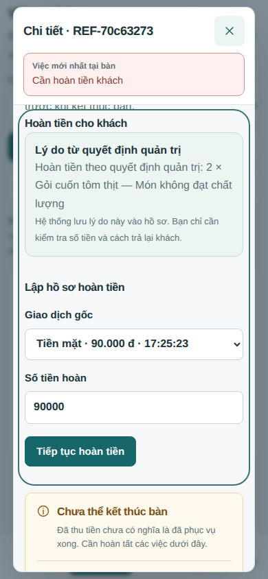
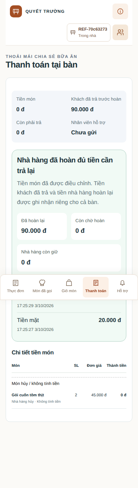

# 24. Bếp dừng món, phục vụ báo khách, admin quyết định tiền

Đây là hướng dẫn cho giao diện được cập nhật ngày **02/10/2026**. Đọc bài này khi muốn thử một món gặp sự cố trong lúc nấu và xem kết quả trên phiếu thanh toán. [Bài 05](05-bep-huy-mon.md) giải thích vòng đời món; [bài 06](06-thanh-toan.md) giải thích các bảng tiền.

## 1. Một tình huống cụ thể

Khách bàn P01 gọi **Bò nướng sốt tiêu 159.000đ** và **Nước suối 15.000đ**. Bếp bắt đầu nấu bò nhưng làm cháy món. Nước vẫn được phục vụ bình thường.

| Người | Việc phải làm | Kết quả trên hệ thống |
|---|---|---|
| Bếp | Chọn “Lỗi chế biến của nhà hàng”, nhấn “Dừng món và báo sự cố” | Món bò dừng; phục vụ và admin có việc riêng |
| Phục vụ | Đến P01 xin lỗi và trao đổi món thay thế nếu khách muốn | Sau khi thực sự trao đổi, nhấn “Đã trao đổi với khách tại bàn” |
| Admin | Mở thanh “Việc cần xử lý”, kiểm tra báo cáo và duyệt lỗi nhà hàng | Khoản thu món bò được bỏ; nước vẫn tính 15.000đ |
| Khách | Xem phiếu hoặc được nhân viên giải thích trực tiếp | Bò có thành tiền 0đ; phân biệt rõ nhà hàng hủy |

Khách không cần liên tục kiểm tra điện thoại để biết món gặp vấn đề. Phục vụ có lời nhắc đến bàn ngay trên màn hình làm việc.

## 2. Thao tác của bếp

Trên món **đang chế biến** hoặc **chờ mang ra**, mở “Báo sự cố và dừng món”. Chọn một trong ba lý do:

- **Lỗi chế biến của nhà hàng**: món bị cháy, nấu sai hoặc thao tác chế biến gây lỗi.
- **Món không đạt chất lượng**: món hoàn thành nhưng không đạt tiêu chuẩn phục vụ.
- **Nhà hàng làm nhầm món**: làm sai món khách đã gọi.

Ghi chú bổ sung **không bắt buộc**, tối đa 500 ký tự. Chọn lý do rồi nhấn nút gửi; không phải viết lại một đoạn diễn biến hoặc đi qua hai hộp xác nhận. Lý do chọn sẵn đã xác định loại sự cố, còn ghi chú dùng khi có thông tin cần thêm.

Đây là thao tác **dừng toàn bộ dòng món** đã chọn, gồm số lượng trên dòng đó. Phiên bản hiện tại chưa tách hủy một phần trong cùng dòng. Món chưa bắt đầu nấu mà hết nguyên liệu vẫn dùng “Không thể phục vụ”; món đã mang ra phải chuyển phục vụ/admin xử lý khiếu nại.

Bếp không có quyền tự miễn tiền. Sau khi bếp báo lỗi, số tiền món vẫn được giữ tạm thời cho đến quyết định của admin.

## 3. Phục vụ nhận tín hiệu gì?

Màn hình phục vụ có khối màu cảnh báo **“Món bị dừng · Cần đến trao đổi với khách”**, ghi mã bàn liên quan. Nhấn “Xem việc trao đổi tại bàn” để mở việc cần làm. Trên sơ đồ bàn cũng có nhãn “Món bị dừng · Cần báo khách”.

Thẻ công việc ghi bàn, tên món và lý do ngắn. Nhân viên đến bàn, xin lỗi, giải thích và trao đổi phương án tiếp theo. Chỉ sau đó mới nhấn **“Đã trao đổi với khách tại bàn”**. Màn hình không tự đặt món thay thế; nếu khách đồng ý món khác thì gọi thêm qua quy trình thông thường.

Xác nhận này lưu người thao tác và thời điểm vào lịch sử. Nó không miễn tiền, không hoàn tiền và không đóng báo cáo admin. Admin duyệt trước hay phục vụ báo khách trước đều được: hai công việc độc lập, và việc chưa xong vẫn còn lời nhắc.

## 4. Admin không cần mò qua các mục

Ở các mục admin đều có thanh **“Việc cần xử lý”**, hiển thị số món bếp báo và số bàn cần hoàn tiền. Nhấn thanh đó, hoặc mục cùng tên trong menu, để đến màn hình xử lý.

Màn hình mở mặc định nhóm **“Bếp báo · Chờ duyệt”**. Các món được gom theo bàn; có ô tìm theo mã bàn hoặc tên món. Hai nhóm phụ là “Món đang phục vụ” và “Món đã hủy”. Danh sách khác sự cố giới hạn 200 dòng gần nhất trong các phiên đang mở; báo cáo bếp còn chờ luôn được đưa vào, không bị các món bình thường mới hơn đẩy khỏi danh sách.

Mỗi sự cố hiện tên món, số lượng, tiền, lý do bếp chọn, người báo, thời điểm và trạng thái phục vụ đã trao đổi với khách hay chưa. Nút chính là **“Duyệt lỗi nhà hàng · Không tính tiền”**. Admin không cần chọn lại lý do hoặc gõ lại ghi chú bếp; một bước xác nhận nêu đúng bàn, món và số tiền trước khi ghi.

Backend lấy lý do từ báo cáo đã lưu, không lấy lý do tùy ý gửi thêm từ trình duyệt. Mã báo cáo phải khớp với báo cáo đang xem. Nếu người khác đã quyết định khác, yêu cầu cũ bị chặn và cần tải lại; gửi lặp cùng quyết định đã duyệt không bỏ tiền lần thứ hai.

Nếu đối chiếu cho thấy **khách yêu cầu hủy sau chế biến**, mở lựa chọn riêng dưới món. Nút ghi rõ **“Xác nhận khách hủy · Vẫn tính tiền”**. Đây là kết luận của người quản lý sau khi đối chiếu, không phải cách gán lỗi cho khách khi chưa kiểm tra. Quyết định miễn riêng vẫn có trong nhóm món tương ứng và giữ lý do/audit.

## 5. Bỏ tiền món và hoàn tiền là hai bước khác nhau

| Thời điểm | Phải thanh toán | Đã thu | Đã hoàn | Cần hoàn |
|---|---:|---:|---:|---:|
| Khách đã trả bò + nước | 174.000đ | 174.000đ | 0đ | 0đ |
| Admin duyệt không tính tiền bò | 15.000đ | 174.000đ | 0đ | 159.000đ |
| Lập hồ sơ hoàn | 15.000đ | 174.000đ | 0đ | 159.000đ |
| Thực trả lại và ghi nhận hoàn đủ | 15.000đ | 174.000đ | 159.000đ | 0đ |

Nếu khách chưa trả tiền thì chỉ giảm số phải thanh toán, không tạo giao dịch hoàn giả. Nếu đã trả dư, màn hình “Việc cần xử lý” có **“Tiền cần hoàn cho khách”** theo bàn và nút **“Mở hoàn tiền tại bàn”**.

Trong hộp chi tiết admin, chọn giao dịch gốc, kiểm tra số tiền và lập hồ sơ. Với khoản bỏ thu theo quyết định ADMIN, lý do hoàn được backend lấy từ các quyết định đã lưu; nhân viên kiểm tra nội dung hiển thị và không phải nhập lại. Hồ sơ cũ giữ lý do đã ghi; trường hợp không có quyết định quản trị tương ứng vẫn dùng form lý do thủ công. Khi hồ sơ đã giữ đủ số cần hoàn, form lập mới được ẩn để tránh tạo trùng. Thực trả tiền mặt hoặc chuyển khoản rồi nhấn “Đã hoàn tiền cho khách”; chuyển khoản cần mã giao dịch. Xác nhận ghi nhận tiền vẫn giữ một bước kiểm tra vì đây là tiền thực tế.

Admin và phục vụ được xem phiếu, lập và ghi nhận hoàn tiền; bếp không được làm các việc này. Quyền chung chỉ áp dụng các API đó và đọc cảnh báo, không tự cấp admin quyền thao tác phục vụ khác. Khi đã ghi nhận hoàn đủ, cảnh báo hoàn tiền tự hoàn tất. Lời nhắc trao đổi với khách vẫn độc lập.

## 6. Phiếu thanh toán được đọc thế nào?

| Món | SL | Đơn giá | Thành tiền |
|---|---:|---:|---:|
| Nước suối 500 ml | 1 | 15.000đ | 15.000đ |
| **Món hủy / không tính tiền** | | | |
| Bò nướng sốt tiêu — Nhà hàng hủy · Không tính tiền | 1 | 159.000đ | **0đ** |

Mỗi món chỉ có **một dòng tiền**. Đơn giá gốc giúp biết món nào được bỏ tiền; thành tiền mới là phần khách phải trả cho dòng đó. Không còn một dòng 159.000đ rồi một dòng trừ 159.000đ kèm ghi chú dài.

Món thường ở trước, món tặng nếu có ở nhóm riêng, món hủy/miễn ở cuối. Dòng khách hủy muộn nhưng vẫn tính tiền ghi “Khách yêu cầu hủy · Vẫn tính tiền” và giữ thành tiền thực phải trả. Miễn tiền món đã phục vụ giữ trạng thái phục vụ; không giả vờ bếp chưa nấu món đó.

Ghi chú nội bộ của bếp/admin không được đưa nguyên văn vào dòng tiền khách đọc. Dữ liệu lý do đầy đủ vẫn nằm trong lịch sử để đối soát. Phiếu cũ đọc từ snapshot đã chốt; đổi cách trình bày không sửa lại dữ liệu lịch sử. Với snapshot cũ thiếu mã lý do, chỉ nhận diện nhãn đã biết; không tự đoán lỗi nhà hàng hoặc khách.

## 7. Các bảng có thêm không?

Đợt này **không thêm bảng, cột hoặc migration**. Hai việc dùng `operational_alert` sẵn có; audit liên kết cảnh báo với món và lưu trách nhiệm riêng.

| Nơi lưu | Ý nghĩa |
|---|---|
| `order_item` | Món dừng, mã và diễn giải lý do |
| `order_status_history` | Trạng thái trước/sau và người thao tác |
| `business_audit_event` | Báo cáo bếp, quyết định admin, việc báo khách và người thực hiện |
| `operational_alert` | Một việc admin xử lý tiền; một việc phục vụ trao đổi khách |
| `financial_charge` | Khoản thu giữ ACTIVE khi chờ; đổi REVERSED khi được bỏ tiền |
| `order_item_ingredient_snapshot`, `inventory_movement` | Nguyên liệu đã dùng và giá vốn vẫn giữ |
| `refund_case`, `refund_transaction` | Hồ sơ hoàn và tiền đã ghi nhận trả lại thực tế |
| `table_session.receipt_snapshot` | Dữ liệu phiếu đóng băng khi đóng phiên |

Audit mới: `KITCHEN_ISSUE_GUEST_NOTICE` tạo việc tại bàn, `GUEST_NOTIFIED_OF_DISH_ISSUE` ghi xác nhận trao đổi. `KITCHEN_ISSUE_REPORTED`, `RESTAURANT_FAULT_CONFIRMED` và `KITCHEN_ISSUE_RESOLVED` giữ trách nhiệm báo/duyệt tiền. Admin xử lý không giải quyết hộ việc báo khách. Đóng phiên vẫn yêu cầu món, tiền, hỗ trợ và mọi cảnh báo hoàn tất.

## 8. Đi từ nút bấm đến code

| Việc | API backend | Code chính |
|---|---|---|
| Bếp dừng món | `POST /core/items/:id/report-issue` | `apps/web/features/workspace/kitchen-issue.tsx`, `apps/api/src/modules/orders/issue.routes.ts` |
| Admin mở hàng đợi | `GET /core/order-exceptions?pending=true` | `apps/web/features/admin/urgent-work.tsx`, `apps/api/src/modules/orders/exception.routes.ts` |
| Duyệt đúng báo cáo bếp | `POST /core/items/:id/late-cancel` với `useReportedReason`, `expectedReportId` | `apps/web/features/admin/order-exceptions.tsx` |
| Phục vụ báo khách xong | `POST /core/alerts/:id/guest-notified` | `apps/web/features/workspace/service-actions.tsx`, `apps/api/src/modules/dining/dish-notice.routes.ts` |
| Xem/lập/ghi nhận hoàn | Bill và refund API hiện có | `apps/web/features/workspace/bill-panel.tsx`, `apps/api/src/modules/payments/payments.routes.ts` |
| Dựng dòng phiếu | Không đổi dữ liệu phiếu cũ | `apps/web/features/workspace/receipt-lines.ts`, `receipt.tsx`, `apps/web/features/guest/bill-lines.tsx` |

Trình duyệt dùng tiền tố `/api`. Màn hình đang mở lấy lại tín hiệu khoảng mỗi 3 giây; quay lại tab cũng tải lại. Âm báo phục vụ dùng nút “Bật âm báo” hiện có và phụ thuộc thiết bị. Không nhận đã có push notification khi đóng trình duyệt hoặc WebSocket.

## 9. Nguồn tham khảo và phần áp dụng riêng

[Square: Comp and void](https://squareup.com/help/us/en/article/5814-get-started-with-comp-and-void) mô tả lý do chọn sẵn, phân biệt hủy với miễn khoản thu và món được miễn có giá trị 0 trên ticket. Dự án áp dụng lựa chọn lý do và dòng thành tiền 0, nhưng nhóm món hủy riêng theo yêu cầu của bạn; đây không phải sao chép nguyên mẫu phiếu Square.

[Lightspeed: Editing and reviewing orders](https://k-series-support.lightspeedhq.com/hc/en-us/articles/360050328554-Editing-and-reviewing-orders) mô tả chọn lý do và lưu người thao tác, bàn, món, ngày. Dự án giữ thông tin đó trong audit, hiển thị việc cần làm theo bàn và hạn chế các nút không phù hợp trạng thái/quyền.

[Toast: Void items, payments and checks](https://support.toasttab.com/en/article/Voiding-Items-Payments-and-Checks) phân biệt thay đổi món với hoàn khoản đã thu. Dự án sử dụng thu/hoàn thủ công và có hai bước ghi nhận riêng, không áp dụng quy tắc capture thẻ hoặc gateway của Toast.

## 10. Tự thử và đọc bằng chứng

1. Mở ba tài khoản bếp, phục vụ và admin; khách dùng QR của một bàn thử.
2. Gọi bò và nước, nhận món và bắt đầu nấu; phục vụ mang nước ra.
3. Cho bếp chọn lý do lỗi, không nhập ghi chú; kiểm tra phục vụ thấy mã bàn và admin thấy số món chờ duyệt dù đang ở mục Thực đơn.
4. Admin nhấn thanh cảnh báo và duyệt. Kiểm tra phục vụ vẫn còn việc đến báo khách.
5. Phục vụ trao đổi rồi xác nhận. Kiểm tra dòng bò trên phiếu có thành tiền 0đ và nằm trong nhóm cuối.
6. Nếu đã thu đủ 174.000đ, lập hồ sơ và thực hoàn 159.000đ. Chỉ ghi “đã hoàn” sau thực trả; kiểm tra còn phải hoàn bằng 0.
7. Thử trường hợp khách hủy muộn riêng: tiền vẫn giữ và phiếu ghi rõ khách yêu cầu hủy.

Kiểm thử tự động dùng database, cổng web/API và ảnh thử riêng. [Biên bản, mã thoát và phạm vi kiểm tra](reference/dish-issue-review-20261002.json) · [Hồ sơ toàn hệ thống](15-doi-chieu.md).

| Ảnh | Mở |
|---|---|
| Bếp chọn lý do nhanh | [Bếp](evidence/dish-issue-kitchen.png) |
| Admin theo bàn trên điện thoại | [Admin](evidence/dish-issue-admin-mobile.png) |
| Phục vụ cần đến trao đổi khách | [Phục vụ](evidence/dish-issue-staff-mobile.png) |
| Khách xem tiền món | [Khách](evidence/dish-issue-guest-mobile.png) |
| Phiếu trên máy tính | [Phiếu](evidence/dish-issue-receipt.png) |
| Bố cục in phiếu | [Bản in](evidence/dish-issue-print.png) |

## Cách mở phần tiền sau cập nhật giao diện

Chi tiết bàn đã chia bốn mục. Chọn **Thu tiền & phiếu** để xem các tổng tiền, lần thanh toán, in phiếu hoặc xử lý hoàn. **Việc tại bàn** là nơi xác nhận đã đến trao đổi khách về sự cố. **Hoàn do điều chỉnh món** khác **tiền thối** của lần thu tiền mặt. [Bài 25](25-thu-tien-tai-ban.md) hướng dẫn luồng thu mới; điều kiện miễn/hoàn trong bài này vẫn giữ.

## Hoàn tiền dễ nhận biết ở cả hai phía — cập nhật 03/10/2026

**Nhân viên:** Trong Việc tại bàn, cảnh báo Cần hoàn tiền có nút **Mở xác nhận hoàn tiền**. Nút mở Thu tiền & phiếu và đưa con trỏ đến vùng **Hoàn tiền cho khách**. Cảnh báo này không dùng ô Nội dung đã xử lý hoặc nút Hoàn tất cảnh báo. Ghi một câu giải thích không thể thay cho giao dịch hoàn thực tế.

**Lý do:** Khi có quyết định không tính tiền/miễn tiền của ADMIN, bill hiện Lý do từ quyết định quản trị. Backend tự tạo lý do hồ sơ từ các dòng món đã bỏ khoản thu và quyết định đã lưu. Nhân viên chọn giao dịch gốc, kiểm tra số tiền, lập hồ sơ rồi ghi nhận tiền thực trả. Lý do hồ sơ là ảnh chụp lúc lập; không thay đổi theo những quyết định mới hơn khi gửi lại cùng yêu cầu.

**Khách:** Thanh toán có vùng Thông tin hoàn tiền, gồm Đã hoàn lại, Còn chờ hoàn, Nhà hàng còn giữ và danh sách các lần hoàn đã được ghi nhận thành công. Mỗi lần có số tiền, tiền mặt/chuyển khoản và thời điểm. Không gửi mã ngân hàng, tài khoản nhân viên, ghi chú nội bộ hay hồ sơ chưa thực trả vào lịch sử khách.

| Ví dụ: 4 phần gỏi cuốn 180.000đ đã trả trước, sau đó nhà hàng hủy toàn bộ | Khách đã trả trước hoàn | Đã hoàn lại | Còn chờ hoàn | Nhà hàng còn giữ |
|---|---:|---:|---:|---:|
| ADMIN duyệt bỏ tiền món | 180.000đ | 0đ | 180.000đ | 180.000đ |
| Nhân viên lập hồ sơ | 180.000đ | 0đ | 180.000đ | 180.000đ |
| Đã trả và ghi nhận lần đầu 50.000đ | 180.000đ | 50.000đ | 130.000đ | 130.000đ |
| Đã trả và ghi nhận tiếp 130.000đ | 180.000đ | 180.000đ | 0đ | 0đ |

Khi xong, khách thấy Nhà hàng đã hoàn đủ tiền cần trả lại, không phải một thông báo chung rằng không có khoản cần thanh toán. Tiền hoàn đang theo giao dịch/phiên của **cả bàn**, chưa có phân bổ hoàn riêng cho từng món hoặc từng khách; không gắn nhãn một món cụ thể đã được hoàn hết khi mới trả một phần cho bàn.

### Tự test luồng mới

1. Khách gọi gỏi cuốn; phục vụ duyệt nếu cần và ghi nhận thu đủ tiền.
2. Bếp bắt đầu chế biến, chọn lỗi chất lượng và dừng món; ADMIN duyệt Không tính tiền.
3. Khách mở Thanh toán: Đã hoàn lại phải còn 0đ và Còn chờ hoàn phải bằng số dư thật.
4. Phục vụ mở bàn, chọn Việc tại bàn, nhấn Mở xác nhận hoàn tiền. Kiểm tra tới vùng hoàn, có lý do ADMIN và không có ô Lý do hoàn để nhập lại trong luồng này.
5. Lập hồ sơ; kiểm tra khách vẫn chưa được tính là đã nhận tiền.
6. Trả và ghi nhận một phần: khách thấy một lần hoàn, đúng số đã hoàn và còn chờ; cảnh báo vẫn còn.
7. Trả và ghi nhận phần còn lại: khách thấy lịch sử đủ, Còn chờ hoàn 0đ; cảnh báo tự hoàn tất.

[Hồ sơ kiểm tra lần cập nhật](reference/refund-experience-review-20261003.json).
