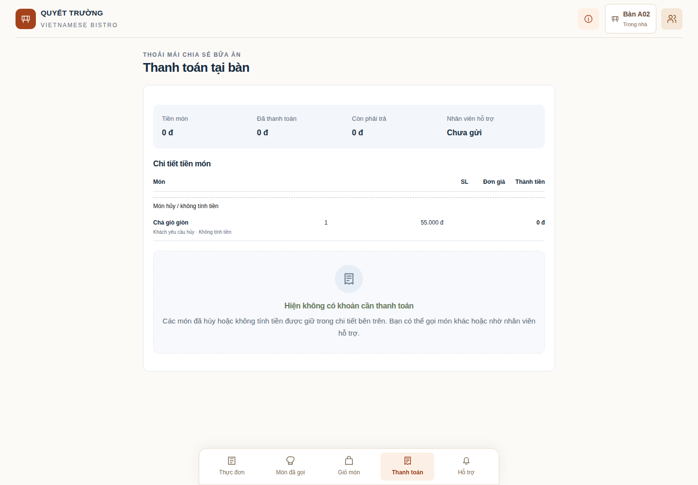

# 25. Khách gọi thanh toán — nhân viên thu tiền tại bàn

## Online tại bàn qua payOS — cập nhật 17/10/2026

**Khách gọi phục vụ; nhân viên lập khoản thu; server xác nhận tiền; cả hai màn hình tự cập nhật.** Giao diện khách hiện có **Tiền mặt / Chuyển khoản**, không có nút tự tạo payOS. Nhân viên trao đổi rồi chọn **Online (payOS)** khi phù hợp. Chưa cấu hình online thì hai hình thức thủ công vẫn dùng được. [Thiết lập](12-van-hanh.md) · [Sổ tiền và đối soát](06-thanh-toan.md).

1. **Khách:** mở Thanh toán, xem phần còn phải trả, chọn Tiền mặt hoặc Chuyển khoản và bấm **Báo nhân viên thu tiền**. Lời gọi chưa có số tiền thu, chưa giữ chỗ hoặc giảm dư nợ.
2. **Phục vụ:** nhận việc, mở **Chi tiết bàn → Thu tiền & phiếu**, thống nhất cả bàn/món của một khách/số tiền khác, kiểm tra ưu đãi và chọn Online (payOS). Bấm tạo khoản thu; không nhập ảnh/mã để tự xác nhận online.
3. **Khách:** quét QR hoặc dùng link được nhân viên cung cấp, đối chiếu số tiền và chuyển qua ứng dụng ngân hàng. Thẻ phía nhân viên hiện **Số tiền của khoản thu / Đã nhận qua ngân hàng / Khách còn cần chuyển**, mã và hạn QR.
4. **Hệ thống:** nhận webhook, dùng SDK xác minh chữ ký và đối chiếu từng giao dịch. Khi tiền được ghi vào sổ, tổng tiền, trạng thái khoản, lời gọi liên quan và checklist tự cập nhật. QR được ẩn khi khoản đã đủ hoặc không còn dùng được; không cần nhân viên bấm kiểm tra trong luồng bình thường.
5. **Khách:** xem thẻ trạng thái của bàn hoặc phần thuộc mình, số đã ghi nhận và số còn thiếu; không nhận dữ liệu tài khoản/ngân hàng/raw provider hoặc mã nội bộ. **Thanh toán thành công một khoản** không thay thế tổng còn thiếu của cả bàn.
6. **Phục vụ:** kiểm tra việc còn lại, giao phiếu rồi kết thúc/dọn bàn đúng quy trình. Đã đủ tiền không tự kết thúc bàn khi còn món, hỗ trợ, hoàn tiền hoặc đối soát.

Return URL chỉ phục vụ điều hướng; chữ PAID trên URL hoặc ảnh khách gửi không tự xác nhận tiền. Chữ ký và dữ liệu ngân hàng phải được server kiểm tra, kể cả thông báo trùng/đến chậm hoặc GET chạy cùng webhook. [payOS: webhook](https://payos.vn/docs/du-lieu-tra-ve/webhook/), [payOS: Return URL](https://payos.vn/docs/du-lieu-tra-ve/return-url/).

### Tự cập nhật và nút dự phòng

Màn hình đang có khoản online cần theo dõi đọc lại DB khoảng **3 giây/lần**. Khi hết khoản chờ, khách quay về nhịp trạng thái bàn 5 giây, bill đang mở 10 giây; bill đã đóng dừng lịch đọc. Tab ẩn/offline tạm dừng, quay lại thì cập nhật; có timeout, backoff và dọn timer để không gửi dồn. Đây là polling có điều kiện, chưa phải SSE/WebSocket; không hứa phản hồi ngay nếu ngân hàng hoặc mạng đang chậm.

**Kiểm tra trạng thái** chỉ dùng khi cần phục hồi: backend hỏi payOS rồi UI tải lại bill, không tạo link mới. `409` có nghĩa worker khác đang kiểm tra; đợi cập nhật rồi thử lại nếu cần. `503 PAYMENT_PROVIDER_UNAVAILABLE` kèm `Retry-After: 3` là provider tạm lỗi/chưa đủ dữ liệu, không phải đã thu hay đã hủy. UI vẫn đọc lại bill khi thao tác báo lỗi; không tự thu lại cùng phần tiền bằng tiền mặt.

Nếu tạo link mất phản hồi, tiếp tục khoản cũ. Có thể khôi phục được link mà chưa có ảnh QR; không lập khoản thứ hai hoặc tự tạo QR từ số tài khoản đoán. Nếu lỗi kéo dài/cần đối soát, báo admin thay vì bấm liên tục.

### Đọc trạng thái để biết việc cần làm

| Trạng thái                   | Việc tiếp theo                                                                                                         |
| ---------------------------- | ---------------------------------------------------------------------------------------------------------------------- |
| Đang tạo/chờ chuyển          | Đợi hệ thống; không bấm Đã nhận tiền cho online.                                                                       |
| Ngân hàng đang xử lý         | Đợi dữ liệu ngân hàng được đối chiếu; không chuyển lại hoặc thay cách thu cho phần đang giữ.                           |
| Đã nhận một phần             | Đọc số đã ghi nhận/còn cần chuyển. QR có thể vẫn điền số tiền ban đầu; kiểm tra và chỉnh số trước khi xác nhận chuyển. |
| Đã thanh toán đủ khoản       | Khoản đã có giao dịch được xác minh; xem tổng còn thiếu của bàn và công việc còn mở.                                   |
| Lỗi/đang hủy/chưa rõ kết quả | Giữ khoản cũ; chờ hệ thống hoặc dùng nút kiểm tra để phục hồi.                                                         |
| Hủy/hết hạn đã đối chiếu     | Không dùng QR đó. Nếu đã nhận một phần thì tiền vẫn có trong lịch sử, có thể cần đối soát.                             |
| Cần admin đối soát           | Chưa chuyển lại cùng khoản; admin đối chiếu tiền và sổ, không sửa số tiền để che lỗi.                                  |

Ví dụ bàn còn 94.000đ, nhân viên lập khoản 49.000đ: đủ khoản này thì bàn vẫn còn 45.000đ. Ví dụ món 49.000đ giảm 10% còn 44.100đ: hai lần chuyển 20.000đ và 24.100đ được ghi hai giao dịch, tổng 44.100đ đã gồm VAT. Webhook gửi lại không ghi thêm tiền.

Sau trả một phần, **chỉ chuyển phần còn thiếu**. Nếu QR/ứng dụng ngân hàng không cho đổi số tiền thì nhờ nhân viên hướng dẫn; không chuyển lại toàn bộ khoản. Một số kênh tài khoản ảo có thể từ chối/hoàn chuyển sai số tiền, vì vậy chỉ căn cứ kết quả được ngân hàng/provider xác nhận. [payOS: tài khoản ảo và chuyển sai số tiền](https://payos.vn/docs/cau-hoi-thuong-gap/).

Màn hình khách tách **Đã ghi nhận thanh toán** và thông báo **Ngân hàng đã xác nhận nhưng nhà hàng đang đối soát** nếu có. Tiền chỉ được cách ly/chưa phân bổ không làm tổng đã trả của bàn tăng giả.

### Lời gọi thu tiền tự hoàn tất theo đúng khoản

`support_request_id` gắn khoản thu với lời gọi mà nhân viên đang xử lý. Khi đã trả đủ **số tiền được lập cho phạm vi đó**, lời gọi gắn này tự RESOLVED bởi SYSTEM. Ví dụ trả trước 49.000đ trong bàn còn 94.000đ thì lời gọi này hoàn tất khi đủ 49.000đ; bàn còn 45.000đ và có thể thu phần sau. Không cần bấm hoàn tất hỗ trợ lần nữa.

Khi cả bàn đã cân đối đủ, các lời gọi BILL còn mở khác tự CANCELLED với lý do đủ tiền, không đổi người khác thành người thu. Hỗ trợ/cảnh báo khác vẫn phải xử lý riêng. Nếu chưa có liên kết chắc chắn, không đoán lời gọi của ai cần hoàn tất.

### Hoàn và đối soát đúng người

Bếp dừng món sau thu online: admin lập/duyệt hồ sơ theo từng giao dịch gốc; phục vụ thực trả tiền mặt/chuyển khoản rồi xác nhận đã hoàn. Số hoàn là tiền sau giảm đã thu; tiền thối của các lần tiền mặt khác là khoản riêng. Bản này không tự hoàn qua payOS.

Admin mở **Đối soát online**, kiểm tra bàn/mã phiên, khoản yêu cầu, ngân hàng đã xác nhận và tiền ghi sổ. Khoản OPEN không tự được giải quyết vì đã sửa code hoặc màn hình đọc lại. Nếu khoản cũ bị chặn do tài khoản nhận không khớp, nhân viên phụ trách kiểm tra lại **đúng khoản cũ** sau nâng cấp, admin đối chiếu dashboard/sao kê và dữ liệu server. Còn không khớp thì giữ OPEN để kiểm tra kênh; không dùng thu tiền mặt/chuyển khoản giả để bù số hiển thị.

Chỉ đóng đối soát phiên đang mở khi provider đã kết thúc, tiền ghi sổ khớp tiền xác nhận và phần cần hoàn đã thực hiện. Tiền mới đến sau đóng phiên được cách ly; admin thực trả bên ngoài nếu cần rồi lưu **RETURNED_EXTERNALLY**, tham chiếu và căn cứ. Phiếu cũ/sổ thu trước đóng không bị viết lại; lưu kết quả không tự chuyển tiền. [Bài 06 giải thích điều kiện chi tiết](06-thanh-toan.md).

**Thông báo payOS chưa khớp khoản thu** chỉ để admin tra cứu thông báo có chữ ký nhưng chưa tìm được khoản. Có thể là thông báo thử đăng ký hoặc ngoài luồng; phải đối chiếu trước khi kết luận. Danh sách này không tính doanh thu và không có nút tự ghi đã nhận tiền.

Phiếu vẫn ghi hình thức Online (payOS), số tiền sau giảm đã gồm VAT và hoàn tiền thành công riêng; không thay thế hóa đơn điện tử thuế. Kết quả kiểm thử dùng provider giả xem [bài 15](15-doi-chieu.md); thử chuyển khoản thật phải theo [runbook vận hành](26-trien-khai-qtruongres.md), không suy ra từ test tự động.

## Khuyến mãi trước thu tiền và phiếu gồm VAT — 13/10/2026

Trong **Thu tiền & phiếu**, phục vụ kiểm tra **Khuyến mãi của bàn** trước khi lập khoản thu. Server tự chọn ưu đãi tự động phù hợp; có thể nhập mã/chọn chương trình khác hoặc gỡ. Khách có thể xem điều kiện và nhập mã tại phần thanh toán. Combo không tính vào ngưỡng và không giảm lần nữa. Đang thu thì ưu đãi tạm khóa; đã thu thành công thì ưu đãi chốt cho các dòng hiện có, món gọi thêm tính giá riêng.

Giá thực đơn và tổng thanh toán **đã gồm VAT**. Phiếu hiện tiền trước giảm → khuyến mãi → tổng thanh toán, rồi tách phần tiền chưa VAT và VAT nằm trong tổng. Nhân viên không tự đổi thuế suất, tự cộng VAT hoặc nhập phần trăm giảm ngoài chương trình được admin quản lý. [Bài 06 giải thích công thức và mốc thuế](06-thanh-toan.md).

Ví dụ hai món gốc 45.000đ + 49.000đ, giảm 10%: tổng cần trả **84.600đ**. Thu hai lần 40.500đ và 44.100đ, mỗi lần khách đưa 100.000đ: tổng khách đưa **200.000đ**, tổng tiền thối **115.400đ**, tiền dùng trả món **84.600đ**. Nếu cả hai món bị nhà hàng hủy, admin lập hồ sơ theo hai nguồn thu, phục vụ hoàn **84.600đ** và xác nhận. Tổng tiền thối + tiền hoàn là 200.000đ; đây là hai loại khoản trả lại khác nhau, không ghi tổng 200.000đ thành doanh thu.

Phiếu thường và phiếu theo người gọi là hai nút mở/thu gọn; không cần nút Ẩn phiếu riêng. Phiếu đóng cũ được đọc từ snapshot. Nếu chưa có dữ liệu thuế lúc lập phiếu cũ, phần mềm thông báo thiếu dữ liệu tách VAT, giữ nguyên tiền đã ghi.

**Khách chọn hình thức và gọi nhân viên. Nhân viên trao đổi tại bàn, chọn phần tiền cần thu.** Tiền mặt/chuyển khoản thủ công do nhân viên đối chiếu và ghi nhận; online qua payOS do hệ thống xác minh.

Phần thu tiền thủ công được thiết kế ngày 03/10/2026; payOS bổ sung ngày 14/10/2026 và luồng xác nhận/tự cập nhật được rà soát ngày 17/10/2026. Kết quả nghiệm thu hiện hành được ghi riêng. [Bài 06: hiểu sổ tiền](06-thanh-toan.md) · [Bài 15: kết quả kiểm tra](15-doi-chieu.md).

## 1. Khách thao tác thế nào?

Khi bàn có tiền còn phải trả:

1. Vào **Thanh toán**, xem món và số tiền còn phải trả của bàn.
2. Chọn **Tiền mặt** hoặc **Chuyển khoản** khi đã sẵn sàng. Việc dùng payOS do nhân viên thống nhất và lập sau khi nhận lời gọi.
3. Bấm **Báo nhân viên thu tiền** một lần.
4. Màn hình hiện **“Bạn đã báo nhân viên hỗ trợ thanh toán”** và nhắc chờ nhân viên đến bàn. Tải lại trang vẫn thấy yêu cầu đang chờ.

Khách không phải nhập số tiền hoặc tự xác nhận đã thanh toán. Khi nhân viên đến, khách có thể nói “tôi trả cả bàn”, “tôi trả món mình gọi” hoặc “tôi trả trước 40.000đ”. Nhân viên xử lý khoản thu đó. Gọi nhân viên **không làm giảm tiền còn phải trả và không giữ chỗ một khoản tiền**.

Nếu có một yêu cầu cùng loại đang chờ, hệ thống dùng lại yêu cầu ấy. Trong khi đang chờ, màn hình hiện trạng thái thay cho nút gửi thêm.

### Khi tiền món bằng 0

Số 0 không tự có nghĩa là đã thanh toán. Màn hình giải thích theo dữ liệu thực:

| Tình huống                                                                                | Thông báo                                                                         |
| ----------------------------------------------------------------------------------------- | --------------------------------------------------------------------------------- |
| Chưa gửi món, giỏ trống                                                                   | Bàn chưa có món cần thanh toán                                                    |
| Món mới ở trong giỏ                                                                       | Bạn chưa gửi món                                                                  |
| Lượt gọi chờ nhân viên duyệt                                                              | Món đang chờ nhân viên xác nhận; tiền sẽ cập nhật sau khi duyệt                   |
| Món đã hủy/không tính tiền, không có tiền cần hoàn                                        | Hiện không có khoản cần thanh toán; vẫn giữ chi tiết món đã hủy                   |
| Có khoản cần hoàn                                                                         | Thông tin hoàn tiền: đã hoàn, còn chờ hoàn, số nhà hàng còn giữ và các lần đã trả |
| Đã hoàn một phần                                                                          | Đã hoàn một phần · Còn tiền chờ hoàn                                              |
| Đã hoàn đủ sau hủy/miễn                                                                   | Nhà hàng đã hoàn đủ tiền cần trả lại, kèm số đã hoàn và lịch sử                   |
| Có tiền món đã tính, đã ghi nhận thu đủ, không còn khoản cần thu/hoàn hoặc lượt chờ duyệt | Bàn đã thanh toán đủ                                                              |

Khi không có khoản cần trả, không hiển thị biểu mẫu gọi nhân viên thu tiền hay hướng dẫn chuyển tiền. Nếu có món chờ duyệt cùng khoản cũ còn phải trả, khoản còn phải trả vẫn được hiển thị để xử lý. Thông báo này không tự ghi nhận thanh toán.

[Ảnh Android](evidence/guest-zero-payment-mobile.png) · [Ảnh iPhone](evidence/guest-zero-payment-webkit-mobile.png).

## 2. Nhân viên tìm đúng việc ở đâu?

Màn hình **Việc cần làm** và **Sơ đồ bàn** có nhãn màu kèm chữ. Không cần nhớ màu để sử dụng.

| Màu        | Công việc                                        |
| ---------- | ------------------------------------------------ |
| Xanh lá    | Khách gọi thu tiền / khoản thu đang chờ xác nhận |
| Vàng cam   | Món đã xong, cần mang ra                         |
| Xanh dương | Hỗ trợ / xác minh khách tại bàn                  |
| Đỏ         | Sự cố món, cảnh báo                              |
| Nâu vàng   | Khoản cần hoàn tiền                              |
| Tím        | Lượt gọi cần nhân viên duyệt                     |

**Việc cần làm** gộp các công việc của cùng bàn trên một thẻ. Có bốn nhóm **Việc chung / Tôi phụ trách / Bàn giao đến tôi / Đồng nghiệp phụ trách**. Thẻ chỉ có nút **Chi tiết bàn**; mở xem chưa nhận trách nhiệm. Bên trong, lời gọi chưa nhận có nút **Nhận việc & đến bàn**; bấm nhận ghi người phụ trách rồi mở thanh toán. Thu tiền, khách chưa thanh toán, bàn giao và lịch sử đều nằm trong chi tiết.

Có bộ lọc loại việc và tìm tên/mã bàn. Chọn bàn để xem; đầu cửa sổ hiện **việc mới nhất còn đang chờ tại bàn**. Bấm thông báo này sẽ mở mục phù hợp. Nó không phải lịch sử mọi việc đã hoàn tất.

Chi tiết bàn chia thành bốn mục:

| Mục              | Khi nào dùng?                                                                  |
| ---------------- | ------------------------------------------------------------------------------ |
| Việc tại bàn     | Xem công việc, nhận/bàn giao hỗ trợ, báo khách về món bị dừng                  |
| Thu tiền & phiếu | Thu tiền, đối chiếu khoản đã ghi nhận, xem/in phiếu, hoàn tiền và kết thúc bàn |
| Món đã gọi       | Duyệt lượt gọi, xem món và xác nhận mang món ra                                |
| Thêm thao tác    | Chuyển bàn, xem lịch sử chuyển và gọi thêm món hộ khách                        |

Các chức năng mở theo mục đang chọn. Nhân viên không phải lướt qua mọi biểu mẫu để đến phần thanh toán. Khi có lời gọi thu tiền, mở bàn sẽ ưu tiên mục thanh toán nếu đó là việc mới nhất.

## 3. Chọn phần tiền cần thu

Trong **Thu tiền lần này**, chọn lời gọi bạn đã nhận nếu bàn có lời gọi đang mở, rồi đối chiếu hình thức với khách. Hình thức khách chọn là mong muốn ban đầu; nhân viên có thể đổi khi trao đổi trực tiếp.

| Lựa chọn          | Ý nghĩa                                                             |
| ----------------- | ------------------------------------------------------------------- |
| Cả bàn            | Thu toàn bộ phần còn thiếu chưa có khoản thu đang chờ giữ chỗ       |
| Món của một khách | Chọn tên khách; thu phần còn chưa trả của những món do khách đó gửi |
| Số tiền khác      | Nhập một khoản nhỏ hơn hoặc bằng phần còn được phép thu             |

“Món của một khách” dựa vào người sở hữu dòng món được lưu trong hệ thống. Món nhân viên gọi hộ hoặc món chung không tự chia cho từng người; dùng **Cả bàn** hoặc **Số tiền khác** sau khi thống nhất. Hệ thống chưa chia tiền từng ghế hay tùy ý chọn bất kỳ tập món nào trên hóa đơn.

**Ví dụ trả riêng:** Lan gọi nước 15.000đ trước, Minh gọi hai gỏi cuốn tổng 90.000đ sau. Nhân viên chọn **Món của một khách → Minh** và thu 90.000đ. Khoản thu được phân bổ đúng vào món của Minh; nước của Lan vẫn còn 15.000đ phải trả. Không lấy tiền của Minh trừ vào món Lan chỉ vì Lan gọi trước.

Nếu trước đó có khoản thanh toán cả bàn/chia theo tiền, phần đã phân bổ vào món được trừ trước khi tính tiền còn thiếu của từng người. Không thu lại phần đã trả.

## 4. Tiền mặt: phân biệt ba con số

Giả sử tiền món của bàn là **90.000đ**, khách muốn trả trước **40.000đ** và đưa tờ **500.000đ**:

| Ô trên màn hình     |  Số tiền | Cách hiểu                                  |
| ------------------- | -------: | ------------------------------------------ |
| Thu vào hóa đơn     |  40.000đ | Khoản được dùng trả tiền món trong lần này |
| Tiền khách đưa      | 500.000đ | Tiền mặt nhân viên nhận từ tay khách       |
| Tiền thối lại khách | 460.000đ | Phải trả lại khách sau khi lấy 40.000đ     |

Chọn **Số tiền khác**, nhập 40.000, rồi chọn ô nhanh 500.000đ hoặc nhập tiền khách đưa. Có các ô chọn mệnh giá và **Đủ tiền**. Nếu khách đưa chưa đủ, giao diện báo số còn thiếu và không cho ghi nhận.

Sau khi thực sự nhận tiền và thối lại tiền, bấm **Ghi nhận đã nhận tiền**. Khi thành công:

- Lần thanh toán gần nhất giữ rõ cả ba con số 40.000 / 500.000 / 460.000.
- Tổng **Đã thanh toán vào hóa đơn** là 40.000đ, **Còn phải thanh toán** là 50.000đ.
- 460.000đ là **tiền thối**, không phải khoản hoàn do hủy món. Ô **Hoàn do điều chỉnh món** vẫn 0đ trong ví dụ này.

Nếu thu tiếp 50.000đ thì tổng đã thanh toán là 90.000đ. Phiếu giữ hai lần thanh toán và thông tin tiền khách đưa/thối của từng lần; không ghi 500.000đ thành doanh thu.

## 5. Chuyển khoản: nhập mã hoặc chọn ảnh

Nhân viên chọn **Chuyển khoản**, chọn phần cần thu rồi dùng **một trong hai** cách lưu chứng từ:

- Nhập **mã giao dịch ngân hàng**; hoặc
- Chọn/chụp **ảnh chứng từ chuyển khoản**: PNG, JPEG hoặc WebP tối đa 2 MB. Điện thoại có thể mở camera theo hỗ trợ của trình duyệt.

Không bắt buộc vừa nhập mã vừa tải ảnh. Chọn ảnh chỉ chuẩn bị chứng từ; số tiền đã thanh toán vẫn chưa đổi. **Kiểm tra tiền đã vào tài khoản nhà hàng**, rồi bấm **Ghi nhận đã nhận tiền**. Ảnh khách cung cấp không tự chứng minh ngân hàng đã nhận tiền.

Sau khi ghi nhận thành công, **Lần thanh toán gần nhất** có liên kết xem ảnh. Cùng mã chuyển khoản thành công hoặc cùng nội dung tệp ảnh đã dùng cho lần thu khác bị chặn trong cùng nhà hàng. Kiểm tra ảnh bằng hash chỉ nhận ra tệp giống từng byte, không nhận ra mọi ảnh đã cắt/chỉnh sửa; nhân viên vẫn phải đối chiếu tiền thực nhận.

Nếu lưu ảnh xong nhưng xác nhận tiền thất bại, khoản thu còn đang chờ hiện bên dưới để tiếp tục hoặc hủy. Không tự coi thao tác chưa xong là đã thu tiền.

## 6. Gọi nhân viên, khoản thu đang chờ và đã thu khác nhau

| Dữ liệu                       | Vai trò                                                                                                        | Có phải đã trả tiền?                              |
| ----------------------------- | -------------------------------------------------------------------------------------------------------------- | ------------------------------------------------- |
| support_request loại BILL     | Khách gọi người đến hỗ trợ thu tiền; payment_method ghi hình thức đã chọn, lời gọi cũ có thể chưa có hình thức | Chưa                                              |
| payment_intent                | Khoản thu xác định số tiền/phạm vi, đang chuẩn bị xác nhận                                                     | Chưa; giữ phần tiền đang xử lý để tránh lập trùng |
| payment_transaction SUCCEEDED | Đã đối chiếu thực nhận: nhân viên cho thu thủ công hoặc hệ thống cho payOS                                     | Có, theo amount được ghi                          |
| payment_allocation            | Khoản thu đó trả cho món/khoản phải thu nào                                                                    | Là cách phân bổ tiền đã nhận                      |

Với tiền mặt/chuyển khoản thủ công, giao diện thực hiện lập khoản thu, lưu ảnh nếu có và xác nhận bằng **một lần bấm của nhân viên**. Với online, lần bấm tạo QR chỉ lập khoản chờ; payOS được xác minh trước khi ghi tiền. Backend vẫn giữ các bước riêng để kiểm tra trạng thái, khóa dữ liệu và xử lý lỗi. Gửi lại xác nhận một khoản đã thành công trả giao dịch cũ, không cộng tiền thêm. Nội dung thông báo thành công lấy từ giao dịch server trả về.

Thu thành công hoàn tất lời gọi được chọn (RESOLVED). Khi bàn đã trả đủ, các lời gọi BILL khác của cùng bàn tự kết thúc (CANCELLED), có nhật ký lý do bàn đã trả đủ. Không ghi người phụ trách lời gọi khác thành người đã nhận tiền. Hỗ trợ khác và cảnh báo vẫn phải xử lý riêng trước khi kết thúc bàn. Một lời gọi đã do đồng nghiệp tiếp nhận phải được bàn giao và bạn đồng ý nhận trước khi thu tiền. Tên người phụ trách hiển thị ở thẻ việc, sơ đồ bàn và mục Thu tiền & phiếu.

Nếu còn lời gọi BILL đang mở, API không cho chọn thu trực tiếp để bỏ qua người phụ trách. Quy tắc áp dụng cả lời gọi hóa đơn cũ chưa chọn hình thức. Khi không có lời gọi mở, nhân viên vẫn được thu trực tiếp sau trao đổi tại bàn. Khoản thu cũ lập trước lời gọi chưa có liên kết cần hủy rồi lập lại từ lời gọi đã nhận.

Nếu khách chưa muốn thanh toán, người phụ trách chọn **Khách chưa thanh toán**, nhập lý do. Lời gọi kết thúc nhưng tiền còn phải trả không đổi. Không dùng nút này khi còn khoản thu gắn lời gọi đang chờ. Thu thành công đã tự kết thúc lời gọi, không cần xác nhận hỗ trợ lần nữa.

Giao diện khách gọi **POST /guest/payment-requests**. Endpoint **POST /guest/payments** từ chối việc khách tự lập khoản thu; không dùng endpoint đó để tạo intent hoặc xác nhận tiền.

## 7. CSDL và nơi lưu ảnh

Migration [202610020001_payment_collection](../packages/database/prisma/migrations/202610020001_payment_collection/migration.sql) là cập nhật nền của nghiệp vụ thu tại bàn. Bản nâng cấp hiện hành có thêm migration tiến [202610170001_payment_system_resolution](../packages/database/prisma/migrations/202610170001_payment_system_resolution/migration.sql): CHECK cũ bắt buộc người dùng khi RESOLVED đã mâu thuẫn với tự hoàn tất bởi SYSTEM và làm transaction thu tiền rollback. Migration chỉ thay CHECK cũ đã xác nhận đúng định nghĩa bằng điều kiện USER/SYSTEM không lọt giá trị NULL, giữ nguyên CHECK ownership kiểm tra người đã nhận việc; không thêm bảng/cột hoặc reset/seed. Phải áp dụng cùng bản mã theo [runbook](26-trien-khai-qtruongres.md), không coi việc có tệp migration là đã cập nhật production.

Đợt thu tiền nền 02/10 không tạo bảng mới; metadata khi đó có **56 bảng, 613 cột, 138 khóa ngoại**. Đây là số liệu lịch sử. Đợt payOS thêm `payos_payment_request` và ràng buộc liên quan; cấu trúc hiện hành xem bài 16. Bốn cột của đợt nền:

| Bảng / cột                        | Ý nghĩa                                                                                                  |
| --------------------------------- | -------------------------------------------------------------------------------------------------------- |
| support_request.payment_method    | CASH/BANK_TRANSFER/ONLINE cho lời gọi tính tiền; ONLINE bổ sung cùng payOS, NULL với hỗ trợ thông thường |
| payment_intent.collection_scope   | TABLE hoặc PARTICIPANT; khoản cũ mặc định TABLE                                                          |
| payment_intent.support_request_id | Lời gọi hỗ trợ thu tiền mà khoản thu đang xử lý                                                          |
| payment_intent.proof              | JSON do server tạo: tên tệp, hash, loại ảnh, người tải và thời gian                                      |

Dùng lại **payer_participant_id** để xác định người trả riêng món và **payment_allocation** để phân bổ tiền; không cần tạo thêm bảng sao chép hóa đơn/món. FK và CHECK bảo vệ liên kết/giá trị; backend khóa phiên và kiểm tra người thuộc đúng bàn, người phụ trách, số dư và phạm vi món trước khi ghi.

Ảnh chứng từ là tài nguyên **riêng**, tách khỏi ảnh món công khai. Mặc định server lưu trong **var/payment-proofs** ở gốc repository, hoặc thư mục **PAYMENT_PROOF_DIR** khi cấu hình. Database chỉ giữ metadata, không giữ base64 toàn ảnh. Tên tệp do server tạo, không dùng tên đường dẫn khách gửi.

Chỉ STAFF/ADMIN đã đăng nhập được đọc qua API; khách và bếp không đọc được. Response không cho cache dùng chung. Thư mục này được bỏ khỏi Git; khi chuyển máy hoặc triển khai cần lưu bền vững thư mục ảnh cùng PostgreSQL. Đây không phải ảnh để bạn thay như ảnh món ở public/images.

| Chức năng                          | API backend                                                       | Mã nguồn                                                                                                                                                   |
| ---------------------------------- | ----------------------------------------------------------------- | ---------------------------------------------------------------------------------------------------------------------------------------------------------- |
| Khách gọi thu tiền                 | POST /guest/payment-requests                                      | [payment-requests.routes.ts](../apps/api/src/modules/payments/payment-requests.routes.ts), [guest-panels.tsx](../apps/web/features/guest/guest-panels.tsx) |
| Lập và xác nhận khoản thu          | POST /core/sessions/:id/payments; POST /core/payments/:id/confirm | [collection.service.ts](../apps/api/src/modules/payments/collection.service.ts)                                                                            |
| Lưu/đọc chứng từ                   | POST/GET /core/payments/:id/proof                                 | [payment-proof.routes.ts](../apps/api/src/modules/payments/payment-proof.routes.ts)                                                                        |
| Số tiền, phạm vi, tiền thối và ảnh | Các API trên                                                      | [payment-collection.tsx](../apps/web/features/workspace/payment-collection.tsx)                                                                            |
| Việc mới nhất và bốn mục chi tiết  | GET /core/tables, /core/support, /core/orders, /core/alerts       | [service.tsx](../apps/web/features/workspace/service.tsx), [table-work.tsx](../apps/web/features/workspace/table-work.tsx)                                 |
| Các tổng tiền và lần thu gần nhất  | GET /core/sessions/:id/bill                                       | [bill-panel.tsx](../apps/web/features/workspace/bill-panel.tsx), [receipt.service.ts](../apps/api/src/modules/payments/receipt.service.ts)                 |

Trên web các đường dẫn có tiền tố **/api**. `GET /guest/state` trả tóm tắt online an toàn; `GET /core/sessions/:id/bill` trả bill nhân viên. Thao tác phục hồi dùng `POST /core/payments/:id/refresh`; webhook chính thức là `POST /payments/webhooks/payos`. Nhịp đọc 3 giây chỉ áp dụng khi có khoản online cần theo dõi nhanh, ngoài ra khách 5 giây/bill mở 10 giây; không phải push khi đóng trình duyệt. Xem lịch và giới hạn ở phần online đầu bài.

## 8. Tham khảo và cách tự thử

[Square: chia thanh toán theo khoản tiền](https://squareup.com/help/us/en/article/5097-process-split-tender-payments-with-square) mô tả thu nhiều phần và theo dõi phần còn lại. Dự án áp dụng việc chọn phần tiền và giữ số dư đến khi thanh toán đủ; không áp dụng quy tắc thời gian hoặc xử lý thẻ của Square.

[Lightspeed: màn hình xử lý thanh toán](https://k-series-support.lightspeedhq.com/hc/en-us/articles/360051089473-Processing-payments) tách tổng cần trả, khoản thu và số tiền nhận, đồng thời hỗ trợ các kiểu chia phần. Dự án tách ba số tiền để thu ngân dễ đối chiếu, chia theo khách sở hữu món hoặc theo số tiền. Phần tiền mặt dư được coi là **tiền thối**, chưa có tính năng tiền boa.

Để tự thử, dùng một bàn thử, khách và nhân viên trong các phiên trình duyệt riêng:

1. Khách gọi hai gỏi cuốn 90.000đ và báo thu tiền mặt. Kiểm tra thông báo chờ và việc màu xanh lá phía nhân viên.
2. Nhân viên mở **Chi tiết bàn**, bấm **Nhận việc & đến bàn**, chọn 40.000đ, khách đưa 500.000đ; kiểm tra tiền thối 460.000đ trước và sau ghi nhận. Tài khoản nhân viên thứ hai phải thấy tên người đã nhận.
3. Thu tiếp phần còn thiếu và xem phiếu; tổng tiền thanh toán phải 90.000đ.
4. Thử hai khách: nước 15.000đ của Lan trước, gỏi cuốn 90.000đ của Minh sau. Thu riêng Minh, kiểm tra nước vẫn chưa trả.
5. Thử chuyển khoản bằng ảnh thay mã; xác nhận chỉ sau đối chiếu thật. Kiểm tra ảnh không đọc được ở phiên khách.

Các kiểm thử tự động chạy trên database và thư mục ảnh riêng. [Biên bản thu tiền nền](reference/payment-review-20261002.json) và [biên bản hợp nhất việc/ownership hiện hành](reference/work-queue-review-20261002.json) ghi mã thoát và phạm vi thực chạy. [Bài 22](22-ho-tro-va-ban-giao.md) hướng dẫn thử hai nhân viên và bàn giao. [tests/payment-collection.integration.test.ts](../tests/payment-collection.integration.test.ts) và [tests/browser/payment-collection.spec.ts](../tests/browser/payment-collection.spec.ts) là nơi đọc tình huống thủ công. Trường hợp webhook, retry, sai dữ liệu, chia lần chuyển và race nằm ở [payos.integration.test.ts](../tests/payos.integration.test.ts), [payos-protocol.integration.test.ts](../tests/payos-protocol.integration.test.ts); browser nhiều vai trò dùng provider giả ở [payos-live-flow.spec.ts](../tests/browser/payos-live-flow.spec.ts). Các test này không gọi payOS thật hoặc tự chuyển tiền.

| Ảnh giao diện              | Mở                                                            |
| -------------------------- | ------------------------------------------------------------- |
| Khách đã báo nhân viên     | [Điện thoại khách](evidence/payment-guest-request-mobile.png) |
| Ba số tiền trước ghi nhận  | [Tiền mặt](evidence/payment-cash-preview-desktop.png)         |
| Chọn ảnh thay mã giao dịch | [Chuyển khoản](evidence/payment-bank-evidence-mobile.png)     |
| Lần thanh toán và phiếu    | [Khoản thu đã ghi](evidence/payment-recorded-desktop.png)     |

## Cảnh báo hoàn tiền không yêu cầu viết kết quả chung

Trong Việc tại bàn, nhấn **Mở xác nhận hoàn tiền** để đến đúng vùng Thu tiền & phiếu. Nếu tiền món được ADMIN bỏ/miễn, lý do hồ sơ lấy từ quyết định đã lưu, không yêu cầu nhân viên viết lại. Chọn đúng giao dịch, kiểm tra số tiền và chỉ ghi Đã hoàn tiền cho khách sau khi thực trả. Hoàn đủ sẽ tự kết thúc cảnh báo. Khách có các số thu/hoàn riêng và lịch sử thành công; [bài 24](24-su-co-mon-va-phieu-thanh-toan.md) có ví dụ hoàn từng phần và các bước tự test.
