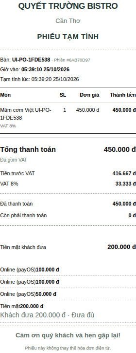
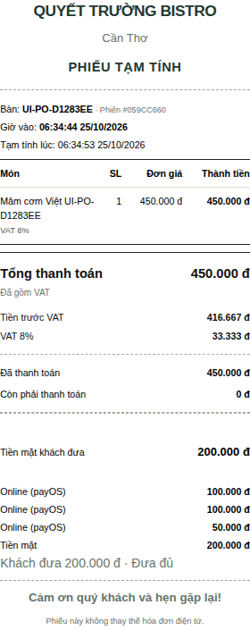
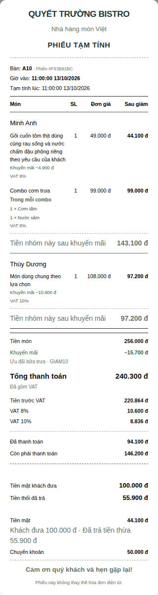
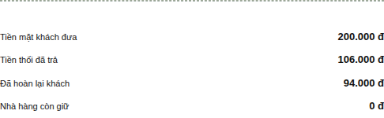
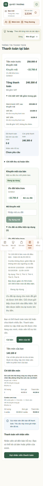
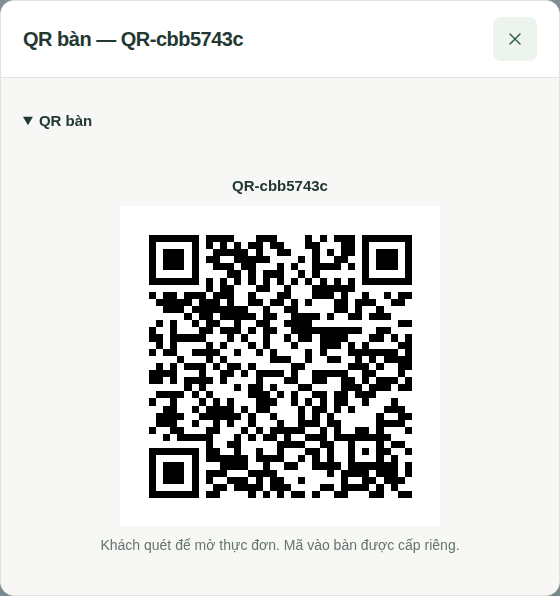
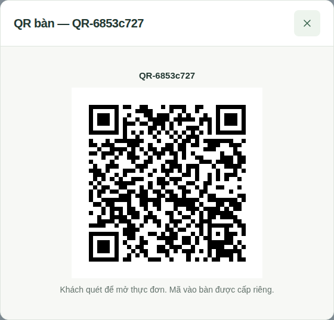

# Rà soát hệ thống trước AI — 25/10/2026

## Baseline và ranh giới

Source `main`: `67ad44681e4c43b55478d997ed44ded880034c71`; working tree sạch trước audit; PR #3/#4 đã merge. Branch `chore/pre-ai-system-audit`; không reset/clean checkout khác. Node 24 / pnpm 12.3.4 / Next 16.4.1 / Fastify / PostgreSQL / Prisma; giữ nguyên lockfile, policy dependency, Docker production và guard payOS. Có 38 migration trước audit; bổ sung một migration additive thành 39.

Tài liệu README/00/15/26 có câu trạng thái trước merge/deploy được ghi từ các đợt cũ. Đợt này thêm mốc hiện hành và phân biệt lịch sử; không khẳng định đã đọc hoặc nghiệm thu production DB. Chỉ đọc metadata Docker để tách target: qtruongres live, database dev ở cổng 5433, PostgreSQL test tmpfs riêng cổng 55439. Không dùng DB dev/live cho test.

## Phát hiện và sửa

| Mức | Bằng chứng / nguyên nhân | Xử lý |
| --- | --- | --- |
| P2 | interface.css đặt `.guest-bill-item > div` thành flex, header còn grid | Chỉ đặt grid cho dòng món; giữ mobile header ẩn. Browser kiểm tra tọa độ cột và overflow 1440/768/390/320 |
| P2 | payment-requests bắt `method`; UI chọn phương thức để gọi nhân viên | Client chỉ gửi UUID thao tác, không gán CASH. STAFF chọn lúc thu. Tương thích method cũ và giữ payOS riêng |
| P2 | Không có retry identity sau khi request kết thúc | Mapping bền vững theo guest+UUID; session lock, alias khi tái dùng request, hash nội dung, FK, replay terminal. Không dùng nội dung giống nhau làm idempotency key |
| P2 | GET QR chỉ có ADMIN dù STAFF cần cho khách quét | STAFF đọc đúng QR hiện hành, tenant/active/expiry/no-store; POST tạo/rotate vẫn ADMIN. Không mở phiên khi xem |
| P2 | Phiếu in nhiều khối tiền rỗng/lặp và giải thích nội bộ | Rút gọn presentation, giữ VAT snapshot, phân bổ thật, thiếu tiền, tiền thừa chưa trả, refund và tiền chưa xác minh |
| P2 | Phiếu toàn món EXEMPT vẫn có nhãn “Đã gồm VAT” | Test đỏ trước sửa; nhãn dựa nhóm TAXABLE thực có, không sửa thuế/tiền snapshot |
| P3 | Tài liệu ghi trạng thái cũ lẫn hiện hành | Thêm mốc source/giới hạn và cập nhật API/UX; không gán trạng thái production từ source |

Chưa phát hiện P0/P1 mới trong phạm vi code và các bộ test đã thực hiện. Điều này không chứng minh mọi nhánh nghiệp vụ hoặc cấu hình live đều đã được kiểm tra thủ công.

## Kiểm chứng theo mốc

- A: Hai regression trước sửa thất bại HTTP 400; sau sửa 35/35 payment-collection integration đạt. Bao gồm 6 request đồng thời, alias, replay sau resolve, thao tác mới cùng nội dung, guest khác, key malformed/conflicting; không tạo intent/transaction.
- B: 8/8 test render phiếu: VAT đã gồm, không dòng tiền rỗng, snapshot bất biến, cash tender/change, khoản ngân hàng chưa xác minh, legacy không bịa thuế, nhiều mức VAT và discount, tiền thừa chưa trả.
- C: Hai regression trước sửa bị 403; sau sửa 12/12 table-access integration đạt. Kiểm tra STAFF/admin, kitchen/anonymous, POST bị chặn, hết hạn, inactive/cross-tenant, không đổi token hoặc tạo phiên.
- Unit/check: format/lint/typecheck và 400/400 unit /46 files đạt ở lượt source cuối.
- Quality coverage: 675/675 /47 files, line 92,44%. Đây là API unit + integration, có phần trùng với unit; không cộng các bộ thành số test độc lập.
- Secrets: basic check đạt; audit dependency không có high/critical, còn 5 low/6 moderate. Không đổi ngưỡng/policy để bỏ qua.
- Deployment tool tests: truyền image API vừa build vào `QTRUONGRES_API_TEST_IMAGE`, đạt 30/30, không skip. Kiểm import dependency/workspace source bằng UID 10001, read-only, network none. Chưa gọi deploy/migrate live.
- Browser: mốc đầu 26/30 desktop; mock còn ép method, nhãn bill cũ và phát hiện mobile header tràn đã được sửa. Mốc sau 95/99; assertion tọa độ mới phát hiện gap header/row lệch 12px, đã đồng nhất gap; một thao tác fill rỗng Safari không lặp lại trong 3 lượt nguyên test. Hai tình huống Safari (layout + tiền) lặp 3 lần đạt 6/6, giữ assertion và code ô tiền. Lượt full đầu được dừng khi phát hiện bill compact làm mất chi tiết cash/refund cần thiết; đã giữ số dư sau hoàn khi có nghĩa vụ tài chính, thêm cash detail gọn cho nhiều khoản thu và giữ kiểm tra 0đ sau hoàn. Hai luồng cash/refund + payOS live giả đạt 6/6 trên ba browser. Full local trên snapshot ứng dụng mốc đầu: 500 đạt, 3 lỗi, 1 skip có sẵn (52,7 phút). Roster desktop đua polling; đã chờ response thật, không tăng timeout hoặc thay polling sản phẩm. Hai lỗi Safari còn lại là dialog món không mở một lần và context close timeout sau các assertion table queue; chưa đủ bằng chứng để gán lỗi nghiệp vụ. Kết quả chạy lặp và gate cuối xem bảng bên dưới; không tính lượt đỏ thành PASS.
- Build: Next 16.4.1 production build trong lab đạt 7 route. Build cả API/runtime, maintenance và web từ source audit thành công. API smoke 30/30; maintenance đọc được 39 migration; web trả HTTP 200. Tất cả dùng UID 10001, root filesystem read-only, không mạng hoặc mount dữ liệu production.
- Công cụ safety: 40/40 Node tests với `--import tsx` đạt. Fixture bootstrap trước đây thiếu package.json ESM của API, đã bổ sung đúng môi trường giả; không đổi tool production hoặc gỡ redaction. Lượt gọi thiếu loader trước đó không được tính PASS.
- AI scaffold: TypeScript/Python validators đều đạt 36 mẫu tổng hợp (24/6/6), không đo chất lượng model.

## Phạm vi nghiệp vụ đã đối chiếu

| Nhóm | Code/kiểm chứng | Giới hạn |
| --- | --- | --- |
| Auth/tenant | auth/index identity đọc user/restaurant/role còn hoạt động; hooks Origin/CSRF, JWT/version, role permission; suite backend | Chưa kiểm cấu hình cookie/tunnel live |
| Bàn/khách/hỗ trợ | session() khóa identity phiên; guest() kiểm trạng thái; table-access/support/transfer tests | Quét camera điện thoại thật chưa nghiệm thu |
| Menu/combo/kho | combo.service, product_catalog_available, recipes/reservation và combo/catalog/inventory/restaurant-history suites | Không xác minh định lượng công thức/ảnh món bằng khảo sát nhà hàng thực tế |
| Đơn/bếp/hủy | transition/charge/reservation tests trong core/review/policy/order-history | Không coi coverage là exhaustive interleaving proof |
| Tiền/VAT/ưu đãi | ledger giữ receipt; outstanding từ allocation; pricing/promotion/payOS/bank-evidence tests | Không phải tư vấn pháp lý hoặc nghiệm thu merchant live |
| Workforce/payroll | backend/SQL guards và workforce/pay/history suites trong coverage | Quy chế lương/thuế/ngày lễ áp dụng thực tế cần chủ dự án xác nhận; không đổi chính sách nhân sự trong audit UX |
| Notifications/close | maintenance không chồng interval; closeReadiness dùng chung preview/mutation, chặn nợ/refund/intents/tasks | Worker cũ có thể được gọi lại; không hardcode bỏ qua bàn lịch sử |
| AI foundation | READ ONLY transaction, guest auth không heartbeat, tools allowlist/projection/minimum data, core ghi tách riêng; assistant/read-surface suites | Không có model/eval chất lượng thực, adapter JS cùng tiến trình phải được tin cậy |

## Dữ liệu cũ: chưa thực hiện trên production

Giữ PostgreSQL hiện hành. Các cảnh báo A01/A02 và webhook chưa khớp trong ảnh không tự được phân loại test từ số tiền/mã bàn. Không chạy DELETE/TRUNCATE, không fake PAID/REFUNDED/RECONCILED và không ẩn nghĩa vụ tài chính. Dùng inventory READ ONLY hiện có trong `scripts/payos-demo-reset-plan.mjs`; kết quả chỉ là hồ sơ review, không cấp quyền ghi. Mặc định UNKNOWN/PROTECTED được giữ nguyên. Chưa có dữ liệu confirmed-test theo từng hàng để vận hành archive executor, nên không xây đường tắt ẩn ngoại lệ.

Operator cần cung cấp inventory đã che dữ liệu riêng và whitelist có căn cứ, phân biệt archive vận hành với financially resolved. Khi chưa có manifest này, phần dọn production là **BLOCKED/NEEDS OPERATOR ACTION**, không phải hoàn tất. Không cần sửa từng giao dịch test để test mới; nhưng các receipt/webhook thật hoặc chưa rõ vẫn được bảo toàn và worker vẫn phải idempotent.

## Cấu trúc, migration và nguồn dữ liệu

Giữ kiến trúc monorepo hiện có, không đổi framework/DB. Migration mới `202610250001_payment_assistance_retries` chỉ thêm bảng mapping/FK/index, không sửa SQL cũ hoặc snapshots/allocator. Giá/ảnh/thành phần vẫn dùng catalog/runtime store hiện hành; không trộn upload/proofs vào source. Không thêm đường ghi cho AI. Giữ thư mục nguồn đồng bộ chỉ đọc và dữ liệu provenance nghiên cứu.

## Dung lượng máy phát triển

Kiểm kê riêng Windows/WSL/Docker. Chỉ dọn 39 output build Next cũ có marker build, Git-ignore, hơn 24h, đường dẫn tuyệt đối trong apps/web và không có process host dùng. API/web production không bind-mount source. Đã xóa 2.302.969.510 byte apparent; WSL free tăng thực 2.361.290.752 byte trong cửa sổ đo. Không suy thành ổ C tăng bằng đó. Đo Windows trong lúc chuẩn bị lab: 84,54 GiB trống/274,86 GiB; số này biến động khi build/test. Không prune Docker, xóa volumes/image rollback, backup, var, proofs, SQLite hay file cá nhân. Docker báo build cache 34,26GB nhưng ownership/rollback chưa đủ căn cứ để tự dọn.

## Kế hoạch production để review, chưa thực thi

1. Chốt commit/image được nghiệm thu và đọc baseline/migration đã áp dụng của production bằng công cụ chỉ đọc. Giữ DB hiện hành, không seed/reset.
2. Build image tag theo commit trong môi trường build riêng; kiểm non-root/read-only và migration đóng gói đọc được. Build lỗi chưa dừng live.
3. Operator lên lịch cửa sổ phù hợp; fence writers khi backup/cutover yêu cầu. Backup PostgreSQL, menu-images/payment-proofs và SQLite allocator cùng manifest/hash/quyền. Kiểm cả sidecars và các writer ngoài CLI.
4. Diễn tập restore vào target mới cách ly; đối chiếu tiền/snapshot/hash và upper bound orderCode độc lập. Không bật cùng merchant hoặc restore đè live.
5. Review migration additive mới và image maintenance tương thích; chỉ operator áp vào đúng DB sau backup. Không khởi động API mới nhận request UUID trước migration.
6. Start/cutover bằng image đã duyệt; kiểm health, auth, menu/ảnh, guest support, STAFF QR, bill và workflow không tiền. Readiness HTTP không thay kiểm allocator/merchant binding.
7. Giao dịch payOS thật đầu tiên chỉ do operator chủ động duyệt và thực hiện. Tạo phiên mới, đối chiếu ledger/allocation/due, STAFF/GUEST và replay; không dùng test cũ làm bằng chứng hệ thống mới đã đúng.
8. Rollback chỉ về code M2/hotfix chữ-số tương thích và giữ DB/schema additive, mapping, receipt/claim mới, runtime/proofs/allocator. Không restore snapshot cũ đè giao dịch mới hoặc rewind watermark. Phiên bản cũ không dùng UUID mapping nên không bảo đảm retry UX của client mới; phải ngăn request mới trong cửa sổ rollback và review lại.
9. Dọn dữ liệu production là phê duyệt riêng theo manifest; không nằm trong deploy source.

## Nguồn tham khảo

Truy cập 25/10/2026. KiotViet phân biệt phiếu tạm tính/phiếu thanh toán và khổ K80; Sapo POS cho nhóm thông tin món, tiền/thuế, phương thức và tiền thừa. Áp dụng cách tổ chức thông tin, không coi là chuẩn pháp lý hoặc sao chép thương hiệu.

- https://www.kiotviet.vn/huong-dan-su-dung-kiotviet/fnb-thiet-lap/quan-ly-mau-in/
- https://help.sapo.vn/cau-hinh-mau-in-hoa-don-tai-quay-pos
- https://payos.vn/docs/ — giữ xác minh provider/backend, không tin frontend return.
- Next.js 16.4.1 docs cài kèm `apps/web/node_modules/next/dist/docs/01-app/01-getting-started/11-css.md` và `05-server-and-client-components.md`: CSS scope, client browser APIs và effect cleanup.
- https://docs.docker.com/engine/manage-resources/pruning/ — volume/cache/image có vòng đời khác nhau; không xóa chỉ vì nhãn unused.

## Trạng thái nghiệm thu

PR Draft #5: https://github.com/lqtruong134/project-qr-restaurant-ordering/pull/5. Mốc tính năng đã commit `575c7119165877bcf8a1cfeccc24a42374fc77d0`; commit chốt bằng chứng xem lịch sử PR. Trạng thái gate cho đúng HEAD xem https://github.com/lqtruong134/project-qr-restaurant-ordering/pull/5/checks. Gate của commit cũ không thay gate của HEAD mới.

| Hạng mục | Kết luận trong phạm vi dev/review | Việc còn lại |
| --- | --- | --- |
| A — Guest gọi thanh toán | PASS | Operator nghiệm thu trên bản được duyệt; không thay cách thu tiền thực tế |
| B — Bill/VAT/cash/refund | PASS WITH RISKS | Đã test browser/print 80 mm; máy in vật lý, nhiều trang giấy và thông tin pháp lý nhà hàng chưa nghiệm thu |
| C — STAFF QR bàn | PASS | Camera/điện thoại thật cần operator thử; token vẫn do ADMIN quản lý |
| D — Auth, bàn, catalog/combo, đơn/bếp, kho, nhân sự, báo cáo | PASS WITH RISKS | Code + integration/browser bao phủ các luồng hiện có, không chứng minh mọi interleaving hay quy trình nhà hàng thực |
| E — payOS và tài chính | PASS WITH RISKS | Guard chữ ký/recipient chữ-số/primary/order/link/reference/amount/claim giữ nguyên, test giả provider; không kiểm merchant hoặc giao dịch live |
| F — UX toàn vai trò | PASS WITH RISKS | Browser responsive/focus/notice; còn nghiệm thu người dùng và thiết bị thực |
| G — Lưu trữ dữ liệu production cũ | BLOCKED | Thiếu inventory/whitelist confirmed-test theo từng bản ghi; không ẩn/xóa nghĩa vụ chưa rõ |
| H — Schema/code/backup/restore | PASS WITH RISKS | Additive migration đã chạy ở PostgreSQL test và restore 72 bảng; production migration chưa thực hiện |
| I — Dọn dev | PASS WITH RISKS | Chỉ giải phóng artifact đã xác minh; không khẳng định ổ C tăng tương ứng dung lượng WSL |
| J — AI foundation | PASS WITH RISKS | Read-only boundary/contract/validators đạt; chất lượng model và độ đúng từng công thức thực tế NOT VERIFIED |
| Production / tiền thật / dữ liệu lịch sử | NOT VERIFIED | Nằm ngoài quyền thao tác của audit này |

Không tuyên bố production đã sạch hoặc toàn hệ thống được chứng nhận không còn lỗi. Chưa merge, deploy, đổi secret, migrate live hoặc tạo/chuyển/hoàn tiền thật.

## Bằng chứng cuối và cách kiểm tra lại

Sau lần xem ảnh in, sửa riêng khoảng cách phương thức/số tiền do CSS `display: block !important` cũ; thêm assertion tọa độ desktop/mobile/print. QR modal bỏ disclosure lồng nhau, QR và quyền không đổi. Rehearsal thêm đúng một retry mapping tổng hợp để xác minh backup mới không mất identity sau restore.

- `pnpm check`: format, lint, typecheck, 400 unit /46 files; `pnpm check:secrets` đạt trên source cuối.
- `pnpm test:coverage`: 675/675 /47 files; line 92,44%, dùng PostgreSQL tmpfs riêng. Unit và coverage trùng một phần, không cộng thành tổng độc lập.
- `node --import tsx --test` cho bốn công cụ payment safety: 40/40; `pnpm test:deploy` với image API mới: 30/30.
- Rehearsal thực trên PostgreSQL tmpfs thứ hai: bảo toàn 72 bảng, 1 bank evidence, 1 canonical claim, 1 retry mapping; hash/private permission, financial projection, từ chối restore đè/corrupt, read-only archive và allocator rollback safety đều đạt.
- Playwright: chờ đúng response roster, lặp 3 lượt trên 3 project, 9/9 đạt. Safari policy + table queue giữ nguyên code/assertion, lặp 3 lượt mỗi tình huống đạt 6/6; chưa tái hiện lỗi dialog/teardown nên vẫn ghi rủi ro flake, không gán nguyên nhân phỏng đoán. Bill/QR trên ba project đạt 9/9; bộ chụp ảnh cuối gồm cash/refund, provider giả, QR và bill desktop đạt 5/5. Tổng 29 lượt targeted đạt, có lặp/bao phủ trùng; không thay thế tuyên bố full suite xanh. Full local đỏ được giữ trong biên bản ở trên.
- Không sửa lockfile, bỏ test/assertion, thêm skip, thay retry/timeout hoặc tắt Quality Gate. Skip Swagger đã có trước audit được giữ nguyên.

Ảnh dưới đây dùng dữ liệu tổng hợp trong DB test. Ảnh production người dùng gửi không được đưa vào repository. Hai ảnh “trước” là trước bước chốt khoảng cách/modal của audit, không được gán nhầm là toàn bộ baseline `main`.

## Dữ liệu, rollback và quyết định cần duyệt

Dữ liệu thay đổi chỉ ở các DB ngẫu nhiên/test tmpfs. Rehearsal tạo và xóa fixture tổng hợp trong target riêng; không gọi payOS. Cleanup dev giữ nguyên uploads/proofs/backup/SQLite allocator và mọi volume production. Production PostgreSQL, khóa, schema, worker và các bản ghi cũ chưa bị thay đổi bởi audit.

Migration mới: `packages/database/prisma/migrations/202610250001_payment_assistance_retries/migration.sql`. Giữ nguyên nội dung 38 migration cũ. Thứ tự production: xác nhận target/HEAD → build image riêng → fence/backup PostgreSQL + runtime/proofs/allocator nhất quán → restore rehearsal → review/apply migration bằng operator → start/cutover → health và smoke không tiền → operator duyệt thử tiền thật. Đọc chi tiết công cụ hiện có ở mục 26 và runbook nền tảng payOS; audit không tự chạy các bước đó.

Rollback giữ DB mới và bảng mapping, không DROP bảng hoặc restore đè snapshot cũ. Phải phối hợp rollback web/API, ngăn request client mới trong cửa sổ chuyển đổi vì API cũ yêu cầu method và không hiểu UUID. Bảo toàn receipt/claim và upper bound orderCode mới; tuyệt đối không rewind allocator hoặc sao chép allocator cũ đè bản đang dùng.

Chủ dự án/ChatGPT reviewer cần duyệt: HEAD + gate đúng commit; cửa sổ backup/cutover; thông tin pháp lý/thuế và máy in; manifest phân loại dữ liệu cũ trước mọi thao tác lưu trữ; nghiệm thu camera và giao dịch mới đầu tiên. Việc model/AI production là nhiệm vụ sau, chưa được bật trong PR này.
